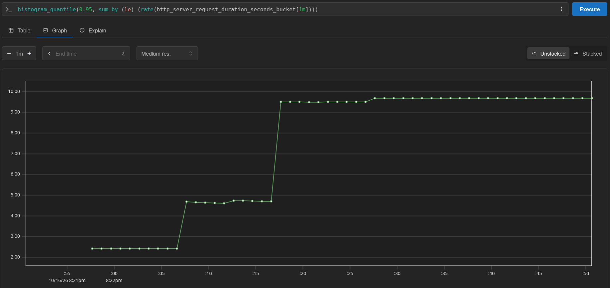
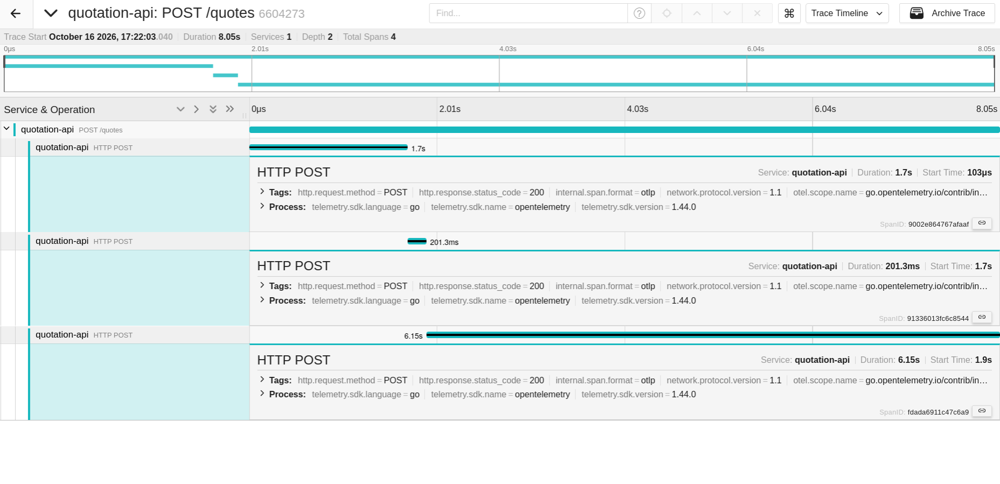
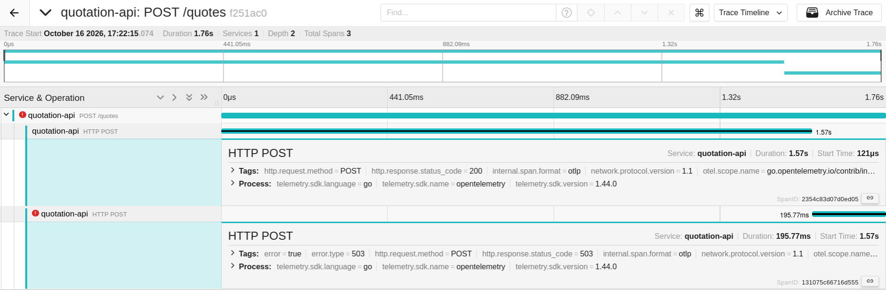

# Legendas

## ANTES

### make reproduce

```bash
make down && make reproduce
```

```text
baseline — 10 requests, 1 in flight, 20:21:39 UTC to 20:21:58 UTC
  success        5 of 10 (50%)
  latency        p50 1.89s   p95 2.04s   p99 2.04s   max 2.04s
  throughput     0.5 req/s in 18.78s
  failures       HTTP 502 from partner-flaky: 5

load — 200 requests, 50 in flight, 20:21:58 UTC to 20:22:22 UTC
  success        120 of 200 (60%)
  latency        p50 6.11s   p95 8.01s   p99 8.03s   max 8.05s
  throughput     8.0 req/s in 24.86s
  failures       HTTP 502 from partner-flaky: 80

baseline → load
  p95 latency    2.04s → 8.01s   3.9x
  max latency    2.04s → 8.05s   4.0x
  success        50% → 60%
  throughput     0.5 → 8.0 req/s
```

Legenda: baseline e carga com falhas da `partner-flaky` e p95 subindo de ~2 s para ~8 s.

### p95 do POST /quotes (Prometheus, janela [1m])

```promql
histogram_quantile(0.95, sum by (le) (rate(http_server_request_duration_seconds_bucket[1m])))
```



Legenda: p95 da API durante a carga.

### Trace lento (Jaeger, Last Hour)

```json
{
  "data": [
    {
      "traceID": "660427311d1f007a2234c985fd08efaf",
      "spans": [
        {
          "traceID": "660427311d1f007a2234c985fd08efaf",
          "spanID": "91336013fc6c8544",
          "operationName": "HTTP POST",
          "references": [
            {
              "refType": "CHILD_OF",
              "traceID": "660427311d1f007a2234c985fd08efaf",
              "spanID": "02cfe748a42ed684"
            }
          ],
          "startTime": 1792182124740376,
          "duration": 201299,
          "tags": [
            {
              "key": "http.request.method",
              "type": "string",
              "value": "POST"
            },
            {
              "key": "http.response.status_code",
              "type": "int64",
              "value": 200
            },
            {
              "key": "internal.span.format",
              "type": "string",
              "value": "otlp"
            },
            {
              "key": "network.protocol.version",
              "type": "string",
              "value": "1.1"
            },
            {
              "key": "otel.scope.name",
              "type": "string",
              "value": "go.opentelemetry.io/contrib/instrumentation/net/http/otelhttp"
            },
            {
              "key": "otel.scope.version",
              "type": "string",
              "value": "0.69.0"
            },
            {
              "key": "server.address",
              "type": "string",
              "value": "partner-flaky"
            },
            {
              "key": "server.port",
              "type": "int64",
              "value": 8080
            },
            {
              "key": "span.kind",
              "type": "string",
              "value": "client"
            },
            {
              "key": "url.full",
              "type": "string",
              "value": "http://partner-flaky:8080/quotes"
            }
          ],
          "logs": [],
          "processID": "p1",
          "warnings": null
        },
        {
          "traceID": "660427311d1f007a2234c985fd08efaf",
          "spanID": "fdada6911c47c6a9",
          "operationName": "HTTP POST",
          "references": [
            {
              "refType": "CHILD_OF",
              "traceID": "660427311d1f007a2234c985fd08efaf",
              "spanID": "02cfe748a42ed684"
            }
          ],
          "startTime": 1792182124941799,
          "duration": 6149308,
          "tags": [
            {
              "key": "http.request.method",
              "type": "string",
              "value": "POST"
            },
            {
              "key": "http.response.status_code",
              "type": "int64",
              "value": 200
            },
            {
              "key": "internal.span.format",
              "type": "string",
              "value": "otlp"
            },
            {
              "key": "network.protocol.version",
              "type": "string",
              "value": "1.1"
            },
            {
              "key": "otel.scope.name",
              "type": "string",
              "value": "go.opentelemetry.io/contrib/instrumentation/net/http/otelhttp"
            },
            {
              "key": "otel.scope.version",
              "type": "string",
              "value": "0.69.0"
            },
            {
              "key": "server.address",
              "type": "string",
              "value": "partner-degrading"
            },
            {
              "key": "server.port",
              "type": "int64",
              "value": 8080
            },
            {
              "key": "span.kind",
              "type": "string",
              "value": "client"
            },
            {
              "key": "url.full",
              "type": "string",
              "value": "http://partner-degrading:8080/quotes"
            }
          ],
          "logs": [],
          "processID": "p1",
          "warnings": null
        },
        {
          "traceID": "660427311d1f007a2234c985fd08efaf",
          "spanID": "02cfe748a42ed684",
          "operationName": "POST /quotes",
          "references": [],
          "startTime": 1792182123040367,
          "duration": 8050849,
          "tags": [
            {
              "key": "client.address",
              "type": "string",
              "value": "172.23.0.10"
            },
            {
              "key": "http.request.body.size",
              "type": "int64",
              "value": 165
            },
            {
              "key": "http.request.method",
              "type": "string",
              "value": "POST"
            },
            {
              "key": "http.response.body.size",
              "type": "int64",
              "value": 546
            },
            {
              "key": "http.response.status_code",
              "type": "int64",
              "value": 200
            },
            {
              "key": "internal.span.format",
              "type": "string",
              "value": "otlp"
            },
            {
              "key": "network.peer.address",
              "type": "string",
              "value": "172.23.0.10"
            },
            {
              "key": "network.peer.port",
              "type": "int64",
              "value": 52998
            },
            {
              "key": "network.protocol.version",
              "type": "string",
              "value": "1.1"
            },
            {
              "key": "otel.scope.name",
              "type": "string",
              "value": "go.opentelemetry.io/contrib/instrumentation/net/http/otelhttp"
            },
            {
              "key": "otel.scope.version",
              "type": "string",
              "value": "0.69.0"
            },
            {
              "key": "server.address",
              "type": "string",
              "value": "quotation-api"
            },
            {
              "key": "server.port",
              "type": "int64",
              "value": 8080
            },
            {
              "key": "span.kind",
              "type": "string",
              "value": "server"
            },
            {
              "key": "url.path",
              "type": "string",
              "value": "/quotes"
            },
            {
              "key": "url.scheme",
              "type": "string",
              "value": "http"
            },
            {
              "key": "user_agent.original",
              "type": "string",
              "value": "Go-http-client/1.1"
            }
          ],
          "logs": [],
          "processID": "p1",
          "warnings": null
        },
        {
          "traceID": "660427311d1f007a2234c985fd08efaf",
          "spanID": "9002e864767afaaf",
          "operationName": "HTTP POST",
          "references": [
            {
              "refType": "CHILD_OF",
              "traceID": "660427311d1f007a2234c985fd08efaf",
              "spanID": "02cfe748a42ed684"
            }
          ],
          "startTime": 1792182123040470,
          "duration": 1699869,
          "tags": [
            {
              "key": "http.request.method",
              "type": "string",
              "value": "POST"
            },
            {
              "key": "http.response.status_code",
              "type": "int64",
              "value": 200
            },
            {
              "key": "internal.span.format",
              "type": "string",
              "value": "otlp"
            },
            {
              "key": "network.protocol.version",
              "type": "string",
              "value": "1.1"
            },
            {
              "key": "otel.scope.name",
              "type": "string",
              "value": "go.opentelemetry.io/contrib/instrumentation/net/http/otelhttp"
            },
            {
              "key": "otel.scope.version",
              "type": "string",
              "value": "0.69.0"
            },
            {
              "key": "server.address",
              "type": "string",
              "value": "partner-slow"
            },
            {
              "key": "server.port",
              "type": "int64",
              "value": 8080
            },
            {
              "key": "span.kind",
              "type": "string",
              "value": "client"
            },
            {
              "key": "url.full",
              "type": "string",
              "value": "http://partner-slow:8080/quotes"
            }
          ],
          "logs": [],
          "processID": "p1",
          "warnings": null
        }
      ],
      "processes": {
        "p1": {
          "serviceName": "quotation-api",
          "tags": [
            {
              "key": "telemetry.sdk.language",
              "type": "string",
              "value": "go"
            },
            {
              "key": "telemetry.sdk.name",
              "type": "string",
              "value": "opentelemetry"
            },
            {
              "key": "telemetry.sdk.version",
              "type": "string",
              "value": "1.44.0"
            }
          ]
        }
      },
      "warnings": null
    }
  ],
  "total": 0,
  "limit": 0,
  "offset": 0,
  "errors": null
}
```



Legenda: três spans `HTTP POST` em série somando ~8 s.

### Trace com erro (Jaeger, Last Hour)

```json
{
  "data": [
    {
      "traceID": "f251ac01c14a1be974633f14c392b8f6",
      "spans": [
        {
          "traceID": "f251ac01c14a1be974633f14c392b8f6",
          "spanID": "411e7926c5160c11",
          "operationName": "POST /quotes",
          "references": [],
          "startTime": 1792182135074519,
          "duration": 1764185,
          "tags": [
            {
              "key": "client.address",
              "type": "string",
              "value": "172.23.0.10"
            },
            {
              "key": "error",
              "type": "bool",
              "value": true
            },
            {
              "key": "http.request.body.size",
              "type": "int64",
              "value": 165
            },
            {
              "key": "http.request.method",
              "type": "string",
              "value": "POST"
            },
            {
              "key": "http.response.body.size",
              "type": "int64",
              "value": 66
            },
            {
              "key": "http.response.status_code",
              "type": "int64",
              "value": 502
            },
            {
              "key": "internal.span.format",
              "type": "string",
              "value": "otlp"
            },
            {
              "key": "network.peer.address",
              "type": "string",
              "value": "172.23.0.10"
            },
            {
              "key": "network.peer.port",
              "type": "int64",
              "value": 53282
            },
            {
              "key": "network.protocol.version",
              "type": "string",
              "value": "1.1"
            },
            {
              "key": "otel.scope.name",
              "type": "string",
              "value": "go.opentelemetry.io/contrib/instrumentation/net/http/otelhttp"
            },
            {
              "key": "otel.scope.version",
              "type": "string",
              "value": "0.69.0"
            },
            {
              "key": "otel.status_code",
              "type": "string",
              "value": "ERROR"
            },
            {
              "key": "server.address",
              "type": "string",
              "value": "quotation-api"
            },
            {
              "key": "server.port",
              "type": "int64",
              "value": 8080
            },
            {
              "key": "span.kind",
              "type": "string",
              "value": "server"
            },
            {
              "key": "url.path",
              "type": "string",
              "value": "/quotes"
            },
            {
              "key": "url.scheme",
              "type": "string",
              "value": "http"
            },
            {
              "key": "user_agent.original",
              "type": "string",
              "value": "Go-http-client/1.1"
            }
          ],
          "logs": [],
          "processID": "p1",
          "warnings": null
        },
        {
          "traceID": "f251ac01c14a1be974633f14c392b8f6",
          "spanID": "2354c83d07d0ed05",
          "operationName": "HTTP POST",
          "references": [
            {
              "refType": "CHILD_OF",
              "traceID": "f251ac01c14a1be974633f14c392b8f6",
              "spanID": "411e7926c5160c11"
            }
          ],
          "startTime": 1792182135074640,
          "duration": 1568000,
          "tags": [
            {
              "key": "http.request.method",
              "type": "string",
              "value": "POST"
            },
            {
              "key": "http.response.status_code",
              "type": "int64",
              "value": 200
            },
            {
              "key": "internal.span.format",
              "type": "string",
              "value": "otlp"
            },
            {
              "key": "network.protocol.version",
              "type": "string",
              "value": "1.1"
            },
            {
              "key": "otel.scope.name",
              "type": "string",
              "value": "go.opentelemetry.io/contrib/instrumentation/net/http/otelhttp"
            },
            {
              "key": "otel.scope.version",
              "type": "string",
              "value": "0.69.0"
            },
            {
              "key": "server.address",
              "type": "string",
              "value": "partner-slow"
            },
            {
              "key": "server.port",
              "type": "int64",
              "value": 8080
            },
            {
              "key": "span.kind",
              "type": "string",
              "value": "client"
            },
            {
              "key": "url.full",
              "type": "string",
              "value": "http://partner-slow:8080/quotes"
            }
          ],
          "logs": [],
          "processID": "p1",
          "warnings": null
        },
        {
          "traceID": "f251ac01c14a1be974633f14c392b8f6",
          "spanID": "131075c66716d555",
          "operationName": "HTTP POST",
          "references": [
            {
              "refType": "CHILD_OF",
              "traceID": "f251ac01c14a1be974633f14c392b8f6",
              "spanID": "411e7926c5160c11"
            }
          ],
          "startTime": 1792182136642890,
          "duration": 195769,
          "tags": [
            {
              "key": "error",
              "type": "bool",
              "value": true
            },
            {
              "key": "error.type",
              "type": "string",
              "value": "503"
            },
            {
              "key": "http.request.method",
              "type": "string",
              "value": "POST"
            },
            {
              "key": "http.response.status_code",
              "type": "int64",
              "value": 503
            },
            {
              "key": "internal.span.format",
              "type": "string",
              "value": "otlp"
            },
            {
              "key": "network.protocol.version",
              "type": "string",
              "value": "1.1"
            },
            {
              "key": "otel.scope.name",
              "type": "string",
              "value": "go.opentelemetry.io/contrib/instrumentation/net/http/otelhttp"
            },
            {
              "key": "otel.scope.version",
              "type": "string",
              "value": "0.69.0"
            },
            {
              "key": "otel.status_code",
              "type": "string",
              "value": "ERROR"
            },
            {
              "key": "server.address",
              "type": "string",
              "value": "partner-flaky"
            },
            {
              "key": "server.port",
              "type": "int64",
              "value": 8080
            },
            {
              "key": "span.kind",
              "type": "string",
              "value": "client"
            },
            {
              "key": "url.full",
              "type": "string",
              "value": "http://partner-flaky:8080/quotes"
            }
          ],
          "logs": [],
          "processID": "p1",
          "warnings": null
        }
      ],
      "processes": {
        "p1": {
          "serviceName": "quotation-api",
          "tags": [
            {
              "key": "telemetry.sdk.language",
              "type": "string",
              "value": "go"
            },
            {
              "key": "telemetry.sdk.name",
              "type": "string",
              "value": "opentelemetry"
            },
            {
              "key": "telemetry.sdk.version",
              "type": "string",
              "value": "1.44.0"
            }
          ]
        }
      },
      "warnings": null
    }
  ],
  "total": 0,
  "limit": 0,
  "offset": 0,
  "errors": null
}
```



Legenda: sequência interrompida na `partner-flaky` (503), sem span da `partner-degrading`, servidor responde 502.

### make test

```bash
make test
```

```text
ok      github.com/GuilhermeOliveira591/mba_arquitetura_desafio_cotacao_seguros/cmd/loadgen     1.762s
ok      github.com/GuilhermeOliveira591/mba_arquitetura_desafio_cotacao_seguros/cmd/partner-mock        0.118s
?       github.com/GuilhermeOliveira591/mba_arquitetura_desafio_cotacao_seguros/cmd/quotation-api       [no test files]
ok      github.com/GuilhermeOliveira591/mba_arquitetura_desafio_cotacao_seguros/internal/partner        0.006s
ok      github.com/GuilhermeOliveira591/mba_arquitetura_desafio_cotacao_seguros/internal/platform       0.003s
ok      github.com/GuilhermeOliveira591/mba_arquitetura_desafio_cotacao_seguros/internal/quotation      0.126s
```

Legenda: testes que já vinham no repositório, todos passando.
