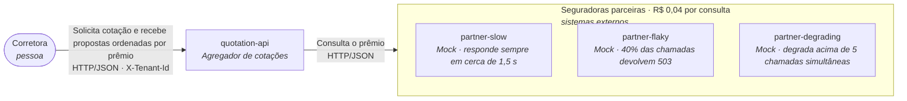
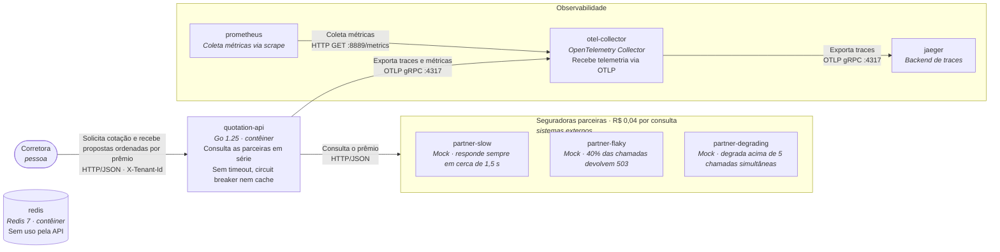
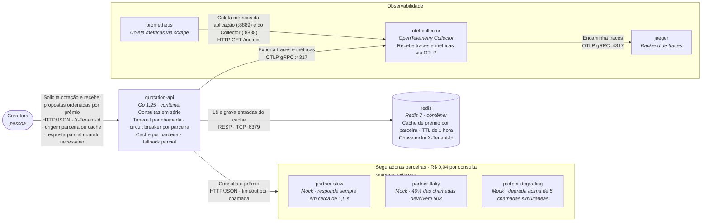
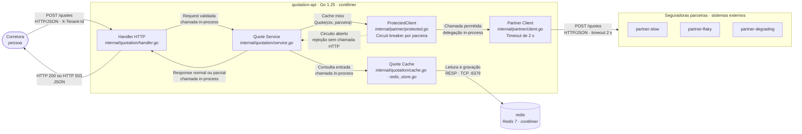

# System Architecture Document

## 1. Introdução

### 1.1. Propósito

Este documento define a arquitetura para aumentar a resiliência da `quotation-api` na comunicação com as três seguradoras parceiras. Os mecanismos são timeout, circuit breaker, cache e fallback. A PoC mede o efeito deles sobre disponibilidade, latência e custo.

O documento sustenta a decisão de adotar esses mecanismos e fixa seus parâmetros (D-01 a D-09).

Na linha de base (200 requisições, 50 em voo), o p95 é de 8,01 s, o sucesso é de 60% e há 80 respostas HTTP 502 ([seção 3.1](#31-linha-de-base-medida)). As consultas custam R$ 14.400 por dia útil: 360.000 × R$ 0,04 ([seção 8](#8-tecnologias-custos-e-pessoal-tco)).

### 1.2. Escopo

**Dentro do escopo:** A `quotation-api` e sua fronteira com as três seguradoras. A PoC implementa timeout por chamada, circuit breaker por parceira, cache de prêmio por parceira e fallback parcial.

**Proposta, sem implementação:** Paralelização das consultas e os padrões retry com backoff, bulkhead, rate limiting e fila. Por isso permanecem como limites conhecidos a ausência de limite de chamadas simultâneas por parceira, o breaker na memória do processo, a invalidação do cache só por TTL e uma corretora consumindo a capacidade das demais ([seção 4.3](#43-limites-conhecidos)).

**Fora do escopo:**

- Motor de precificação das seguradoras e CRM da corretora.
- Integração com seguradoras reais, autenticação e Kubernetes.
- Interface de usuário, cadastro de corretoras, cobrança e relatórios.
- Garantia transacional entre o cache e as seguradoras.

A auditoria é tratada como requisito e custo, sem persistência na PoC. A retenção de cinco anos e a imutabilidade dos registros são requisitos da solução proposta, não funcionalidades comprovadas pela implementação.

### 1.3. Restrições

São impostas pelo enunciado e pelo ambiente, e não são escolhas desta arquitetura.

**Tecnológicas:**

- Go 1.25 para a API e os testes.
- Docker com Compose v2, que pode ser estendido com moderação.
- Redis para o cache.
- OpenTelemetry para a instrumentação, com o SDK já inicializado em [`internal/platform/telemetry.go`](/internal/platform/telemetry.go). Os traces vão ao Jaeger e as métricas ao Prometheus, ambos via Collector.
- Mermaid para os diagramas.
- As três parceiras são mocks em [`cmd/partner-mock/`](/cmd/partner-mock/). Seu código e seus perfis no [`docker-compose.yml`](/docker-compose.yml) não podem ser alterados nas configurações que sustentam as evidências.

**De negócio:**

- Cada consulta a uma parceira custa R$ 0,04, e cada cotação gera três consultas.
- A corretora paga R$ 0,25 por cotação entregue.
- As seguradoras honram o prêmio por até 24 horas, o que limita o reaproveitamento de uma cotação.

**Regulatórias:**

- A cotação apresentada deve ser auditável (seguradora, prêmio, corretora e instante), retida por cinco anos e sem possibilidade de regravação (SUSEP).
- A corretora é controladora dos dados e a Prumo é operadora (LGPD). Isso exige minimização, descarte e proibição de uso cruzado entre corretoras. Por isso a chave do cache inclui a corretora.
- Dados pessoais só saem do país com uma das bases do art. 33 da LGPD, como uma decisão de adequação da ANPD.

### 1.4. Decisões

São escolhas da solução, não restrições. D-01 a D-07 são defendidas na [seção 4.1](#41-decisões-arquiteturais), e D-08 e D-09 na [seção 5](#5-implementação).

- **D-01:** Escopo do circuit breaker (por parceira, por par parceira e corretora, ou global).
- **D-02:** Limiares do breaker (falhas, janela, tempo aberto e requisições do meio aberto).
- **D-03:** Valor do timeout e efeito do estouro sobre o breaker.
- **D-04:** Granularidade do cache (por parceira ou cotação agregada) e chave por extenso.
- **D-05:** TTL do cache, dentro do teto de 24 horas.
- **D-06:** Invalidação e descarte das entradas do cache.
- **D-07:** Tipo de fallback e mudança no contrato de resposta.
- **D-08:** Biblioteca de circuit breaker (implementação própria ou `sony/gobreaker`).
- **D-09:** Hospedagem (cloud com região primária no Brasil e região secundária de recuperação na União Europeia).

### 1.5. Pressupostos

**P-01: Volume de produção.** Assumo 120.000 cotações por dia útil, em 22 dias úteis por mês. Origem: [enunciado](/docs/enunciado.md). Se for falso, os custos das parceiras, o Redis e a auditoria devem ser recalculados ([seção 8](#8-tecnologias-custos-e-pessoal-tco)).

**P-02: Comportamento das parceiras.** Assumo que as parceiras reais se comportam como os mocks. A `partner-slow` responde em cerca de 1.500 ms ± 200 ms, a `partner-flaky` devolve 40% de respostas HTTP 503, e a `partner-degrading` soma 300 ms por chamada simultânea acima de cinco, até 6.000 ms. Origem: [enunciado](/docs/enunciado.md) e medições da [seção 3.1](#31-linha-de-base-medida). Se for falso, os limiares do breaker e o timeout devem ser recalibrados (D-02 e D-03).

**P-03: Validade comercial.** Assumo que o prêmio permanece válido por até 24 horas. Origem: [enunciado](/docs/enunciado.md). O campo `valid_for_seconds` dos mocks (300 s) é um dado técnico e não é o teto comercial. Se for falso, uma cotação servida do cache pode não ser honrada na venda, e o TTL (D-05) e a gestão de mudanças ([seção 6.4](#64-gestão-de-mudanças-ttl-do-cache)) devem ser revistos.

**P-04: Instância única.** Assumo que a API roda em um único contêiner `quotation-api` na PoC. Origem: [enunciado](/docs/enunciado.md) e [`docker-compose.yml`](/docker-compose.yml). Se for falso, cada réplica mantém seu próprio estado do breaker (L-02).

**P-05: Repetição de cotações.** Assumo que 30% das cotações se repetem para a mesma corretora e o mesmo risco em até 1 hora. Origem: exemplo do [`docs/guia-sad.md`](/docs/guia-sad.md), porque o [enunciado](/docs/enunciado.md) fala em "boa parte" das consultas repetidas, sem percentual. Não é um dado medido e deve ser validado com dados reais da Prumo. Se a repetição for de 5%, o cache pode não se pagar e a conclusão da [seção 8](#8-tecnologias-custos-e-pessoal-tco) muda. Se for maior que 30%, a economia aumenta e o TTL (D-05) pode ser revisto.

## 2. Visão geral da arquitetura

### 2.1. Antes da intervenção

#### 2.1.1. C4 - Nível 1: Context



#### 2.1.2. C4 - Nível 2: Container



### 2.2. Depois da intervenção

#### 2.2.1. C4 - Nível 1: Context


#### 2.2.2. C4 - Nível 2: Container



### 2.3. Delta

- **Acrescenta:** Uso do Redis, já presente no [`docker-compose.yml`](/docker-compose.yml), como cache de prêmio por parceira, com a corretora na chave. Timeout por chamada e circuit breaker por parceira. Fallback parcial. Eventos de trace e métricas de negócio, sobre a observabilidade existente.
- **Altera:** O contrato de resposta passa a informar a origem de cada proposta (parceira ou cache) e as parceiras ausentes quando há degradação.
- **Remove:** Nenhum componente. Nenhum contêiner é removido ou muda de lugar.

### 2.4. Partes interessadas

Esta arquitetura atende a três partes interessadas. O CTO da Prumo acompanha o custo das consultas e a economia do cache ([seção 8](#8-tecnologias-custos-e-pessoal-tco)). Os operadores acompanham o breaker, o cache e a latência no Jaeger e no Prometheus, com ações definidas para cada alerta ([seção 6](#6-operação-e-gestão-de-mudanças)). O encarregado de dados e auditoria verifica a rastreabilidade das propostas e o isolamento entre corretoras pela chave do cache ([seção 4](#4-detalhamento-da-arquitetura)). A persistência da auditoria por cinco anos é requisito da proposta e não foi implementada na PoC.

## 3. Requisitos funcionais e não funcionais

### 3.1. Linha de base medida

Todas as medições foram realizadas pelo autor deste documento, em máquina própria, antes do desenvolvimento do PoC, com a carga padrão do `make reproduce` (10 requisições de baseline e 200 com 50 em voo). Os arquivos brutos estão em [`docs/evidencias/`](/docs/evidencias/). É a partir desta linha de base que são desenvolvidos os requisitos não funcionais, presentes na [seção 3.3](#33-requisitos-não-funcionais).

#### Relatório do `make reproduce`

```bash
make down && make reproduce
```

```text
baseline — 10 requests, 1 in flight, 20:21:39 UTC to 20:21:58 UTC
  success        5 of 10 (50%)
  latency        p50 1.89s   p95 2.04s   p99 2.04s   max 2.04s
  throughput     0.5 req/s in 18.78s
  failures       HTTP 502 from partner-flaky: 5

load — 200 requests, 50 in flight, 20:21:58 UTC to 20:22:22 UTC
  success        120 of 200 (60%)
  latency        p50 6.11s   p95 8.01s   p99 8.03s   max 8.05s
  throughput     8.0 req/s in 24.86s
  failures       HTTP 502 from partner-flaky: 80

baseline → load
  p95 latency    2.04s → 8.01s   3.9x
  max latency    2.04s → 8.05s   4.0x
  success        50% → 60%
  throughput     0.5 → 8.0 req/s
```

Legenda: Baseline e carga com falhas da `partner-flaky`, e p95 subindo de ~2 s para ~8 s.

#### p95 do POST /quotes (Prometheus, janela [1m])

```promql
histogram_quantile(0.95, sum by (le) (rate(http_server_request_duration_seconds_bucket[1m])))
```


Legenda: p95 estimado pelo Prometheus durante a carga, na janela `[1m]`. O gráfico mostra a forma da curva e o valor exato é o do relatório do teste de carga e/ou dos traces do Jaeger.

#### Trace lento (Jaeger, Last Hour)

Export completo: [`/docs/evidencias/antes-trace-lento.json`](/docs/evidencias/antes-trace-lento.json).
Resumo dos spans, com início medido a partir do span raiz:

| Span                              | Início | Duração | Status |
| --------------------------------- | ------ | ------- | ------ |
| `POST /quotes` (`quotation-api`)  | 0,00 s | 8,05 s  | 200    |
| `HTTP POST` → `partner-slow`      | 0,00 s | 1,70 s  | 200    |
| `HTTP POST` → `partner-flaky`     | 1,70 s | 0,20 s  | 200    |
| `HTTP POST` → `partner-degrading` | 1,90 s | 6,15 s  | 200    |


Legenda: Três spans `HTTP POST` em série somando ~8 s.

#### Trace com erro (Jaeger, Last Hour)

Export completo: [`/docs/evidencias/antes-trace-erro.json`](/docs/evidencias/antes-trace-erro.json).
Resumo dos spans, com início medido a partir do span raiz:

| Span                             | Início | Duração | Status |
| -------------------------------- | ------ | ------- | ------ |
| `POST /quotes` (`quotation-api`) | 0,00 s | 1,76 s  | 502    |
| `HTTP POST` → `partner-slow`     | 0,00 s | 1,57 s  | 200    |
| `HTTP POST` → `partner-flaky`    | 1,57 s | 0,20 s  | 503    |


Legenda: Sequência interrompida na `partner-flaky` (503), sem span da `partner-degrading`, e o servidor responde 502.

#### make test

```bash
make test
```

```text
ok      github.com/GuilhermeOliveira591/mba_arquitetura_desafio_cotacao_seguros/cmd/loadgen             1.762s
ok      github.com/GuilhermeOliveira591/mba_arquitetura_desafio_cotacao_seguros/cmd/partner-mock        0.118s
?       github.com/GuilhermeOliveira591/mba_arquitetura_desafio_cotacao_seguros/cmd/quotation-api       [no test files]
ok      github.com/GuilhermeOliveira591/mba_arquitetura_desafio_cotacao_seguros/internal/partner        0.006s
ok      github.com/GuilhermeOliveira591/mba_arquitetura_desafio_cotacao_seguros/internal/platform       0.003s
ok      github.com/GuilhermeOliveira591/mba_arquitetura_desafio_cotacao_seguros/internal/quotation      0.126s
```

Legenda: Testes que já vinham no repositório, todos passando.

### 3.2. Requisitos funcionais

#### 3.2.1. Funcionalidades core

- **RF-01:** A API agrega as propostas das três parceiras e as entrega ordenadas por `premium_cents` crescente, inclusive quando a resposta é parcial. Origem: contrato atual ([`internal/quotation/service.go`](/internal/quotation/service.go)).
- **RF-02:** Toda proposta entregue corresponde a uma cotação recebida de uma parceira ou recuperada do cache, com o `quote_id` original. A plataforma não calcula nem modifica o prêmio. Origem: cenário de negócio e rastreabilidade.
- **RF-03:** Quando a chave de cache corresponde a uma entrada não expirada, a API entrega o prêmio armazenado sem nova consulta à seguradora, com origem `cache` e idade em `cache_age_seconds`. Criado por esta arquitetura.
- **RF-04:** Quando uma parceira falha, excede o timeout ou é rejeitada pelo breaker e não há entrada válida no cache, a API entrega as propostas disponíveis em HTTP 200, com `degraded: true` e as parceiras ausentes em `missing`. Sem nenhuma proposta, devolve HTTP 503 com `no quotes available`. Criado por esta arquitetura.

#### 3.2.2. Funcionalidades de suporte

- **RF-05:** A API rejeita cotação sem `X-Tenant-Id` com HTTP 400 e `X-Tenant-Id is required`, e corretora fora de `TENANTS` com HTTP 403 e `broker not enabled on this platform`. Origem: contrato atual ([`internal/quotation/handler.go`](/internal/quotation/handler.go)).
- **RF-06:** Toda cotação apresentada tem registro auditável (seguradora, prêmio, corretora e instante), retido por cinco anos e sem regravação, inclusive quando servida do cache ou de fallback. É requisito arquitetural e regulatório, e a persistência não é implementada na PoC.
- **RF-07:** Respostas servidas do cache e chamadas rejeitadas pelo breaker deixam marca no trace (`cache_hit` e `circuit_breaker_rejected`) e atualizam as métricas de transição do breaker e de hit e miss, sem CPF, placa ou `quote_id`. Criado por esta arquitetura.

### 3.3. Requisitos não funcionais

Cada requisito traz métrica, valor de hoje, alvo, medição e origem do alvo. Os valores de "hoje" vêm da [seção 3.1](#31-linha-de-base-medida).

#### 3.3.1. Características (Teorema CAP)

A tolerância a partições é obrigatória: as parceiras são sistemas externos instáveis e a rede até elas pode falhar. Resta escolher entre consistência e disponibilidade, e a escolha é **AP**. Sem partição, a plataforma troca consistência por latência, porque o cache responde sem consultar a parceira.

**Disponibilidade (A), priorizada.** Quando uma parceira não responde, a API entrega as propostas disponíveis em vez de um erro (RF-04).

**RNF-01: Taxa de sucesso da cotação.**

- **Hoje:** 60% sob carga, com 80 respostas HTTP 502.
- **Alvo:** ≥ 95%.
- **Medição:** Respostas HTTP 200 divididas pelo total de requisições, no relatório do `make reproduce`.
- **Origem do alvo:** Evitar que a disponibilidade do produto seja o produto da disponibilidade das três parceiras.

**Tolerância a partições (P), exigida.** O timeout e o breaker isolam a parceira lenta ou fora do ar (D-01 e D-03).

**RNF-02: Detecção de parceira instável.**

- **Hoje:** O circuito não existe. A `partner-flaky` é chamada durante toda a carga e contribui para as 80 respostas HTTP 502.
- **Alvo:** Abrir o circuito em até 1 minuto após o início de uma sequência de falhas que satisfaça os critérios da D-02.
- **Medição:** Intervalo entre o início das falhas e a transição `closed -> open`, em `circuit_breaker_transitions_total` e no log da aplicação. A rejeição das chamadas seguintes aparece no evento `circuit_breaker_rejected` no Jaeger.
- **Origem do alvo:** Janela de 30 segundos da D-02.
- **Observação:** Nove falhas consecutivas só abrem o circuito se a proporção de falhas na janela também atingir o limiar.

**Consistência (C), relaxada de forma limitada.** O cache pode servir um prêmio defasado em relação à parceira, dentro do teto comercial de 24 h (P-03 e L-03).

**RNF-03: Defasagem do prêmio servido do cache.**

- **Hoje:** Não se aplica, porque não há cache integrado.
- **Alvo:** Idade máxima de 3.600 s.
- **Medição:** Campo `cache_age_seconds` (RF-03) e o teste `TestCache_HitMiss`, que avança o relógio 1 h + 1 s e verifica o miss.
- **Origem do alvo:** TTL da D-05, abaixo do teto de 24 h.

**Latência, preferida à consistência quando não há partição.**

**RNF-04: Latência da cotação.**

- **Hoje:** p95 de 8,01 s sob carga.
- **Alvo:** ≤ 2,5 s.
- **Medição:** p95 de `http_server_request_duration_seconds` no Prometheus, janela `[1m]`, com a carga do `make reproduce`.
- **Origem do alvo:** A soma das parceiras saudáveis é de cerca de 1,8 s (1,5 s + 0,15 s + 0,12 s). O restante cobre o processamento da API e variações de rede.

#### Outras características

**RNF-05: Consultas compradas por cotação entregue.**

- **Hoje:** 3 consultas por cotação, com hit rate de 0%.
- **Alvo:** ≤ 2,1 consultas por cotação, ou seja, hit rate ≥ 30%.
- **Medição:** `sum(cache_hits_total) / (sum(cache_hits_total) + sum(cache_misses_total))`. As consultas compradas são `3 × (1 - hit rate)`.
- **Origem do alvo:** Pressuposto P-05, que sustenta a economia da [seção 8](#8-tecnologias-custos-e-pessoal-tco). O hit rate da carga de demonstração não descreve produção.

**RNF-06: Isolamento entre corretoras.**

- **Hoje:** Não há cache. A única barreira é a lista de `TENANTS`, que devolve HTTP 403.
- **Alvo:** Zero reutilizações de entrada de cache de outra corretora.
- **Medição:** Os testes `TestCache_TenantIsolation` e `TestCacheKey_Deterministic`, em `make test`.
- **Origem do alvo:** LGPD. Um uso cruzado é incidente de dados pessoais, com dever de notificação à ANPD.

#### 3.3.2. Dados importantes

Valores aproximados, para dimensionar o que a [seção 8](#8-tecnologias-custos-e-pessoal-tco) calcula. O "usuário" é a corretora, identificada por `X-Tenant-Id`. A venda e a emissão de apólice ficam fora da plataforma.

- **Usuários ativos por dia (DAU):** ≈ 300 corretoras. Origem: "algumas centenas" em produção, no enunciado. É estimativa.
- **Requests por usuário:** ≈ 400 cotações por corretora por dia útil (120.000 ÷ 300). Origem: P-01 dividido pelo DAU estimado.
- **Tamanho de cada request:** ≈ 0,5 kB na requisição e ≈ 1 kB na resposta, com três propostas. É estimativa a medir na PoC. O tráfego total é da ordem de 180 MB por dia útil.
- **Leituras vs gravações:** A API só lê. No cache, cada cotação faz 3 leituras e 1 gravação por miss: Com hit rate de 30%, são 3 leituras para 2,1 gravações, ou seja, ≈ 1,4:1. Com hit rate de 90% a proporção chega a 10:1. A auditoria acrescenta 1 gravação por cotação apresentada (2.640.000 registros por mês, [seção 8.3](#83-auditoria-ano-1-e-ano-5)).
- **Volume:** 120.000 cotações por dia útil, ou 360.000 consultas às parceiras (P-01). Em 10 horas de operação são ≈ 3,3 cotações por segundo em média.
- **Picos:** ≈ 3 vezes a média, ou ≈ 10 cotações por segundo. É estimativa. O pico é o cenário que expõe a degradação da `partner-degrading` acima de 5 chamadas simultâneas (P-02 e L-01).
- **Tamanho do cache:** ≈ 25.000 entradas vivas (12.000 cotações por hora × 70% únicas × 3 parceiras), na ordem de dezenas de MB.

### 3.4. Resultados após a intervenção

As medições foram realizadas pelo autor deste documento, em máquina própria, após o desenvolvimento do PoC, utilizando a mesma carga padrão do `make reproduce` (10 requisições de baseline e 200 com 50 em voo). Os arquivos brutos estão em [`docs/evidencias/`](/docs/evidencias/).

#### Relatório do `make reproduce`

```bash
make down && make reproduce
```

```text
baseline — 10 requests, 1 in flight, 19:50:40 UTC to 19:50:50 UTC
  success        10 of 10 (100%)
  latency        p50 199ms   p95 2.04s   p99 2.04s   max 2.04s
  throughput     1.0 req/s in 10.02s

load — 200 requests, 50 in flight, 19:50:50 UTC to 19:50:50 UTC
  success        200 of 200 (100%)
  latency        p50 6ms   p95 198ms   p99 228ms   max 229ms
  throughput     798.0 req/s in 250ms

baseline → load
  p95 latency    2.04s → 198ms   0.1x
  max latency    2.04s → 229ms   0.1x
  success        100% → 100%
  throughput     1.0 → 798.0 req/s
```

Legenda: Carga com 100% de sucesso e p95 de 198 ms, favorecida pela taxa de acerto do cache próxima de 90%.

#### p95 do POST /quotes (Prometheus, janela [1m])

```promql
histogram_quantile(0.95, sum by (le) (rate(http_server_request_duration_seconds_bucket[1m])))
```


Legenda: p95 estimado pelo Prometheus durante a carga, na janela `[1m]`. O gráfico mostra as variações de tempo de resposta e o valor exato é o do relatório do teste de carga e/ou dos traces do Jaeger.

#### Taxa de acerto do cache (Prometheus)

```promql
sum(cache_hits_total) / (sum(cache_hits_total) + sum(cache_misses_total))
```


Legenda: Taxa de acerto do cache próxima de 90%, reduzindo chamadas às seguradoras.

#### Trace com circuito aberto e timeout (Jaeger, Last Hour)

Export completo: [`/docs/evidencias/depois-trace-breaker-open-timeout.json`](/docs/evidencias/depois-trace-breaker-open-timeout.json).
Resumo dos spans, com início medido a partir do span raiz:

| Span / evento                                | Início | Duração | Resultado       |
| -------------------------------------------- | ------ | ------- | --------------- |
| `POST /quotes` (`quotation-api`)             | 0,00 s | 3,61 s  | HTTP 200        |
| `HTTP POST` → `partner-slow`                 | 0,00 s | 1,61 s  | HTTP 200        |
| `HTTP POST` → `partner-degrading`            | 1,61 s | 2,00 s  | Timeout         |
| `circuit_breaker_rejected` → `partner-flaky` | 1,61 s | —       | Circuito aberto |


Legenda: Circuito aberto rejeita a chamada à `partner-flaky`, sem gerar span de saída para essa parceira, enquanto a `partner-degrading` atinge o timeout de 2 segundos.

#### make test

```bash
make test
```

```text
ok      github.com/GuilhermeOliveira591/mba_arquitetura_desafio_cotacao_seguros/cmd/loadgen             1.769s
ok      github.com/GuilhermeOliveira591/mba_arquitetura_desafio_cotacao_seguros/cmd/partner-mock        0.123s
?       github.com/GuilhermeOliveira591/mba_arquitetura_desafio_cotacao_seguros/cmd/quotation-api       [no test files]
ok      github.com/GuilhermeOliveira591/mba_arquitetura_desafio_cotacao_seguros/internal/partner        0.013s
ok      github.com/GuilhermeOliveira591/mba_arquitetura_desafio_cotacao_seguros/internal/platform       0.008s
ok      github.com/GuilhermeOliveira591/mba_arquitetura_desafio_cotacao_seguros/internal/quotation      0.134s
```

Legenda: Testes executados após a intervenção, com os pacotes listados passando.

## 4. Detalhamento da arquitetura

### 4.1. Decisões arquiteturais

Cada decisão traz contexto, opções, escolha e consequências. Os parâmetros fundamentam os requisitos da [seção 3.3](#33-requisitos-não-funcionais).

#### D-01: Escopo do circuit breaker

- **Contexto:** Três parceiras independentes e instáveis. Número variável de corretoras em produção.
- **Opções:** Breaker global. Um por par (parceira, corretora). Um por parceira.
- **Escolha:** Um breaker por parceira.
- **Por quê:** A falha de uma parceira não derruba as outras duas. O global abriria o circuito para todas. O por par acumularia poucas chamadas em cada breaker, demoraria a detectar falhas e aumentaria a cardinalidade do estado.
- **Consequência ruim:** O estado vive na memória do processo e não atravessa réplicas (L-02).

#### D-02: Limiares do breaker

- **Contexto:** A `partner-flaky` falha 40% das vezes em regime normal e tem uma rajada determinística de nove falhas consecutivas nas sequências 49 a 57 ([enunciado](/docs/enunciado.md)).
- **Opções:** Contador de falhas consecutivas. Janela por contagem das últimas 10 chamadas, com implementação própria. Janela deslizante por tempo, com biblioteca.
- **Escolha:** Janela deslizante de 30 s, em 10 buckets de 3 s, com `sony/gobreaker` ([seção 5.1](#51-mapa-de-implementação)). O circuito abre com pelo menos 5 falhas que representem pelo menos 50% das chamadas concluídas. Fica aberto por 30 s. No meio aberto, deixa passar até 3 requisições de prova, fecha após 3 sucessos consecutivos e reabre na primeira falha.
- **Por quê:**
  - **5 falhas:** É o mínimo de evidência para avaliar a parceira.
  - **50%:** Separa instabilidade de falha isolada. Em regime normal (40%), a `partner-flaky` fica abaixo do limiar e continua entregando propostas em parte das consultas, e o fallback (D-07) cobre as ausências. A rajada de nove falhas abre o circuito se ocorrer dentro da janela e atingir o limiar.
  - **30 s aberto:** Evita novas chamadas durante a instabilidade e ainda permite tentar a recuperação.
  - **3 requisições de prova:** Limite do `MaxRequests` da biblioteca. Três sucessos consecutivos fecham o circuito.
  - **Janela por contagem:** Daria resultado parecido, mas exigiria implementação própria.
  - **Consequência ruim:** Com o circuito aberto, a parceira fica fora das respostas e a corretora recebe uma cotação degradada (RF-04). Com tráfego baixo, a janela pode não reunir 5 falhas. Com tráfego alto, uma rajada curta pode ser diluída e não atingir 50%.

#### D-03: Timeout da chamada

- **Contexto:** A `partner-slow` responde em 1.500 ms ± 200 ms, com máximo observado de 1.700 ms. A `partner-degrading` não falha, mas pode chegar a 6.000 ms sob concorrência.
- **Opções:** 1.500 ms. 1.700 ms. 2.000 ms. 5.000 ms. Sem timeout.
- **Escolha:** 2.000 ms por chamada. O estouro conta como falha para o breaker.
- **Por quê:** Cobre a `partner-slow` saudável com 300 ms de margem e corta a `partner-degrading` quando ela afunda. 1.500 ms e 1.700 ms podem interromper respostas saudáveis. 5.000 ms espera demais antes de reagir.
- **Consequência ruim:** O timeout é por parceira e não um limite total do `POST /quotes`. Com as consultas em série, uma cotação pode chegar a 6 s se as três atingirem o timeout antes de os circuitos abrirem.

#### D-04: Granularidade do cache e chave

**Chave de cache, por extenso:**

```text
prumo:quote:v1:tenant={X-Tenant-Id}:partner={partner}:request.coverage={request.coverage}:driver.document={driver.document}:driver.birth_year={driver.birth_year}:vehicle.plate={vehicle.plate}:vehicle.model={vehicle.model}:vehicle.year={vehicle.year}:vehicle.value_cents={vehicle.value_cents}
```

- **Contexto:** A corretora vem no cabeçalho (`X-Tenant-Id`) e o risco no corpo. O `Normalize()` de [`internal/quotation/request.go`](/internal/quotation/request.go) padroniza os componentes antes de montar a chave.
- **Opções:** Cotação agregada. Prêmio por parceira.
- **Escolha:** Prêmio por parceira.
- **Por quê:** Permite compor uma resposta parcial com propostas de origens diferentes, cada uma com sua expiração.
- **Consequência ruim:** São três entradas por cotação em vez de uma. A chave contém CPF e placa em texto. O isolamento vem do tenant na chave, e o descarte, do TTL (D-06).

#### D-05: TTL do cache

- **Contexto:** As seguradoras honram o prêmio por até 24 h. O P-05 assume 30% de repetição em até 1 h.
- **Opções:** 300 s. 3.600 s. 24 h.
- **Escolha:** 3.600 s, em `CacheTTL` de [`internal/quotation/cache.go`](/internal/quotation/cache.go).
- **Por quê:** Cobre a janela de repetição do P-05, que sustenta o hit rate de 30% (RNF-05) e a [seção 8](#8-tecnologias-custos-e-pessoal-tco). Fica abaixo do teto de 24 h e reduz o risco de servir cotação defasada. 300 s cobriria só parte da janela de repetição. 24 h encostaria no teto comercial sem dado que o justifique.
- **Consequência ruim:** Cotações repetidas depois de 1 h geram novas consultas às parceiras.

#### D-06: Invalidação e descarte das entradas

- **Contexto:** Não há notificação de alteração de preço. O Redis do ambiente é efêmero, sem AOF nem RDB ([`docker-compose.yml`](/docker-compose.yml)).
- **Escolha:** Invalidação só por TTL de 1 h. O Redis aplica a expiração na gravação e a aplicação confere a idade antes de usar a entrada. As entradas somem após 1 h ou quando o Redis reinicia, e o dado pessoal na chave fica limitado ao mesmo prazo. Com o breaker aberto, só entradas dentro do TTL são servidas.
- **Consequência ruim:** Uma mudança de preço pode ser servida por até 1 h, com risco de não ser honrada na venda (L-03).

#### D-07: Fallback parcial

- **Contexto:** Hoje uma parceira falhando aborta a cotação inteira com HTTP 502 (80 respostas 502 em uma carga, [seção 3.1](#31-linha-de-base-medida)).
- **Opções:** Resposta parcial. Cotação anterior agregada. Recusa explícita.
- **Escolha:** Resposta parcial. Uma entrada válida no cache é acerto normal (RF-03), não degradação. Quando uma parceira falha, estoura o timeout ou é rejeitada pelo breaker e não há entrada válida, ela entra em `missing`. A API entrega as propostas disponíveis, ordenadas por prêmio (RF-01), com `degraded: true`. Sem nenhuma proposta, devolve HTTP 503 com `no quotes available`.
- **Como a corretora sabe:** Pelo `degraded: true` e pelo `missing`, e pela origem e idade de cada proposta em `cache_age_seconds` (RF-03).
- **Como segue auditável:** A proposta mantém o `quote_id` original (RF-02) e entra no registro de auditoria (RF-06).
- **Alternativas descartadas:** A cotação anterior agregada perderia a combinação de propostas frescas e em cache por parceira. A recusa explícita descartaria propostas válidas das demais seguradoras.
- **Consequência ruim:** A corretora pode não ver todas as opções do mercado. A ausência é explícita na resposta.

### 4.2. A fatia implementada, em C4 nível 3



O `Quote Service` consulta o cache por parceira. Em acerto, usa a proposta armazenada sem chamar o breaker nem a seguradora. Em miss, a chamada passa pelo `ProtectedClient`, que a executa conforme o estado do circuito ou a rejeita se ele está aberto. O `Partner Client` faz a chamada HTTP, com timeout de 2 s.

A resposta servida do cache registra o evento `cache_hit`, e a chamada rejeitada registra `circuit_breaker_rejected` no trace (RF-07). CPF, placa e `quote_id` não são usados como atributos de evento ou métrica.

### 4.3. Limites conhecidos

Os quatro limites abaixo são conhecidos e ficam fora do escopo desta entrega.

#### L-01: Ausência de limite de chamadas simultâneas por parceira

- **Gatilho:** Rajada de carga ou indisponibilidade do Redis, que gera misses e mais consultas às seguradoras. A concorrência sobre a `partner-degrading` pode passar de 5 chamadas simultâneas.
- **Efeito na corretora:** A latência sobe até o timeout cortar as chamadas excedentes, e mais cotações saem degradadas.

#### L-02: Breaker mantido na memória do processo

- **Gatilho:** Escalar a `quotation-api` para mais de uma réplica.
- **Efeito na corretora:** Cada réplica mantém seu próprio breaker e detecta falhas em momentos diferentes. Uma pode continuar chamando uma parceira enquanto outra já abriu o circuito, o que aumenta as chamadas e gera comportamentos diferentes entre requisições.

#### L-03: TTL como única forma de invalidar o cache

- **Gatilho:** Mudança na tabela de preços de uma seguradora dentro da validade de uma entrada.
- **Efeito na corretora:** Uma proposta defasada pode ser servida por até 1 h, com risco de não ser honrada na venda. Não há invalidação antecipada.

#### L-04: Ausência de rate limiting por corretora

- **Gatilho:** Uma corretora gera volume anormal de requisições.
- **Efeito na corretora:** O consumo dos recursos compartilhados sobe a latência de todas as corretoras e afeta o p95 e a disponibilidade da plataforma.

## 5. Implementação

### 5.1 Mapa de implementação

Cada mecanismo aponta para o arquivo onde nasce, a biblioteca usada e o teste que o valida. Os parâmetros ficam nas decisões da [seção 4](#4-detalhamento-da-arquitetura).

**Timeout por chamada (D-03).**

- **Arquivo:** [`internal/partner/client.go`](/internal/partner/client.go).
- **Biblioteca:** `net/http`, com `http.Client{Timeout: 2 * time.Second}`.
- **Teste:** `TestClient_Timeout` em [`internal/partner/client_test.go`](/internal/partner/client_test.go).

**Circuit breaker por parceira (D-01, D-02).**

- **Arquivo:** [`internal/partner/protected.go`](/internal/partner/protected.go).
- **Biblioteca:** `github.com/sony/gobreaker/v2` (D-08).
- **Testes:** `TestBreaker_OpensOnBurst` (nove falhas consecutivas abrem o circuito) e `TestBreaker_RecoversAfterThreeSuccesses` (três sucessos no meio aberto fecham o circuito), em [`internal/partner/protected_test.go`](/internal/partner/protected_test.go).

**Cache por parceira e chave (D-04, D-05, D-06).**

- **Arquivos:** [`internal/quotation/cache.go`](/internal/quotation/cache.go) (inclui `CacheKey()`) e [`internal/quotation/redis_store.go`](/internal/quotation/redis_store.go).
- **Biblioteca:** `github.com/redis/go-redis/v9`.
- **Testes:** `TestCache_HitMiss`, `TestCache_TenantIsolation` e `TestCacheKey_Deterministic`, em [`internal/quotation/cache_test.go`](/internal/quotation/cache_test.go).

**Fallback parcial e ordenação (D-07, RF-01, RF-04).**

- **Arquivo:** [`internal/quotation/service.go`](/internal/quotation/service.go), em `Quote()` e `quoteFrom()`.
- **Biblioteca:** Nenhuma, apenas `sort` da biblioteca padrão.
- **Testes:** `TestService_PartialFallback_OnePartnerFails`, `TestService_AllFail_Returns503` e `TestService_QuotesSortedByPremium`, em [`internal/quotation/service_test.go`](/internal/quotation/service_test.go).

**Instrumentação (RF-07).**

- **Arquivos:** [`internal/partner/protected.go`](/internal/partner/protected.go) (breaker) e [`internal/quotation/cache.go`](/internal/quotation/cache.go) (cache).
- **Biblioteca:** `go.opentelemetry.io/otel/metric` e `go.opentelemetry.io/otel/trace`.
- **Métricas:** `circuit_breaker.transitions` (atributos `partner`, `from`, `to`), `cache.hits` e `cache.misses` (atributos `tenant_id`, `partner`). No Prometheus aparecem como `circuit_breaker_transitions_total`, `cache_hits_total` e `cache_misses_total`.
- **Eventos de trace:** `circuit_breaker_rejected` e `cache_hit`, sem CPF, placa ou `quote_id`.
- **Latência por parceira:** Reaproveita `http_client_request_duration_seconds` (atributo `server_address`), emitida pelo `otelhttp` já configurado em [`internal/platform/telemetry.go`](/internal/platform/telemetry.go).
- **Testes:** `TestBreaker_EmitsTransitionMetric`, `TestBreaker_RecordsRejectedEvent`, `TestCache_EmitsHitMissMetrics` e `TestCache_RecordsHitEvent`, nos arquivos de teste de `protected.go` e `cache.go`.

#### Biblioteca de circuit breaker

- **Contexto:** O D-02 exige três estados explícitos e janela por tempo. O projeto fica em Go 1.25.
- **Opções:** Implementação própria. `sony/gobreaker/v2`.
- **Escolha:** `sony/gobreaker/v2` v2.4.0.
- **Por quê:** Ela expõe os estados fechado, aberto e meio aberto de forma nomeada e oferece a janela por tempo (`Interval`, `BucketPeriod`) e o critério de abertura (`ReadyToTrip`) sobre contadores. A alternativa própria exigiria escrever e testar essa janela, ou seja, mais código para manter.
- **Consequência ruim:** O estado vive na memória do processo (L-02). Há também uma dependência externa para manter compatível com Go 1.25.

### 5.2 Modelo de implantação

#### Hospedagem

- **Contexto:** A corretora é controladora e a Prumo é operadora (LGPD). A auditoria exige retenção de 5 anos sem regravação (SUSEP, RF-06). A disponibilidade é promessa comercial. A AWS tem uma única região no Brasil (`sa-east-1`), então a perda da região exige um secundário emxc\za\ outro país ou em outro fornecedor.
- **Opções:** Cloud com região primária no Brasil e secundária no exterior. Cloud com as duas regiões no Brasil, em outro fornecedor. On-premise. Híbrido.
- **Escolha:** Cloud pública (AWS) com região primária em São Paulo (`sa-east-1`, multi-AZ) e região secundária de recuperação na União Europeia (ex.: Irlanda, `eu-west-1`, ou Espanha, `eu-south-2`). Hospeda a `quotation-api`, o Redis e a observabilidade.
- **Por quê:**
  1. **Residência (LGPD):** Em operação normal, CPF e placa são tratados e guardados no Brasil.
  2. **Auditoria (SUSEP):** A retenção imutável de 5 anos se apoia no S3 Object Lock em modo Compliance (WORM). O registro de auditoria (RF-06) contém seguradora, prêmio, corretora e instante, sem CPF nem placa.
  3. **Recuperação:** As zonas de disponibilidade cobrem a falha de uma zona. A região secundária cobre a perda da região, cenário (c) da [seção 7](#7-recuperação-de-desastres).
  4. **Base legal da transferência:** A União Europeia é reconhecida como adequada pela ANPD ([Resolução CD/ANPD nº 32/2026](https://legismap.com.br/leis-e-normas/resolucao-anpd-n-032-de-26-01-2026)), com base no art. 33, I da LGPD. Em regra, isso dispensa outros mecanismos, como as cláusulas-padrão contratuais.
  5. **Minimização:** Em operação normal só o registro de auditoria é replicado para a região secundária, e o Redis não é replicado. Os dados pessoais passam a ser tratados na região secundária apenas durante um failover.
- **Alternativas descartadas:**
  - **Secundário em país sem adequação (ex.: EUA):** Exigiria as cláusulas-padrão contratuais da [Resolução CD/ANPD nº 19/2024](https://legismap.com.br/leis-e-normas/resolucao-cd-anpd-n-019-de-23-08-2024), assinadas com o importador sem alteração do texto.
  - **Secundário no Brasil, em outro fornecedor:** Azure (Brazil South e Brazil Southeast) ou Oracle (São Paulo e Vinhedo) mantêm tudo no país, mas exigem uma segunda stack, outro contrato e outra operação.
  - **On-premise:** Exige hardware próprio, dois sites geograficamente
    separados, infraestrutura de armazenamento imutável, conectividade
    redundante e operação dos ambientes. Como referência pública, o
    colocation de 10U em Osasco custa ≈ R$ 3.500/mês e um quarter rack
    no Rio de Janeiro parte de ≈ R$ 1.499/mês. Quatro servidores Dell
    PowerEdge R360, a partir de R$ 21.998 cada, representam ≈ R$ 2.444
    mensais quando amortizados em 36 meses. O subtotal de referência
    é ≈ R$ 7.443/mês, sem storage imutável, conectividade entre sites,
    licenças, suporte e operação. O custo completo depende de
    dimensionamento e cotação comercial.
  - **Híbrido:** Mantém a operação principal na cloud e utiliza um site
    físico no Brasil para recuperação de desastres. Considerando dois
    servidores Dell PowerEdge R360 no site secundário e um quarter rack
    no Rio de Janeiro, o custo adicional de referência é ≈ R$ 2.721/mês,
    incluindo amortização do hardware em 36 meses. Não inclui
    conectividade, armazenamento imutável, replicação, segurança
    de rede, suporte ou operação. A contingência nacional evita a
    transferência internacional de dados durante o failover, embora
    essa transferência também possa ser realizada legalmente para
    destinos reconhecidos como adequados pela ANPD. O custo completo
    precisa ser validado por cotação.
- **Consequência ruim:** Dependência do fornecedor e custo variável com o uso. Durante um failover, dados pessoais são tratados fora do país. Isso exige previsão no contrato com as corretoras, que são as controladoras. A adequação simplifica o mecanismo de transferência, mas não dispensa os princípios, a segurança e os direitos dos titulares da LGPD. Os dados tratados na União Europeia também ficam sujeitos ao GDPR.
- **Atenção à SUSEP:** Se a contratante for supervisionada, a contratação de nuvem segue a [Circular SUSEP nº 638/2021](https://legismap.com.br/leis-e-normas/circular-susep-n-638-de-27-07-2021), alterada pela Resolução SUSEP nº 90/2026, que considera os países e regiões onde os dados são tratados. Confirmar com o jurídico.
- **Custo:** Redis gerenciado, retenção de traces e métricas, armazenamento de auditoria e réplica na região secundária ([seção 8](#8-tecnologias-custos-e-pessoal-tco)).

## 6. Operação e gestão de mudanças

### 6.1. O que se olha

Três sinais, todos já emitidos pela aplicação ([seção 5](#5-implementação)):

- **Estado do breaker por parceira:** `circuit_breaker_transitions_total` (atributos `partner`, `from`, `to`), mais o evento `circuit_breaker_rejected` no Jaeger.
- **Hit rate do cache:** `sum(cache_hits_total) / (sum(cache_hits_total) + sum(cache_misses_total))`.
- **Latência por parceira:** `http_client_request_duration_seconds`, agrupada por `server_address`.

Não há outros painéis. Cada sinal sustenta um requisito da [seção 3.3](#33-requisitos-não-funcionais): RNF-02, RNF-05 e RNF-04.

### 6.2. Alertas

- **A-01: Breaker instável.**
  - **Métrica:** `increase(circuit_breaker_transitions_total{to="open"}[10m])`, por parceira.
  - **Limiar:** ≥ 3 aberturas na janela.
  - **Ação:** Seguir o runbook da [seção 6.3](#63-runbook-breaker-da-partner-degrading-aberto).

- **A-02: Hit rate abaixo do pressuposto.**
  - **Métrica:** Hit rate do cache.
  - **Limiar:** < 30% por 15 min, fora do aquecimento após reinício do Redis. O valor vem do RNF-05 e do P-05.
  - **Ação:** Verificar o Redis. Se ele reiniciou, tratar como o cenário (a) da [seção 7](#7-recuperação-de-desastres). Se está saudável, o pressuposto P-05 pode estar errado: Abrir revisão do TTL ([seção 6.4](#64-gestão-de-mudanças-ttl-do-cache)). Abaixo de ≈ 7% o cache deixa de se pagar ([seção 8.5](#85-veredito)).

- **A-03: Latência da cotação acima do alvo.**
  - **Métrica:** p95 de `http_server_request_duration_seconds`, janela `[1m]`.
  - **Limiar:** > 2,5 s por 5 min. O valor vem do RNF-04.
  - **Ação:** Identificar a parceira responsável em `http_client_request_duration_seconds` por `server_address` e seguir o runbook se o breaker dela estiver aberto.

### 6.3. Runbook: Breaker da `partner-degrading` aberto

**Sintoma:** A-01 disparou para `partner-degrading`. As corretoras recebem respostas HTTP 200 com `degraded: true` e `missing: ["partner-degrading"]` (RF-04).

**Por que acontece:** A parceira não falha, ela afunda acima de cinco chamadas simultâneas. O timeout de 2 s (D-03) conta como falha e abre o circuito (D-02).

**O que fazer:**

1. Confirmar no Prometheus que o estado é `open` e há quanto tempo.
2. Abrir um trace no Jaeger (`Last Hour`) e verificar que não há span de saída para a parceira: É o evento `circuit_breaker_rejected`.
3. Verificar o hit rate. Se estiver baixo, há mais chamadas simultâneas chegando à parceira (L-01), e a causa pode ser o Redis.
4. Aguardar. O circuito fica aberto 30 s, libera três requisições de prova e fecha após três sucessos (D-02).
5. Se reabrir repetidamente por mais de 15 min, avisar a seguradora e a área comercial: As corretoras estão vendo cotações sem uma das três propostas.

**O que não fazer:**

- **Não reiniciar a `quotation-api`.** O estado do breaker vive na memória (L-02): Reiniciar zera o circuito e volta a chamar a parceira degradada.
- **Não limpar nem reiniciar o Redis.** Cache vazio significa todas as consultas de volta às parceiras, e a `partner-degrading` colapsa mais rápido ([seção 7](#7-recuperação-de-desastres)).
- **Não aumentar o timeout.** Isso só prolonga a espera por uma parceira que já está lenta.

**Escalonamento:** Papel: SRE On-Call Líder; Canal: Slack #incidentes-seguros + PagerDuty; Prazo: ack 15 min, mitigação 60 min. Escalar se o circuito ficar aberto além do prazo do passo 5 ou se A-03 disparar junto.

### 6.4. Gestão de mudanças: TTL do cache

O TTL (D-05, 3.600 s) é parâmetro de **negócio**: Aumentar economiza consultas, mas eleva o risco de preço vencido (L-03). O teto é 24 h (P-03).

- **Quem aprova:** Product Owner de Cotação + Encarregado de Dados/DPO, porque o TTL também é o prazo de descarte de dado pessoal na chave (D-06).
- **Como chega à produção:** Alteração de `CacheTTL` em [`internal/quotation/cache.go`](/internal/quotation/cache.go), revisada e implantada pelo fluxo normal de deploy.
- **Como se reverte:** Reverter o commit e reimplantar. Reduzir o TTL vale na hora, porque a aplicação confere a idade da entrada antes de usá-la. Aumentar só vale para entradas gravadas depois, porque o Redis fixa a expiração na gravação.
- **Como se mede se melhorou:** Hit rate (A-02), custo mensal de consultas ([seção 8](#8-tecnologias-custos-e-pessoal-tco)) e Taxa de divergência de prêmio na emissão da apólice / % de cotações com preço vencido honrado pela seguradora.

## 7. Recuperação de desastres

### 7.1. RTO e RPO por classe de dado

As classes não valem o mesmo. Perder o cache custa dinheiro e latência. Perder a auditoria é infração regulatória (RF-06).

**Cache de prêmio.** Vive no Redis, sem AOF nem RDB (D-06). O RPO é de até 1 h, e a perda total é aceita: toda entrada expira em 1 h (D-05) e é recomprada da parceira. O RTO é 5 min.

**Registro de auditoria.** Vive no armazenamento de auditoria, que é proposta e não foi implementado na PoC. O RPO proposto é 0 dentro da região (multi-AZ), porque a retenção é de 5 anos, sem regravação (RF-06). Na perda da região, o RPO passa a ser o atraso da replicação para a região secundária ([seção 7.4](#74-cenário-c-perda-do-site-ou-da-região)). O RTO é 30 min.

**Estado do breaker.** Vive na memória do processo (L-02), então não há RPO. O RTO é de segundos após o reinício: o breaker reinicia fechado e reaprende com as falhas.

### 7.2. Cenário (a): o Redis inteiro se perde

**O que a corretora vê:** Todas as consultas voltam às parceiras, e a latência sobe. Com `partner-degrading` acima de cinco chamadas simultâneas, ela afunda até 6 s. O timeout de 2 s (D-03) corta a espera e a corretora recebe respostas parciais (RF-04). Só recebe HTTP 503 se as três parceiras falharem.

**Degrada:** Latência e completude da cotação. **Para:** Nada, enquanto ao menos uma parceira responder.

**Qual efeito chega primeiro:** O colapso da `partner-degrading`, em segundos. O custo só aparece depois, de forma acumulada.

- **Volume nas parceiras:** O volume multiplica por 1 ÷ (1 − hit rate). Com os 30% do P-05 são 1,43 vezes. Com 50%, o volume dobra.
- **Custo em reais:** Cache vazio durante um dia útil inteiro custaria R$ 4.320 a mais (360.000 consultas × 30% × R$ 0,04). O cache reaquece em até 1 h (TTL), então o custo real é uma fração disso: Em 10 h de operação por dia útil, 1 h de cache vazio custa ≈ R$ 432.

**Caminho de volta:** O Redis volta vazio e reaquece sozinho. Seguir o A-02 ([seção 6.2](#62-alertas)) e não reiniciar a API (L-02, runbook da [seção 6.3](#63-runbook-breaker-da-partner-degrading-aberto)).

### 7.3. Cenário (b): uma parceira fora por 6 horas

**O que a corretora vê:** Respostas HTTP 200 com `degraded: true` e a parceira em `missing` (RF-04). Entradas válidas no cache continuam servindo a parceira normalmente (RF-03).

**Degrada:** A cotação perde uma proposta, talvez a mais barata. **Para:** Nada.

**Custo do modo degradado:**

- **Economia:** Cada cotação sem a parceira deixa de gastar R$ 0,04 (D-02: circuito aberto não chama a parceira).
- **Custo das requisições de prova:** No máximo 3 consultas a cada 30 s no meio aberto. São 720 ciclos × 3 × R$ 0,04 = R$ 86,40 em 6 h. É um teto, porque a primeira falha reabre o circuito.
- **Receita em risco:** A regra proposta é cobrar o preço integral (R$ 0,25) só da cotação completa, e dar desconto ou isenção na degradada. Em 6 h são ≈ 72.000 cotações (12.000 por hora, [seção 3.3.2](#332-dados-importantes)), ou até R$ 18.000 de receita não cobrada, contra R$ 2.880 de consultas economizadas.

**Caminho de volta:** Automático. Quando a parceira responde, o circuito fecha após três sucessos (D-02). Avisar a seguradora e a área comercial, conforme o runbook.

### 7.4. Cenário (c): perda do site ou da região

**O que a corretora vê:** Nenhuma resposta até o failover para a região secundária. A `quotation-api` e o Redis ficam fora juntos.

**Degrada:** Nada. **Para:** Cotação inteira, até o failover. Sem a API, não há fallback.

**Custo do modo parado:** Receita de cotações não entregues, R$ 0,25 por cotação, até R$ 30.000 por dia útil (120.000 cotações). Em contrapartida, não há consulta paga às parceiras.

**Alvos de recuperação:**

- **RTO da região:** 4 h. É proposta, a validar em exercício de recuperação.
- **RPO da auditoria:** O atraso da replicação entre regiões, de ≈ 15 min com o S3 Replication Time Control. Dentro da região o RPO continua 0 ([seção 7.1](#71-rto-e-rpo-por-classe-de-dado)).

**Caminho de volta:**

1. Subir a API e o Redis na região secundária, na União Europeia, a partir de código de infraestrutura e imagens já replicadas ([seção 5.2](#52-modelo-de-implantação)). A transferência dos dados pessoais, que passam a ser tratados fora do país, se apoia na adequação da União Europeia reconhecida pela ANPD, e o contrato com as corretoras deve prever a região secundária.
2. O Redis volta vazio, e o cenário (a) acontece em seguida. Reaquecer sem reiniciar nada ([seção 7.2](#72-cenário-a-o-redis-inteiro-se-perde)).
3. Retomar a auditoria a partir da réplica. RPO e RTO conforme a [seção 7.1](#71-rto-e-rpo-por-classe-de-dado).
4. Quando a `sa-east-1` voltar, retornar ao Brasil. O cache da região secundária expira em 1 h (D-06), o que encerra o tratamento de dados pessoais fora do país.

## 8. Tecnologias, custos e pessoal (TCO)

### 8.1. Conta de parceiro por cenário

A base vem do enunciado e do P-01: 120.000 cotações por dia útil × 3 parceiras = **360.000 consultas por dia útil**, a R$ 0,04 cada. Com 22 dias úteis por mês, a receita é de R$ 660.000 (R$ 0,25 por cotação).

O hit rate é por consulta, porque o cache é por parceira (D-04). O cache só gera acerto quando a mesma cotação volta enquanto a entrada ainda existe, e o TTL de 1 h (D-05) cobre exatamente a janela de repetição do P-05.

- **Hoje (0%).** Sem cache integrado. São 360.000 consultas por dia útil, com custo de R$ 14.400 por dia e R$ 316.800 por mês (48% da receita). Economia: R$ 0.
- **Pessimista (5%).** O P-05 é falso e só 5% das cotações se repetem em até 1 h. São 342.000 consultas por dia útil, com custo de R$ 13.680 por dia. A economia é de R$ 720 por dia e R$ 15.840 por mês (2,4% da receita).
- **Base (30%).** É o P-05: o TTL de 1 h cobre toda a janela de repetição assumida (RNF-05). São 252.000 consultas por dia útil, com custo de R$ 10.080 por dia. A economia é de R$ 4.320 por dia e R$ 95.040 por mês (14,4% da receita).
- **Sensibilidade (50%).** O SAD não tem um pressuposto de repetição que chegue a este valor. Seriam necessárias mais cotações repetidas na mesma hora, ou um TTL maior (teto de 24 h, P-03), com revisão do D-05 e maior risco L-03. Fica como sensibilidade, não como previsão. Seriam 180.000 consultas por dia útil, com custo de R$ 7.200 por dia. A economia seria de R$ 7.200 por dia e R$ 158.400 por mês (24% da receita).

O hit rate de cerca de 90% medido na carga da [seção 3.4](#34-resultados-após-a-intervenção) não entra nesta conta. Ele vem de poucas cotações repetidas e não descreve produção.

### 8.2. Infraestrutura acrescentada

Os valores em dólar usam o câmbio de R$ 5,51, de 06/11/2026.

- **Redis gerenciado:** 2 nós `cache.r6g.large` (13 GiB cada), multi-AZ, a ≈ R$ 2.200 a R$ 3.100 por mês. Em `us-east-1` o nó custa US$ 0,206 por hora (Redis OSS) e US$ 0,165 (Valkey). Em São Paulo o preço é maior, e a estimativa é de ≈ US$ 0,39 por hora por nó. O menor valor considera Valkey ou instância reservada. É estimativa, a validar na calculadora de preços da AWS. O nó é maior que o necessário (dezenas de MB, [seção 3.3.2](#332-dados-importantes)), então há espaço para reduzir.
- **Retenção de traces e métricas:** ≈ R$ 1.200 a R$ 1.800 por mês. É estimativa sem fonte, que depende do serviço e do volume.
- **Região secundária:** Sem custo fixo relevante em operação normal, além da réplica de auditoria (≈ 16 GB por ano). Durante um failover, a infraestrutura é cobrada pelo tempo de uso ([seção 5.2](#52-modelo-de-implantação)).
- **Armazenamento de auditoria:** Ver a [seção 8.3](#83-auditoria-ano-1-e-ano-5).

O total acrescentado em Redis, observabilidade e auditoria é de ≈ R$ 3.500 a R$ 5.000 por mês.

### 8.3. Auditoria: ano 1 e ano 5

A unidade é a **cotação apresentada**, não a consulta comprada. O cache derruba a consulta, mas não derruba o registro: cotação servida de cache continua sendo cotação apresentada (RF-06). O hit rate, portanto, não entra nesta conta. Dimensionar pelas consultas compradas erraria para baixo por 1 ÷ (1 − hit rate), ou seja, 1,43 vez a 30%.

- **Registros por mês:** 2.640.000 cotações (120.000 × 22).
- **Premissas:** ≈ 500 bytes por registro, 1 registro por cotação e 1 objeto por registro, em S3 Standard na `sa-east-1`. O preço é de US$ 0,0405 por GB-mês (≈ R$ 0,22) e US$ 0,007 por mil gravações.
- **Ano 1:** 31.680.000 registros, ou ≈ 15,8 GB ao fim do ano. O custo é de ≈ R$ 1,2 mil no ano, ou ≈ R$ 105 por mês (≈ R$ 102 de gravações e ≈ R$ 3,5 de armazenamento).
- **Ano 5:** 158.400.000 registros guardados ao mesmo tempo, ou ≈ 79,2 GB, com volume constante e retenção de 5 anos sem regravação. O custo é de ≈ R$ 1,4 mil no ano, ou ≈ R$ 120 por mês (≈ R$ 102 de gravações e ≈ R$ 18 de armazenamento).
- **Leitura:** O armazenamento cresce 5 vezes entre o ano 1 e o ano 5, mas o que pesa são as gravações. Gravar os registros em lotes reduz esse custo.

A auditoria é custo da regulação (SUSEP), não do cache. Ela existiria mesmo sem ele.

### 8.4. Pessoal

- **Construir:** 2 engenheiros back-end Go por 3 meses e 1 SRE por 1 mês, a ≈ R$ 221 mil no total (6 × R$ 29,7 mil + R$ 43,2 mil).
- **Operar:** SRE e desenvolvedor a 25% cada, a ≈ R$ 18,2 mil por mês. É quem executa os alertas e o runbook da [seção 6](#6-operação-e-gestão-de-mudanças).
- **Premissas:** Salário CLT de R$ 24 mil para o SRE sênior (faixa de R$ 18 a 30 mil, [JobRise 2026](https://jobrise.io/pt/blog/sre-vagas-brasil-2026/)) e de R$ 16,5 mil para o desenvolvedor back-end sênior (faixas de R$ 12,5 a 23 mil, [Robert Half 2026](https://www.roberthalf.com/br/pt/vagas-detalhes/desenvolvedora-back-end-senior/rio-de-janeiro)). O custo total é de 1,8 vez o salário, no meio da faixa de 1,7 a 1,9 do Lucro Presumido ([Contabilidade Zen](https://www.contabilidadezen.com.br/blog/custo-funcionario-por-faixa-salarial-2026/)).

### 8.5. Veredito

O cache se paga se a economia mensal superar o custo mensal que ele acrescenta: infraestrutura de ≈ R$ 4 mil (Redis, observabilidade e auditoria) e operação de ≈ R$ 18 mil, ou ≈ R$ 22 mil por mês.

O hit rate mínimo para empatar é o custo adicional mensal ÷ R$ 316.800, ou seja, ≈ 7%.

- **Em 30% (base):** Economia de R$ 95.040 por mês contra ≈ R$ 22 mil de custo adicional, ou ≈ R$ 73 mil líquidos. Com a construção de ≈ R$ 221 mil, o payback é de ≈ 3 meses após a entrada em produção, e a economia é ≈ 4 vezes o custo.
- **Em 5%:** Economia de R$ 15.840 por mês, abaixo dos ≈ R$ 22 mil de custo. O cache não se paga, com déficit de ≈ R$ 6 mil por mês, e é isso que o A-02 ([seção 6.2](#62-alertas)) existe para detectar.

O P-05 (30%) precisa ser validado com dados reais da Prumo antes do investimento, porque o veredito muda abaixo de ≈ 7%.
