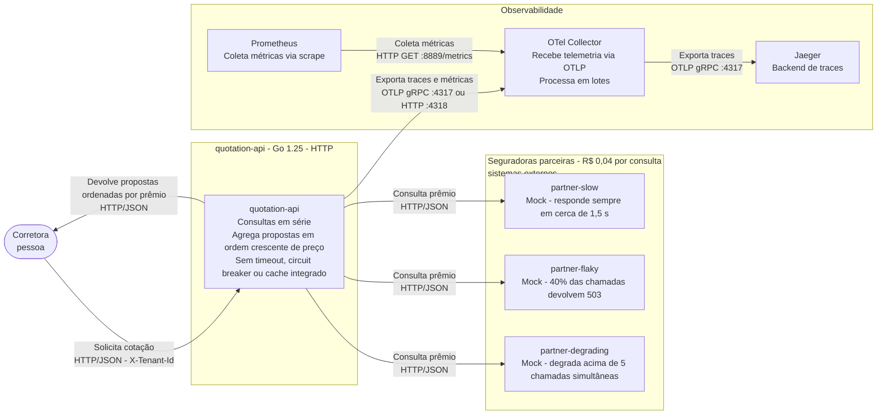
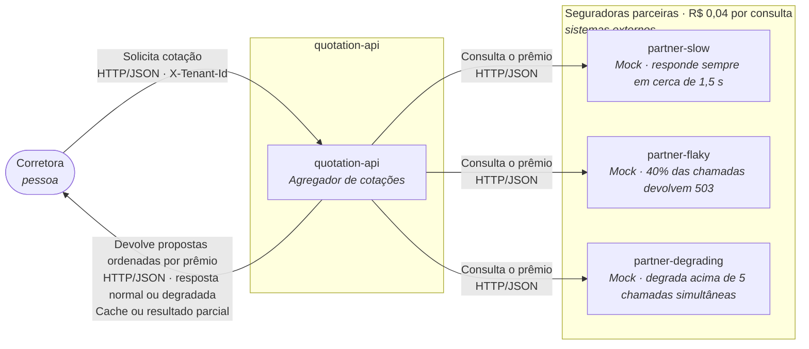
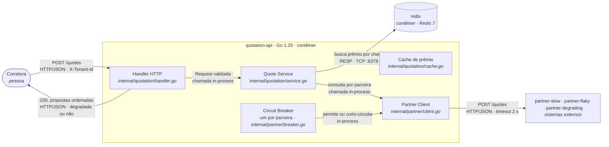

# System Architecture Document

## 1. Introdução

### 1.1. Propósito

O presente documento fundamenta a decisão de proteger a comunicação entre a `quotation api` e as seguradoras por meio da aplicação de tecnologias como circuit breaker, cache e fallback. Além disso, define o TTL do cache, os limiares e o escopo do breaker. O PoC que o acompanha, por sua vez, constrói e prova o que aqui será defendido.

A decisão tem duas motivações medidas:

**Disponibilidade e latência.** Hoje a plataforma consulta as parceiras em série, sem timeout, e devolve erro inteiro quando qualquer uma falha. Na execução de `make reproduce` feita para este documento ([seção 3.1](#31-linha-de-base-medida)), a carga de 200 requisições com 50 em voo terminou com p95 de 8,01 s (contra 2,04 s no baseline), 60% de sucesso e 80 respostas 502, todas originadas na `partner-flaky`. O p95 é limitado pela soma das três parceiras: no trace lento, a `partner-degrading` sozinha consumiu 6,15 s ([seção 3.1](#31-linha-de-base-medida)).

**Custo.** Cada consulta custa R$ 0,04 e são 360.000 por dia útil: R$ 14.400 por dia, cerca de R$ 317.000 por mês, contra R$ 660.000 de receita. Cada consulta repetida que não precise ser comprada é dinheiro recuperável, e é essa conta que a [seção 8](#8-tecnologias-custos-e-pessoal-tco) fecha.

### 1.2. Escopo

#### 1.2.1. Dentro do escopo

A plataforma de cotação (`quotation-api`) e a fronteira dela com as três seguradoras parceiras. É nessa fronteira que este documento decide como a plataforma se protege da instabilidade das parceiras.

**Propostas implementadas.** Circuit breaker, timeout nas chamadas à parceira, cache e fallback.

**Propostas não implementadas.** Tudo o que este documento descreve e a PoC não implementa. O que inclui:

- A paralelização da agregação, que sobreporia as três parceiras em vez de somá-las;
- Os padrões citados e não implementados: retry com backoff, bulkhead, rate limiting e fila;
- O tratamento dos quatro limites conhecidos (detalhados na [seção 4](#4-detalhamento-da-arquitetura)): ausência de limite de chamadas simultâneas por parceira, breaker em memória do processo (que não atravessa réplicas), TTL como única forma de invalidar o cache e uma corretora consumindo a capacidade das outras.

#### 1.2.2. Fora do escopo

- O motor de precificação das seguradoras e o CRM da corretora. A Prumo intermedia e não precifica;
- Integração real com qualquer seguradora: As três parceiras são e continuam mocks;
- Autenticação e Kubernetes;
- Persistência real de auditoria. A auditoria é tratada como decisão de arquitetura e como custo ([seção 8](#8-tecnologias-custos-e-pessoal-tco));
- Garantia transacional entre cache e parceira;
- Interface de usuário, cadastro de corretoras, cobrança e relatórios para o corretor.

### 1.3. Restrições

#### 1.3.1. Tecnologias e ambiente

- Go 1.25 para a API e para os testes;
- Docker com Compose v2 como ambiente;
- Redis como cache;
- OpenTelemetry para a instrumentação, com o SDK já inicializado em [`internal/platform/telemetry.go`](/internal/platform/telemetry.go) (traces para o Jaeger e métricas para o Prometheus, ambos via Collector);
- Mermaid para todo diagrama utilizado;
- As três parceiras são mocks e não podem ser alteradas ([`cmd/partner-mock/`](/cmd/partner-mock/)), nem os perfis delas no [`docker-compose.yml`](/docker-compose.yml).

#### 1.3.2. Negócio e contrato

- Cada consulta a uma parceira custa R$ 0,04, e cada cotação gera três consultas;
- Volume de referência de 120.000 cotações por dia útil, em 22 dias úteis por mês;
- As seguradoras honram um prêmio por até 24 horas, que é o teto comercial para reaproveitar uma cotação;
- O prêmio devolvido é sempre de uma parceira ou de um cache rastreável. A plataforma nunca calcula um valor.

#### 1.3.3. Regulatórias

- SUSEP: Toda cotação apresentada a um consumidor é auditável (seguradora, prêmio, corretora e instante), retida por cinco anos e não regravável. Isso vale também para cotação servida de cache ou de fallback;
- LGPD: A corretora é controladora e a Prumo é operadora. O contrato proíbe uso cruzado de dados e exige minimização e prazo de descarte;
- A chave de cache contém a corretora, sem exceção.

### 1.4. Decisões

São escolhas deste documento, defendidas com número nas seções indicadas.

- **D-01:** Escopo do circuit breaker (por parceira, por par parceira e corretora, ou global). Defendida na [seção 4](#4-detalhamento-da-arquitetura).
- **D-02:** Limiares do breaker: Falhas, janela, tempo aberto e requisições do meio aberto. Defendida na [seção 4](#4-detalhamento-da-arquitetura).
- **D-03:** Valor do timeout da chamada e efeito do estouro sobre o breaker. Defendida na [seção 4](#4-detalhamento-da-arquitetura).
- **D-04:** Granularidade do cache (por parceira ou cotação agregada) e chave por extenso. Defendida na [seção 4](#4-detalhamento-da-arquitetura).
- **D-05:** TTL do cache, dentro do teto de 24 horas. Defendida na [seção 4](#4-detalhamento-da-arquitetura).
- **D-06:** Política de invalidação e de descarte das entradas do cache. Defendida na [seção 4](#4-detalhamento-da-arquitetura).
- **D-07:** Tipo de fallback e a mudança no contrato de resposta. Defendida na [seção 4](#4-detalhamento-da-arquitetura).
- **D-08:** Biblioteca de circuit breaker. Defendida na [seção 5](#5-implementação).

### 1.5. Pressupostos

**P-01: Volume de produção.**

- **Valor:** 120.000 cotações por dia útil, em 22 dias úteis por mês;
- **Origem:** [Enunciado do desafio](TODO:ATUALIZAR_CAMINHO_NA_REVISAO_FINAL);
- **Se for falso:** O custo de parceiro, o dimensionamento do Redis e o custo de auditoria mudam na mesma proporção ([seção 8](#8-tecnologias-custos-e-pessoal-tco)).

**P-02: As parceiras reais se comportam como os mocks.**

- **Valor:** `partner-slow` em 1.500 ms ± 200 ms, `partner-flaky` com 40% de 503, `partner-degrading` afundando acima de 5 chamadas simultâneas;
- **Origem:** [Enunciado do desafio](TODO:ATUALIZAR_CAMINHO_NA_REVISAO_FINAL) e medição própria ([seção 3.1](#31-linha-de-base-medida));
- **Se for falso:** Os limiares do breaker ([D-02](#14-decisões)) e o timeout ([D-03](#14-decisões)) precisam ser recalibrados ([seção 4](#4-detalhamento-da-arquitetura)).

**P-03: Um prêmio continua praticável durante todo o TTL.**

- **Valor:** Prazo de 24 horas, sem mudança de preço antes disso;
- **Origem:** [Enunciado do desafio](TODO:ATUALIZAR_CAMINHO_NA_REVISAO_FINAL);
- **Se for falso:** Uma cotação servida de cache pode não ser honrada na venda. Isso é risco comercial e afeta o TTL ([D-05](#14-decisões), [seção 4](#4-detalhamento-da-arquitetura)) e a gestão de mudança ([seção 6](#6-operação-e-gestão-de-mudanças)).

**P-04: A API roda como uma única instância.**

- **Valor:** Um contêiner `quotation-api`;
- **Origem:** [Enunciado do desafio](TODO:ATUALIZAR_CAMINHO_NA_REVISAO_FINAL) e [`docker-compose.yml`](/docker-compose.yml);
- **Se for falso:** Com mais de uma réplica, cada uma aprende sozinha que a parceira caiu, porque o breaker vive em memória do processo. É um limite conhecido ([seção 4](#4-detalhamento-da-arquitetura)).

**P-05: Recotação (reaproveitamento de cotações pelo cache).**

- **Valor:** Assumo que 30% das cotações se repetem para a mesma corretora e o mesmo risco em até 1 hora;
- **Origem:** O [enunciado do desafio](TODO:ATUALIZAR_CAMINHO_NA_REVISAO_FINAL) fala só em "boa parte" das consultas repetidas e não traz percentual. O valor deve ser validado com dados reais da Prumo;
- **Se for falso:** Se for 5%, o cache não se paga e a [seção 8](#8-tecnologias-custos-e-pessoal-tco) muda de veredito. Se for maior que 30%, a economia cresce e o TTL ([D-05](#14-decisões)) pode ser revisto na [seção 4](#4-detalhamento-da-arquitetura).

## 2. Visão geral da arquitetura

### 2.1. Antes da intervenção

#### 2.1.1. C4 - Nível 1: Context


#### 2.1.2. C4 - Nível 2: Container



### 2.2. Depois da intervenção

#### 2.2.1. C4 - Nível 1: Context



#### 2.2.2. C4 - Nível 2: Container


### 2.3. Delta

**Entra.** o uso do redis, contêiner que já existe no docker-compose.yml e passa a ser consultado pela quotation-api como cache de prêmio por seguradora, com a corretora na chave.

**Muda.** a fronteira da quotation-api com as seguradoras ganha timeout por chamada, circuit breaker, cache e fallback; o contrato de resposta passa a admitir resposta degradada (servida do cache ou parcial), visível para a corretora.

**Sai.** nada. Nenhum contêiner é removido e nenhum muda de lugar.

### 2.4. A quem esta arquitetura serve

Esta arquitetura serve a três leitores ao mesmo tempo: ao CTO da Prumo, porque transforma o custo por consulta em uma conta defensável ([seção 8](#8-tecnologias-custos-e-pessoal-tco)); aos operadores do sistema, porque o estado de cada mecanismo fica observável e com ação definida ([seção 6](#6-operação-e-gestão-de-mudanças)); e ao encarregado de dados e auditoria, porque nenhuma cotação servida de cache ou fallback deixa de ser rastreável à consulta que a originou, e o isolamento entre corretoras está na chave do cache ([seção 4](#4-detalhamento-da-arquitetura)).

## 3. Requisitos funcionais e não funcionais

### 3.1. Linha de base medida

Todas as medições foram realizadas pelo autor deste documento, em máquina própria, antes do desenvolvimento do PoC, com a carga padrão do `make reproduce` (10 requisições de baseline e 200 com 50 em voo). Os arquivos brutos estão em [`docs/evidencias/`](/docs/evidencias/). É a partir desta linha de base que são desenvolvidos os requisitos não funcionais, presentes na [seção 3.3](#33-requisitos-não-funcionais).

#### Relatório do `make reproduce`

```bash
make down && make reproduce
```

```text
baseline — 10 requests, 1 in flight, 20:21:39 UTC to 20:21:58 UTC
  success        5 of 10 (50%)
  latency        p50 1.89s   p95 2.04s   p99 2.04s   max 2.04s
  throughput     0.5 req/s in 18.78s
  failures       HTTP 502 from partner-flaky: 5

load — 200 requests, 50 in flight, 20:21:58 UTC to 20:22:22 UTC
  success        120 of 200 (60%)
  latency        p50 6.11s   p95 8.01s   p99 8.03s   max 8.05s
  throughput     8.0 req/s in 24.86s
  failures       HTTP 502 from partner-flaky: 80

baseline → load
  p95 latency    2.04s → 8.01s   3.9x
  max latency    2.04s → 8.05s   4.0x
  success        50% → 60%
  throughput     0.5 → 8.0 req/s
```

Legenda: baseline e carga com falhas da `partner-flaky`, e p95 subindo de ~2 s para ~8 s.

#### p95 do POST /quotes (Prometheus, janela [1m])

```promql
histogram_quantile(0.95, sum by (le) (rate(http_server_request_duration_seconds_bucket[1m])))
```


Legenda: p95 estimado pelo Prometheus durante a carga, na janela `[1m]`. O gráfico mostra a forma da curva e o valor exato é o do relatório do teste de carga e/ou dos traces do Jaeger.

#### Trace lento (Jaeger, Last Hour)

Export completo: [`/docs/evidencias/antes-trace-lento.json`](/docs/evidencias/antes-trace-lento.json).
Resumo dos spans, com início medido a partir do span raiz:

| Span                              | Início | Duração | Status |
| --------------------------------- | ------ | ------- | ------ |
| `POST /quotes` (`quotation-api`)  | 0,00 s | 8,05 s  | 200    |
| `HTTP POST` → `partner-slow`      | 0,00 s | 1,70 s  | 200    |
| `HTTP POST` → `partner-flaky`     | 1,70 s | 0,20 s  | 200    |
| `HTTP POST` → `partner-degrading` | 1,90 s | 6,15 s  | 200    |


Legenda: três spans `HTTP POST` em série somando ~8 s.

#### Trace com erro (Jaeger, Last Hour)

Export completo: [`/docs/evidencias/antes-trace-erro.json`](/docs/evidencias/antes-trace-erro.json).
Resumo dos spans, com início medido a partir do span raiz:

| Span                             | Início | Duração | Status |
| -------------------------------- | ------ | ------- | ------ |
| `POST /quotes` (`quotation-api`) | 0,00 s | 1,76 s  | 502    |
| `HTTP POST` → `partner-slow`     | 0,00 s | 1,57 s  | 200    |
| `HTTP POST` → `partner-flaky`    | 1,57 s | 0,20 s  | 503    |


Legenda: sequência interrompida na `partner-flaky` (503), sem span da `partner-degrading`, e o servidor responde 502.

#### make test

```bash
make test
```

```text
ok      github.com/GuilhermeOliveira591/mba_arquitetura_desafio_cotacao_seguros/cmd/loadgen             1.762s
ok      github.com/GuilhermeOliveira591/mba_arquitetura_desafio_cotacao_seguros/cmd/partner-mock        0.118s
?       github.com/GuilhermeOliveira591/mba_arquitetura_desafio_cotacao_seguros/cmd/quotation-api       [no test files]
ok      github.com/GuilhermeOliveira591/mba_arquitetura_desafio_cotacao_seguros/internal/partner        0.006s
ok      github.com/GuilhermeOliveira591/mba_arquitetura_desafio_cotacao_seguros/internal/platform       0.003s
ok      github.com/GuilhermeOliveira591/mba_arquitetura_desafio_cotacao_seguros/internal/quotation      0.126s
```

Legenda: testes que já vinham no repositório, todos passando.

### 3.2. Requisitos funcionais

Os requisitos RF-01 a RF-04 saem do contrato que já existe ([`internal/quotation/handler.go`](/internal/quotation/handler.go), [`internal/quotation/service.go`](/internal/quotation/service.go)); RF-05 e RF-06 são criados por esta arquitetura e aparecem como mecanismo na [seção 4](#4-detalhamento-da-arquitetura).

- **RF-01:** A API rejeita cotação sem o cabeçalho `X-Tenant-Id` com 400 `X-Tenant-Id is required`, e corretora fora de `TENANTS` com 403 `broker not enabled on this platform`. Originado do contrato atual;
- **RF-02:** A resposta de sucesso entrega as propostas recebidas ordenadas por `premium_cents` crescente, também quando degradada. Originado do contrato atual;
- **RF-03:** Todo prêmio entregue vem de uma parceira ou do cache rastreável à consulta que o originou (`quote_id` preservado); a plataforma nunca calcula prêmio. Originado do contrato atual e da regulação (SUSEP/LGPD);
- **RF-04:** Toda cotação apresentada é auditável (seguradora, prêmio, corretora, instante), retida por cinco anos e não regravável, inclusive a servida de cache ou fallback. Originado da SUSEP ([seção 8](#8-tecnologias-custos-e-pessoal-tco));
- **RF-05:** Cotação cuja chave de cache bate e não expirou é respondida com o prêmio do cache, sem nova consulta às seguradoras, e a resposta declara a origem `cache` e a idade da entrada. Criado por esta arquitetura;
- **RF-06:** Quando uma parceira falha, estoura o timeout ou é curto-circuitada pelo breaker, a resposta continua sendo entregue com as propostas disponíveis, marcada como degradada e declarando quais parceiras faltam; sem nenhuma proposta disponível, a API devolve erro de negócio distinguível, não 502 genérico. Criado por esta arquitetura.

### 3.3. Requisitos não funcionais

A coluna "hoje" vem da medição da [seção 3.1](#31-linha-de-base-medida), exceto onde indicado. As métricas `partner_breaker_state`, `partner_breaker_transitions_total` `cache_hits_total` e `cache_misses_total` são criadas por esta entrega e têm os nomes declarados no README do processo.

**RNF-01: Latência da cotação.**

- **Métrica:** p95 do `POST /quotes`;
- **Hoje:** 8,01 s sob carga ([seção 3.1](#31-linha-de-base-medida));
- **Alvo:** ≤ 2,5 s;
- **Como medir:** `http_server_request_duration_seconds` no Prometheus, janela `[5m]`, mesma carga do `make reproduce`;
- **Por que este número:** A soma serial das parceiras saudáveis é ~1,8 s (1,5 s + 0,15 s + 0,12 s); 2,5 s cobre o caminho completo com margem e é o que o corretor aguenta com o cliente na frente.

**RNF-02: Taxa de sucesso da cotação.**

- **Métrica:** % de respostas 200;
- **Hoje:** 60% sob carga, 80 respostas 502 ([seção 3.1](#31-linha-de-base-medida));
- **Alvo:** ≥ 95%;
- **Como medir:** Relatório do `make reproduce`, contagem de 502;
- **Por que este número:** Hoje a disponibilidade é o produto das três parceiras; 95% é o piso para o produto não ser refém da pior parceira.

**RNF-03: Consultas compradas por cotação entregue.**

- **Métrica:** Nº de consultas / hit rate do cache;
- **Hoje:** 3 consultas por cotação, hit rate 0% (fato contábil do enunciado);
- **Alvo:** ≤ 2,1 consultas (hit rate ≥ 30%);
- **Como medir:** `sum(rate(cache_hits_total[15m])) / (sum(rate(cache_hits_total[15m])) + sum(rate(cache_misses_total[15m])))`;
- **Por que este número:** 30% é o pressuposto de recotação P-05; É o número que sustenta a economia da [seção 8](#8-tecnologias-custos-e-pessoal-tco).

**RNF-04: Deteção de parceira instável.**

- **Métrica:** Tempo até o circuito abrir;
- **Hoje:** Nunca — a `partner-flaky` foi chamada em toda a carga e gerou as 80 falhas 502 ([seção 3.1](#31-linha-de-base-medida));
- **Alvo:** Circuito aberto em ≤ 1 min de rajada;
- **Como medir:** `partner_breaker_state` no Prometheus;
- **Por que este número:** A rajada de nove falhas consecutivas é conhecida e medida; O breaker precisa abrir dentro dela.

**RNF-05: Isolamento entre corretoras.**

- **Métrica:** Cotações servidas com prêmio originado de outra corretora;
- **Hoje:** Sem cache hoje; a única barreira é o allowlist de tenant (403);
- **Alvo:** 0;
- **Como medir:** Teste determinístico de chave (`make test`) + chave por extenso na [seção 4](#4-detalhamento-da-arquitetura);
- **Por que este número:** LGPD/SUSEP: o contrato entre controladora e operadora proíbe uso cruzado; vazamento é incidente notificável à ANPD.

## 4. Detalhamento da arquitetura

Cada decisão segue o formato: Contexto, opções, escolha e consequências. Os parâmetros definidos aqui serão os mesmos do código ([seção 5](#5-implementação)) e sustentam os requisitos da [seção 3.3](#33-requisitos-não-funcionais).

### 4.1. Circuit breaker, timeout e limiares

#### D-01: Escopo do breaker (um por parceira)

- **Contexto:** Três parceiras independentes, instáveis por natureza; Número variável de corretoras em produção.
- **Opções:** Breaker global; Um por par (parceira, corretora); Um por parceira.
- **Escolha:** Um breaker por parceira.
- **Consequências:** A falha de uma parceira não derruba as consultas às outras duas. Alternativa global descartada: Uma parceira afundando abriria o circuito para todas, derrubando a plataforma inteira, que é exatamente o comportamento que esta arquitetura existe para remover. Alternativa por par descartada: com diversas corretoras, cada breaker acumularia poucas chamadas e demoraria a aprender, além da cardinalidade de estado.
- **Consequência ruim:** O breaker vive na memória do processo e não atravessa réplicas (limite conhecido L-02, [seção 4.5](#45-limites-conhecidos)).

#### D-02: Limiares do breaker

- **Contexto:** A `partner-flaky` falha 40% das vezes em regime, com rajada determinística de nove falhas consecutivas nas sequências 49 a 57 ([enunciado do desafio](TODO:ATUALIZAR_CAMINHO_NA_REVISAO_FINAL)).
- **Opções:** Contador de falhas consecutivas; Janela temporal; Janela deslizante por chamadas.
- **Escolha:** Janela deslizante de 10 chamadas, com limiar de 5 falhas. O circuito abre com 5 falhas nas últimas 10 chamadas, fica aberto por 30 s, deixa passar 3 requisições de prova no meio aberto, fecha com 2 sucessos e reabre com 1 falha.
- **Por que este par:** Falhas consecutivas com 40% de taxa nominal quase nunca chegam a 5 seguidas (0,4⁵ ≈ 1%) e não abrem em regime, por isso foram descartadas. Com 5/10, a rajada das sequências 49 a 57 abre o circuito com folga ([RNF-04](#33-requisitos-não-funcionais)), e em regime de 40% o circuito abre de vez em quando, o que é correto: 40% de erro é parceira doente. A janela por chamadas, e não por tempo, é determinística e testável no padrão de [`feasibility_test.go`](/cmd/partner-mock/feasibility_test.go), sem `sleep`.
- **Aberto por 30 s:** Tempo suficiente para não martelar uma parceira durante uma rajada curta e curto o bastante para não atrasar a recuperação.
- **Consequência ruim:** Com o circuito aberto, a parceira fica de fora das respostas completas até o circuito fechar de novo; A corretora vê cotação degradada ([RF-06](#32-requisitos-funcionais)), não silêncio.

#### D-03: Timeout da chamada

- **Contexto:** A `partner-slow` responde em 1.500 ms ± 200 ms (máximo observável de 1.700 ms); A `partner-degrading` nunca falha, apenas afunda até 6.000 ms. Sem timeout, a degradação dela não vira sinal para contador nenhum.
- **Opções:** 1.500 ms; 1.700 ms; 2.000 ms; 5.000 ms; sem timeout (o atual).
- **Escolha:** 2.000 ms, e o estouro conta como falha para o breaker.
- **Por que:** Cobre a `partner-slow` saudável com folga (1.700 ms mais a margem de rede) e corta a `partner-degrading` afundada; É o estouro que faz a parceira lenta ser vista pelo mecanismo. 1.500 ms e 1.700 ms foram descartados porque matam a `partner-slow` na cauda da distribuição; 5.000 ms foi descartado porque deixa a plataforma esperar quase o teto de afundamento antes de reagir.
- **Consequência ruim:** Uma cotação em série com as três parceiras lentas pode acumular até 6 s antes de o breaker intervir; O alvo do [RNF-01](#33-requisitos-não-funcionais) vale para o regime com cache ativo.

### 4.2. Cache: Granularidade, chave e TTL

#### D-04: Granularidade do cache e chave

**Chave de cache, por extenso:**

```text
prumo:quote:v1:tenant={X-Tenant-Id}:partner={partner}:request.coverage={request.coverage}:driver.document={driver.document}:driver.birth_year={driver.birth_year}:vehicle.plate={vehicle.plate}:vehicle.model={vehicle.model}:vehicle.year={vehicle.year}:vehicle.value_cents={vehicle.value_cents}
```

- **Contexto:** A corretora viaja no cabeçalho (`X-Tenant-Id`) e o risco, no corpo; o `Normalize()` de [`internal/quotation/request.go`](/internal/quotation/request.go) padroniza os componentes antes da montagem.
- **Opções:** Cache da cotação agregada; Cache do prêmio por parceira.
- **Escolha:** Cache do prêmio por parceira.
- **Por quê:** Sobrevive a uma parceira fora (as outras duas continuam servindo respostas frescas), compõe a resposta parcial do fallback peça por peça e expira por parceira.
- **Consequência ruim:** Três entradas por cotação em vez de uma; O hit rate por cotação exige que as três chaves estejam quentes. CPF e placa ficam na chave porque são a identificação do risco; a minimização é atendida pelo descarte ([D-06](#14-decisões)).

#### D-05: TTL do cache (3.600 s)

- **Contexto:** As seguradoras honram o prêmio por até 24 h; O [P-05](#15-pressupostos) assume 30% de recotação do mesmo risco para a mesma corretora dentro de 1 h.
- **Opções:** 300 s; 3.600 s; 24 h.
- **Escolha:** 3.600 s (1 hora), dentro do teto comercial de 24 h.
- **Por quê:** Cobre a janela de recotação do P-05 com folga, o que sustenta o hit rate de 30% do [RNF-03](#33-requisitos-não-funcionais) e da [seção 8](#8-tecnologias-custos-e-pessoal-tco); Parar em 1 h reduz o risco de servir prêmio vencido ([P-03](#15-pressupostos)). 300 s foi descartado porque sustenta hit rate muito menor que o pressuposto e desperdiça o teto comercial. 24 h foi descartado por ter o máximo risco regulatório e comercial (prêmio não honrado na venda) sem ganho de hit rate proporcional.
- **Consequência ruim:** Cotações repetidas depois de 1 h pagam as consultas de novo.

#### D-06: Invalidação e descarte

- **Contexto:** Não existe, no cenário, evento de mudança de preço que permita invalidar antes da hora; O Redis do ambiente sobe sem AOF nem RDB.
- **Escolha:** Invalidação só por TTL. As entradas somem por expiração do TTL e, no ambiente, quando o Redis é reiniciado. O prazo de descarte de dado pessoal (LGPD) é atendido pelo mesmo teto de 1 h.
- **Consequência ruim:** Uma tabela de preço que mude dentro do TTL serve prêmio defasado por até 1 h (limite conhecido L-03, [seção 4.5](#45-limites-conhecidos)).

### 4.3. Fallback

#### D-07: Fallback parcial

- **Contexto:** Hoje uma parceira falhando aborta a requisição inteira com 502 ([seção 3.1](#31-linha-de-base-medida): 80 respostas 502 numa carga).
- **Opções:** Resposta parcial; Cotação anterior agregada; Recusa explícita sempre.
- **Escolha:** O cache funciona como acerto normal ([RF-05](#32-requisitos-funcionais)): Uma entrada não expirada é servida sem consultar a parceira e não é degradação. O fallback é a resposta parcial: Se a parceira falha, estoura o timeout ou é curto-circuitada pelo breaker e não há entrada válida no cache, ela fica ausente. A resposta entrega as propostas que existirem, ordenadas por prêmio ([RF-02](#32-requisitos-funcionais)), e declara a degradação. Sem nenhuma proposta disponível, a API devolve o erro de negócio 503 `no quotes available`, distinguível do 502 `partner insurer unavailable`.
- **Alternativas descartadas:** Recusa sempre (atual); Cotação anterior agregada (perde as respostas frescas e combina mal com o cache por parceira).
- **Consequência ruim:** A corretora pode receber cotação sem a melhor oferta daquela parceira; A degradação é explícita para ela decidir.
  **Contrato de resposta** (mudança em [`internal/quotation/request.go`](/internal/quotation/request.go)):

```json
{
  "tenant_id": "corretora-a",
  "quotes": [
    {
      "partner": "partner-slow",
      "quote_id": "partner-slow-3f2a1c0b9d8e7f60",
      "premium_cents": 84210,
      "currency": "BRL",
      "coverage_cents": 5000000,
      "valid_for_seconds": 300,
      "source": "partner"
    },
    {
      "partner": "partner-flaky",
      "quote_id": "partner-flaky-9a8b7c6d5e4f3210",
      "premium_cents": 91300,
      "currency": "BRL",
      "coverage_cents": 5000000,
      "valid_for_seconds": 300,
      "source": "cache",
      "cache_age_seconds": 942
    }
  ],
  "degraded": true,
  "missing": ["partner-degrading"],
  "elapsed_ms": 1712
}
```

`degraded` é `true` quando há ao menos uma parceira em `missing`; Proposta servida de cache é acerto normal e não degrada a resposta. `missing` lista as parceiras sem resposta e sem cache. `source` diz, de cada proposta, se ela vem de `partner` ou de `cache`, e `cache_age_seconds` dá a idade da entrada. O `quote_id` original é preservado, o que mantém a cotação rastreável à consulta que a originou ([RF-03 e RF-04](#32-requisitos-funcionais)).

### 4.4. A fatia implementada, em C4 nível 3

Os arquivos `internal/quotation/cache.go` e `internal/partner/breaker.go` ainda não existem: são criados por esta entrega (proposta). O mapa completo está na [seção 5](#5-implementação).



As duas marcações de trace que provam os mecanismos: A requisição curto-circuitada recebe o evento `circuit_open` no span (e não tem span de saída), e a resposta servida de cache recebe o evento `cache_hit` (sem spans de saída às parceiras). Nenhum CPF, placa ou `quote_id` em atributo de span ou métrica; `tenant_id` é o único identificador admitido.

### 4.5. Limites conhecidos

Nenhum dos quatro é para implementar; declará-los é parte da arquitetura.

**L-01: Sem limite de chamadas simultâneas por parceira (sem bulkhead).**

- **Gatilho:** Rajada de carga ou perda do Redis: A concorrência sobre a `partner-degrading` passa de 5;
- **Efeito na corretora:** A latência cresce até o timeout segurar, e as cotações degradadas se multiplicam.

**L-02: Breaker na memória do processo, que não atravessa réplicas.**

- **Gatilho:** Escalar para mais de uma réplica da API;
- **Efeito na corretora:** Cada réplica aprende sozinha, com mais consultas compradas do que o esperado e abertura aparentemente mais lenta.

**L-03: TTL como única forma de invalidar o cache.**

- **Gatilho:** Mudança de tabela de preço dentro da janela de 1 h;
- **Efeito na corretora:** Prêmio defasado servido por até 1 h, com risco de não ser honrado na venda.

**L-04: Uma corretora consome a capacidade das outras (sem rate limiting por corretora).**

- **Gatilho:** Uma corretora dispara carga anômala;
- **Efeito na corretora:** O p95 de todas as corretoras sobe junto.
