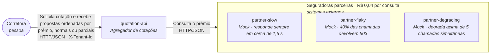
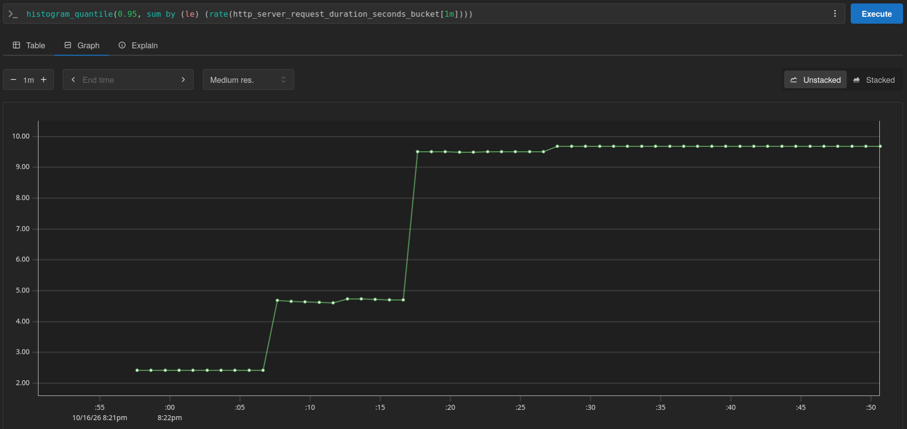
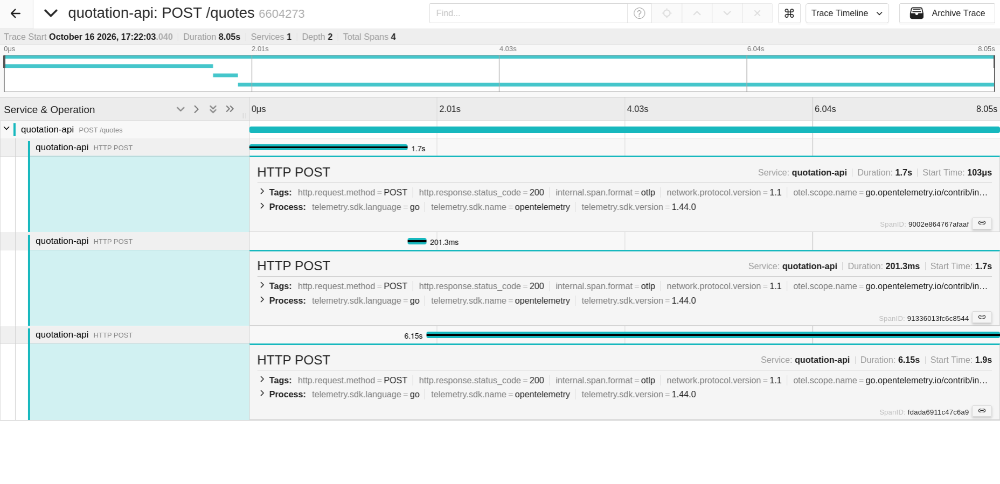
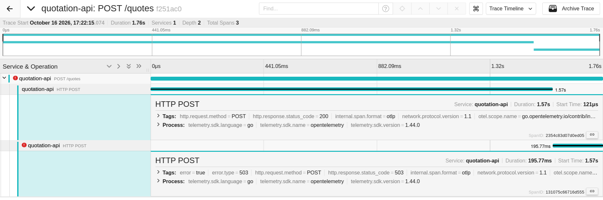
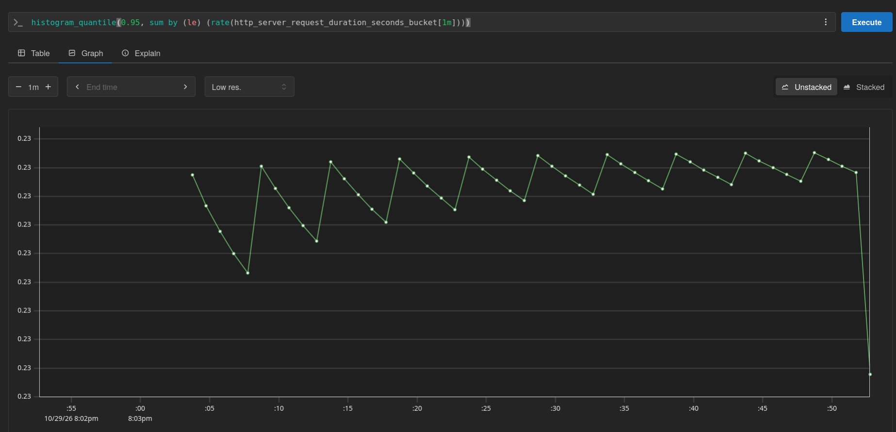
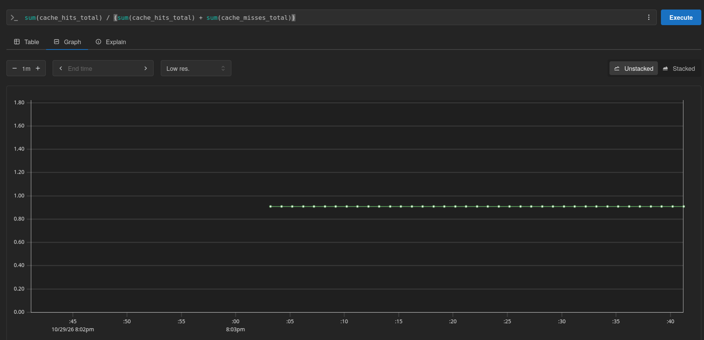
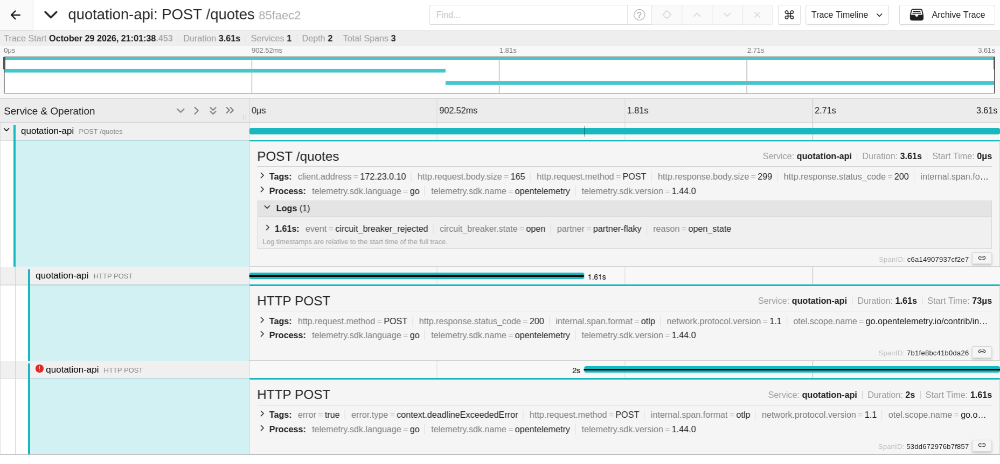
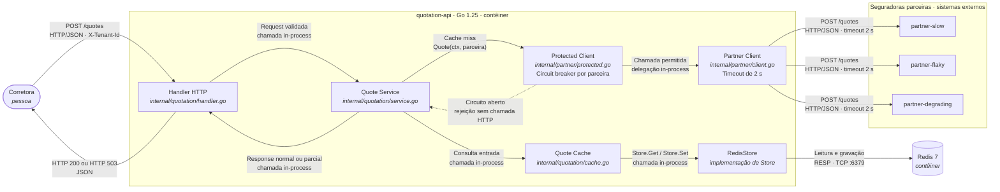

# System Architecture Document

## 1. Introdução

### 1.1. Propósito

Este documento define a arquitetura para aumentar a resiliência da `quotation-api` na comunicação com as três seguradoras parceiras. Os mecanismos são timeout, circuit breaker, cache e fallback. A PoC mede o efeito deles sobre disponibilidade, latência e custo.

O documento sustenta a decisão de adotar esses mecanismos e fixa seus parâmetros (D-01 a D-09).

Na linha de base (200 requisições, 50 em voo), o p95 é de 8,01 s, o sucesso é de 60% e há 80 respostas HTTP 502 ([seção 3.1](#31-linha-de-base-medida)). As consultas custam R$ 14.400 por dia útil: 360.000 × R$ 0,04 ([seção 8](#8-tecnologias-custos-e-pessoal-tco)).

### 1.2. Escopo

**Dentro do escopo:** A `quotation-api` e sua fronteira com as três seguradoras. A PoC implementa timeout por chamada, circuit breaker por parceira, cache de prêmio por parceira e fallback parcial.

**Proposta, sem implementação:** Paralelização das consultas e os padrões retry com backoff, bulkhead, rate limiting e fila. Por isso permanecem como limites conhecidos a ausência de limite de chamadas simultâneas por parceira, o breaker na memória do processo, a invalidação do cache só por TTL e uma corretora consumindo a capacidade das demais ([seção 4.3](#43-limites-conhecidos)).

**Fora do escopo:**

- Motor de precificação das seguradoras e CRM da corretora.
- Integração com seguradoras reais, autenticação e Kubernetes.
- Interface de usuário, cadastro de corretoras, cobrança e relatórios.
- Garantia transacional entre o cache e as seguradoras.

A auditoria é tratada como requisito e custo, sem persistência na PoC. A retenção de cinco anos e a imutabilidade dos registros são requisitos da solução proposta, não funcionalidades comprovadas pela implementação.

### 1.3. Restrições

São impostas pelo enunciado e pelo ambiente, e não são escolhas desta arquitetura.

**Tecnológicas:**

- Go 1.25 para a API e os testes.
- Docker com Compose v2, que pode ser estendido com moderação.
- Redis para o cache.
- OpenTelemetry para a instrumentação, com o SDK já inicializado em [`internal/platform/telemetry.go`](/internal/platform/telemetry.go). Os traces vão ao Jaeger e as métricas ao Prometheus, ambos via Collector.
- Mermaid para os diagramas.
- As três parceiras são mocks em [`cmd/partner-mock/`](/cmd/partner-mock/). Seu código e seus perfis no `docker-compose.yml` não podem ser alterados nas configurações que sustentam as evidências.

**De negócio:**

- Cada consulta a uma parceira custa R$ 0,04, e cada cotação gera três consultas.
- A corretora paga R$ 0,25 por cotação entregue.
- As seguradoras honram o prêmio por até 24 horas, o que limita o reaproveitamento de uma cotação.

**Regulatórias:**

- A cotação apresentada deve ser auditável (seguradora, prêmio, corretora e instante), retida por cinco anos e sem possibilidade de regravação (SUSEP).
- A corretora é controladora dos dados e a Prumo é operadora (LGPD). Isso exige minimização, descarte e proibição de uso cruzado entre corretoras. Por isso a chave do cache inclui a corretora.

### 1.4. Decisões

São escolhas da solução, não restrições. D-01 a D-07 são defendidas na [seção 4.1](#41-decisões-arquiteturais), e D-08 e D-09 na [seção 5](#5-implementação).

- **D-01:** Escopo do circuit breaker (por parceira, por par parceira e corretora, ou global).
- **D-02:** Limiares do breaker (falhas, janela, tempo aberto e requisições do meio aberto).
- **D-03:** Valor do timeout e efeito do estouro sobre o breaker.
- **D-04:** Granularidade do cache (por parceira ou cotação agregada) e chave por extenso.
- **D-05:** TTL do cache, dentro do teto de 24 horas.
- **D-06:** Invalidação e descarte das entradas do cache.
- **D-07:** Tipo de fallback e mudança no contrato de resposta.
- **D-08:** Biblioteca de circuit breaker (implementação própria ou `sony/gobreaker`).
- **D-09:** Hospedagem (cloud em região brasileira).

### 1.5. Pressupostos

**P-01: Volume de produção.** Assumo 120.000 cotações por dia útil, em 22 dias úteis por mês. Origem: [enunciado](/docs/enunciado.md). Se for falso, os custos das parceiras, o Redis e a auditoria devem ser recalculados ([seção 8](#8-tecnologias-custos-e-pessoal-tco)).

**P-02: Comportamento das parceiras.** Assumo que as parceiras reais se comportam como os mocks. A `partner-slow` responde em cerca de 1.500 ms ± 200 ms, a `partner-flaky` devolve 40% de respostas HTTP 503, e a `partner-degrading` soma 300 ms por chamada simultânea acima de cinco, até 6.000 ms. Origem: [enunciado](/docs/enunciado.md) e medições da [seção 3.1](#31-linha-de-base-medida). Se for falso, os limiares do breaker e o timeout devem ser recalibrados (D-02 e D-03).

**P-03: Validade comercial.** Assumo que o prêmio permanece válido por até 24 horas. Origem: [enunciado](/docs/enunciado.md). O campo `valid_for_seconds` dos mocks (300 s) é um dado técnico e não é o teto comercial. Se for falso, uma cotação servida do cache pode não ser honrada na venda, e o TTL (D-05) e a gestão de mudanças ([seção 6.4](#64-gestão-de-mudanças-ttl-do-cache)) devem ser revistos.

**P-04: Instância única.** Assumo que a API roda em um único contêiner `quotation-api` na PoC. Origem: [enunciado](/docs/enunciado.md) e [`docker-compose.yml`](/docker-compose.yml). Se for falso, cada réplica mantém seu próprio estado do breaker (L-02).

**P-05: Repetição de cotações.** Assumo que 30% das cotações se repetem para a mesma corretora e o mesmo risco em até 1 hora. Origem: exemplo do [`docs/guia-sad.md`](/docs/guia-sad.md), porque o [enunciado](/docs/enunciado.md) fala em "boa parte" das consultas repetidas, sem percentual. Não é um dado medido e deve ser validado com dados reais da Prumo. Se a repetição for de 5%, o cache pode não se pagar e a conclusão da [seção 8](#8-tecnologias-custos-e-pessoal-tco) muda. Se for maior que 30%, a economia aumenta e o TTL (D-05) pode ser revisto.
x

## 2. Visão geral da arquitetura

### 2.1. Antes da intervenção

#### 2.1.1. C4 - Nível 1: Context


#### 2.1.2. C4 - Nível 2: Container


### 2.2. Depois da intervenção

#### 2.2.1. C4 - Nível 1: Context



#### 2.2.2. C4 - Nível 2: Container


### 2.3. Delta

- **Acrescenta:** Uso do Redis, já presente no `docker-compose.yml`, como cache de prêmio por parceira, com a corretora na chave. Timeout por chamada e circuit breaker por parceira. Fallback parcial. Eventos de trace e métricas de negócio, sobre a observabilidade existente.
- **Altera:** O contrato de resposta passa a informar a origem de cada proposta (parceira ou cache) e as parceiras ausentes quando há degradação.
- **Remove:** Nenhum componente. Nenhum contêiner é removido ou muda de lugar.

### 2.4. Partes interessadas

Esta arquitetura atende a três partes interessadas. O CTO da Prumo acompanha o custo das consultas e a economia do cache ([seção 8](#8-tecnologias-custos-e-pessoal-tco)). Os operadores acompanham o breaker, o cache e a latência no Jaeger e no Prometheus, com ações definidas para cada alerta ([seção 6](#6-operação-e-gestão-de-mudanças)). O encarregado de dados e auditoria verifica a rastreabilidade das propostas e o isolamento entre corretoras pela chave do cache ([seção 4](#4-detalhamento-da-arquitetura)). A persistência da auditoria por cinco anos é requisito da proposta e não foi implementada na PoC.

## 3. Requisitos funcionais e não funcionais

### 3.1. Linha de base medida

Todas as medições foram realizadas pelo autor deste documento, em máquina própria, antes do desenvolvimento do PoC, com a carga padrão do `make reproduce` (10 requisições de baseline e 200 com 50 em voo). Os arquivos brutos estão em [`docs/evidencias/`](/docs/evidencias/). É a partir desta linha de base que são desenvolvidos os requisitos não funcionais, presentes na [seção 3.3](#33-requisitos-não-funcionais).

#### Relatório do `make reproduce`

```bash
make down && make reproduce
```

```text
baseline — 10 requests, 1 in flight, 20:21:39 UTC to 20:21:58 UTC
  success        5 of 10 (50%)
  latency        p50 1.89s   p95 2.04s   p99 2.04s   max 2.04s
  throughput     0.5 req/s in 18.78s
  failures       HTTP 502 from partner-flaky: 5

load — 200 requests, 50 in flight, 20:21:58 UTC to 20:22:22 UTC
  success        120 of 200 (60%)
  latency        p50 6.11s   p95 8.01s   p99 8.03s   max 8.05s
  throughput     8.0 req/s in 24.86s
  failures       HTTP 502 from partner-flaky: 80

baseline → load
  p95 latency    2.04s → 8.01s   3.9x
  max latency    2.04s → 8.05s   4.0x
  success        50% → 60%
  throughput     0.5 → 8.0 req/s
```

Legenda: Baseline e carga com falhas da `partner-flaky`, e p95 subindo de ~2 s para ~8 s.

#### p95 do POST /quotes (Prometheus, janela [1m])

```promql
histogram_quantile(0.95, sum by (le) (rate(http_server_request_duration_seconds_bucket[1m])))
```



Legenda: p95 estimado pelo Prometheus durante a carga, na janela `[1m]`. O gráfico mostra a forma da curva e o valor exato é o do relatório do teste de carga e/ou dos traces do Jaeger.

#### Trace lento (Jaeger, Last Hour)

Export completo: [`/docs/evidencias/antes-trace-lento.json`](/docs/evidencias/antes-trace-lento.json).
Resumo dos spans, com início medido a partir do span raiz:

| Span                              | Início | Duração | Status |
| --------------------------------- | ------ | ------- | ------ |
| `POST /quotes` (`quotation-api`)  | 0,00 s | 8,05 s  | 200    |
| `HTTP POST` → `partner-slow`      | 0,00 s | 1,70 s  | 200    |
| `HTTP POST` → `partner-flaky`     | 1,70 s | 0,20 s  | 200    |
| `HTTP POST` → `partner-degrading` | 1,90 s | 6,15 s  | 200    |



Legenda: Três spans `HTTP POST` em série somando ~8 s.

#### Trace com erro (Jaeger, Last Hour)

Export completo: [`/docs/evidencias/antes-trace-erro.json`](/docs/evidencias/antes-trace-erro.json).
Resumo dos spans, com início medido a partir do span raiz:

| Span                             | Início | Duração | Status |
| -------------------------------- | ------ | ------- | ------ |
| `POST /quotes` (`quotation-api`) | 0,00 s | 1,76 s  | 502    |
| `HTTP POST` → `partner-slow`     | 0,00 s | 1,57 s  | 200    |
| `HTTP POST` → `partner-flaky`    | 1,57 s | 0,20 s  | 503    |



Legenda: Sequência interrompida na `partner-flaky` (503), sem span da `partner-degrading`, e o servidor responde 502.

#### make test

```bash
make test
```

```text
ok      github.com/GuilhermeOliveira591/mba_arquitetura_desafio_cotacao_seguros/cmd/loadgen             1.762s
ok      github.com/GuilhermeOliveira591/mba_arquitetura_desafio_cotacao_seguros/cmd/partner-mock        0.118s
?       github.com/GuilhermeOliveira591/mba_arquitetura_desafio_cotacao_seguros/cmd/quotation-api       [no test files]
ok      github.com/GuilhermeOliveira591/mba_arquitetura_desafio_cotacao_seguros/internal/partner        0.006s
ok      github.com/GuilhermeOliveira591/mba_arquitetura_desafio_cotacao_seguros/internal/platform       0.003s
ok      github.com/GuilhermeOliveira591/mba_arquitetura_desafio_cotacao_seguros/internal/quotation      0.126s
```

Legenda: Testes que já vinham no repositório, todos passando.

### 3.2. Requisitos funcionais

Os requisitos RF-01 e RF-02 são originados do contrato existente ([`internal/quotation/handler.go`](/internal/quotation/handler.go), [`internal/quotation/service.go`](/internal/quotation/service.go)). RF-03 e RF-04 decorrem do cenário de negócio e dos requisitos de rastreabilidade e auditoria. RF-05 e RF-06 são introduzidos por esta arquitetura e implementados na PoC, conforme os mecanismos descritos na [seção 4](#4-detalhamento-da-arquitetura).

- **RF-01:** A API rejeita cotação sem o cabeçalho `X-Tenant-Id` com HTTP 400 e mensagem `X-Tenant-Id is required`, e corretora fora de `TENANTS` com HTTP 403 e mensagem `broker not enabled on this platform`. Originado do contrato atual.
- **RF-02:** A resposta de sucesso entrega as propostas recebidas ordenadas por `premium_cents` crescente, inclusive quando parcial. Originado do contrato atual.
- **RF-03:** Toda proposta entregue deve corresponder a uma cotação recebida de uma parceira ou recuperada do cache, mantendo o `quote_id` original. A plataforma não calcula nem modifica o prêmio. Originado do cenário de negócio e dos requisitos de rastreabilidade.
- **RF-04:** Toda cotação apresentada deve possuir registro auditável, contendo seguradora, prêmio, corretora e instante, com retenção por cinco anos e sem possibilidade de regravação, inclusive quando servida do cache ou fallback. É um requisito arquitetural e regulatório; a persistência de auditoria não é implementada nesta PoC.
- **RF-05:** Quando a chave de cache corresponde a uma entrada não expirada, a API entrega o prêmio armazenado sem realizar nova consulta à seguradora, identificando a origem como `cache` e informando a idade da entrada em `cache_age_seconds`. Criado por esta arquitetura.
- **RF-06:** Quando uma parceira falha, excede o timeout ou é rejeitada pelo circuit breaker e não existe entrada válida no cache, a API entrega as propostas disponíveis em resposta HTTP 200, marcada como degradada (`degraded: true`) e identificando as parceiras ausentes em `missing`. Quando nenhuma proposta está disponível, retorna HTTP 503 com a mensagem `no quotes available`. Criado por esta arquitetura.

### 3.3. Requisitos não funcionais

A coluna "hoje" utiliza as medições da [seção 3.1](#31-linha-de-base-medida), exceto quando indicado. As métricas de negócio `circuit_breaker_transitions_total`, `cache_hits_total` e `cache_misses_total` são instrumentadas pela aplicação e exportadas via OpenTelemetry. A latência por parceira reaproveita `http_client_request_duration_seconds`, com o atributo `server_address`.

**RNF-01: Latência da cotação.** A métrica é o p95 do `POST /quotes`. Hoje, o valor é de 8,01 s sob carga ([seção 3.1](#31-linha-de-base-medida)). O alvo é ≤ 2,5 s. A medição será feita por meio de `http_server_request_duration_seconds`, no Prometheus, utilizando a janela `[1m]` e a mesma carga do `make reproduce`. Esse limite foi definido porque a soma das chamadas às parceiras saudáveis é de aproximadamente 1,8 s (1,5 s + 0,15 s + 0,12 s); o alvo de 2,5 s contempla o tempo de processamento da API e uma margem para variações de rede.

**RNF-02: Taxa de sucesso da cotação.** A métrica é o percentual de respostas HTTP 200. Hoje, a taxa é de 60% sob carga, com 80 respostas HTTP 502 ([seção 3.1](#31-linha-de-base-medida)). O alvo é ≥ 95%. A medição será feita pelo relatório do `make reproduce`, dividindo a quantidade de respostas HTTP 200 pelo total de requisições. Esse limite busca evitar que a disponibilidade do produto dependa do desempenho conjunto das três parceiras e estabelece 95% como o nível mínimo esperado de sucesso.

**RNF-03: Consultas compradas por cotação entregue.** A métrica é o número médio de consultas às parceiras por cotação entregue e a taxa de acerto do cache. As métricas `cache_hits_total` e `cache_misses_total` são criadas por esta entrega. Hoje, são realizadas três consultas por cotação, com hit rate de 0%, pois não havia cache integrado. O alvo é ≤ 2,1 consultas por cotação, correspondente a um hit rate ≥ 30%. A medição será feita pela fórmula `sum(cache_hits_total) / (sum(cache_hits_total) + sum(cache_misses_total))`. Considerando três consultas potenciais por cotação, a média de consultas compradas é calculada por `3 × (1 - hit rate)`. Esse alvo utiliza o pressuposto de repetição de 30% definido em P-05 e sustenta a economia projetada na [seção 8](#8-tecnologias-custos-e-pessoal-tco). O hit rate observado na carga de demonstração não deve ser confundido com o percentual estimado para produção.

**RNF-04: Detecção de parceira instável.** A métrica é o tempo entre o início de uma sequência de falhas que satisfaz os limiares do breaker e a abertura do circuito. Hoje, o circuito não existe na linha de base: a `partner-flaky` é chamada durante toda a carga e contribui para as 80 respostas HTTP 502 ([seção 3.1](#31-linha-de-base-medida)). O alvo é abrir o circuito em até um minuto após o início de uma sequência de falhas que satisfaça os critérios da D-02. A medição será feita pelo intervalo entre o início das falhas e o registro da transição `closed -> open` no log da aplicação. A rejeição das chamadas posteriores será confirmada pelo evento `circuit_breaker_rejected` no span do Jaeger ([seção 3.4](#34-resultados-após-a-intervenção)). A ocorrência de nove falhas consecutivas só provoca a abertura se a proporção de falhas na janela também satisfizer o limiar definido; com tráfego alto, sucessos intercalados podem diluir essa proporção ([D-02](#41-decisões-arquiteturais)).

**RNF-05: Isolamento entre corretoras.** A métrica é o número de ocorrências de reutilização de uma entrada de cache pertencente a outra corretora. Hoje, não existe cache integrado, e a única barreira de identificação é o allowlist de tenants, que retorna HTTP 403 quando o acesso não é autorizado. O alvo é zero ocorrências de uso cruzado. A medição será feita por testes determinísticos em `make test`, verificando que a chave varia conforme o tenant e que uma corretora não recebe uma entrada armazenada para outra. Esse requisito decorre das obrigações de proteção de dados e auditoria consideradas no projeto: o compartilhamento de dados entre corretoras não é permitido, e um incidente poderá exigir notificação à ANPD.

### 3.4. Resultados após a intervenção

As medições foram realizadas pelo autor deste documento, em máquina própria, após o desenvolvimento do PoC, utilizando a mesma carga padrão do `make reproduce` (10 requisições de baseline e 200 com 50 em voo). Os arquivos brutos estão em [`docs/evidencias/`](/docs/evidencias/).

#### Relatório do `make reproduce`

```bash
make down && make reproduce
```

```text
baseline — 10 requests, 1 in flight, 19:50:40 UTC to 19:50:50 UTC
  success        10 of 10 (100%)
  latency        p50 199ms   p95 2.04s   p99 2.04s   max 2.04s
  throughput     1.0 req/s in 10.02s

load — 200 requests, 50 in flight, 19:50:50 UTC to 19:50:50 UTC
  success        200 of 200 (100%)
  latency        p50 6ms   p95 198ms   p99 228ms   max 229ms
  throughput     798.0 req/s in 250ms

baseline → load
  p95 latency    2.04s → 198ms   0.1x
  max latency    2.04s → 229ms   0.1x
  success        100% → 100%
  throughput     1.0 → 798.0 req/s
```

Legenda: Carga com 100% de sucesso e p95 de 198 ms, favorecida pela taxa de acerto do cache próxima de 90%.

#### p95 do POST /quotes (Prometheus, janela [1m])

```promql
histogram_quantile(0.95, sum by (le) (rate(http_server_request_duration_seconds_bucket[1m])))
```



Legenda: p95 estimado pelo Prometheus durante a carga, na janela `[1m]`. O gráfico mostra as variações de tempo de resposta e o valor exato é o do relatório do teste de carga e/ou dos traces do Jaeger.

#### Taxa de acerto do cache (Prometheus)

```promql
sum(cache_hits_total) / (sum(cache_hits_total) + sum(cache_misses_total))
```



Legenda: Taxa de acerto do cache próxima de 90%, reduzindo chamadas às seguradoras.

#### Trace com circuito aberto e timeout (Jaeger, Last Hour)

Export completo: [`/docs/evidencias/depois-trace-breaker-open.json`](/docs/evidencias/depois-trace-breaker-open-timeout.json).
Resumo dos spans, com início medido a partir do span raiz:

| Span / evento                                | Início | Duração | Resultado       |
| -------------------------------------------- | ------ | ------- | --------------- |
| `POST /quotes` (`quotation-api`)             | 0,00 s | 3,61 s  | HTTP 200        |
| `HTTP POST` → `partner-slow`                 | 0,00 s | 1,61 s  | HTTP 200        |
| `HTTP POST` → `partner-degrading`            | 1,61 s | 2,00 s  | Timeout         |
| `circuit_breaker_rejected` → `partner-flaky` | 1,61 s | —       | Circuito aberto |



Legenda: Circuito aberto rejeita a chamada à `partner-flaky`, sem gerar span de saída para essa parceira, enquanto a `partner-degrading` atinge o timeout de 2 segundos.

#### make test

```bash
make test
```

```text
ok      github.com/GuilhermeOliveira591/mba_arquitetura_desafio_cotacao_seguros/cmd/loadgen             1.769s
ok      github.com/GuilhermeOliveira591/mba_arquitetura_desafio_cotacao_seguros/cmd/partner-mock        0.123s
?       github.com/GuilhermeOliveira591/mba_arquitetura_desafio_cotacao_seguros/cmd/quotation-api       [no test files]
ok      github.com/GuilhermeOliveira591/mba_arquitetura_desafio_cotacao_seguros/internal/partner        0.013s
ok      github.com/GuilhermeOliveira591/mba_arquitetura_desafio_cotacao_seguros/internal/platform       0.008s
ok      github.com/GuilhermeOliveira591/mba_arquitetura_desafio_cotacao_seguros/internal/quotation      0.134s
```

Legenda: Testes executados após a intervenção, com os pacotes listados passando.

## 4. Detalhamento da arquitetura

### 4.1. Decisões arquiteturais

Cada decisão apresenta contexto, opções, escolha e consequências. Os parâmetros definidos nesta seção correspondem à implementação da PoC e fundamentam os requisitos da [seção 3.3](#33-requisitos-não-funcionais).

#### D-01 — Escopo do circuit breaker (um por parceira)

- **Contexto:** Três parceiras independentes, instáveis por natureza. Número variável de corretoras em produção.
- **Opções:** Breaker global. Um por par (parceira, corretora). Um por parceira.
- **Escolha:** Um breaker por parceira.
- **Consequências:** A falha de uma parceira não derruba as consultas às outras duas. A alternativa global foi descartada porque uma parceira com problemas abriria o circuito para todas. A alternativa por par foi descartada porque, com diversas corretoras, cada breaker acumularia poucas chamadas e demoraria a identificar falhas, além de aumentar a cardinalidade do estado.
- **Consequência ruim:** O breaker vive na memória do processo e não compartilha seu estado entre réplicas, conforme o limite L-02.

#### D-02: Limiares do breaker

- **Contexto:** A `partner-flaky` falha 40% das vezes em regime normal e apresenta uma rajada determinística de nove falhas consecutivas nas sequências 49 a 57 ([enunciado do desafio](README.md)).
- **Opções:** Contador de falhas consecutivas. Janela por contagem das últimas 10 chamadas, com implementação própria. Janela deslizante por tempo, utilizando biblioteca.
- **Escolha:** Janela deslizante de 30 segundos, dividida em 10 buckets de 3 segundos, utilizando `sony/gobreaker` (D-08). O circuito abre quando a janela registra pelo menos cinco falhas e elas representam pelo menos metade das chamadas concluídas (sucessos mais falhas). Permanece aberto por 30 segundos, permite até três requisições de prova no estado meio aberto, fecha após três sucessos consecutivos e reabre diante de uma falha nesse estado.
- **Por que este conjunto:** Cinco falhas constituem o mínimo de evidência para avaliar a parceira. A proporção de pelo menos 50% diferencia uma condição de instabilidade de uma falha isolada. Em regime nominal, com 40% de falhas, a `partner-flaky` permanece abaixo do limiar e continua fornecendo propostas em parte das consultas; o fallback parcial (D-07) cobre as ausências. A rajada determinística de nove falhas consecutivas permite reproduzir a abertura do circuito, desde que as falhas ocorram dentro da janela e satisfaçam o limiar. A janela por contagem das últimas 10 chamadas produziria um resultado semelhante, mas exigiria implementação própria.
- **Aberto por 30 segundos:** Tempo suficiente para evitar novas chamadas durante uma instabilidade e curto o bastante para permitir uma tentativa de recuperação.
- **Meio aberto:** `MaxRequests` define o limite de três requisições de prova. Na biblioteca utilizada, três sucessos consecutivos fecham o circuito; qualquer falha durante esse estado provoca sua reabertura.
- **Consequência ruim:** Com o circuito aberto, a parceira fica temporariamente fora das respostas. A corretora recebe uma cotação degradada (RF-06), não silêncio. Com tráfego baixo, a janela de 30 segundos pode não reunir cinco falhas. Com tráfego alto, uma rajada curta pode ser diluída pelo volume de chamadas bem-sucedidas e não atingir 50% de falhas.

#### D-03 — Timeout da chamada (2 segundos)

- **Contexto:** A `partner-slow` responde em 1.500 ms ± 200 ms, com máximo observado de 1.700 ms. A `partner-degrading` não falha espontaneamente, mas pode aumentar sua latência até 6.000 ms sob concorrência.
- **Opções:** 1.500 ms. 1.700 ms. 2.000 ms. 5.000 ms. Sem timeout.
- **Escolha:** 2.000 ms por chamada, com o estouro contabilizado como falha para o circuit breaker.
- **Por que:** O limite cobre a `partner-slow` saudável com margem de 300 ms e interrompe chamadas à `partner-degrading` quando sua latência ultrapassa o limite. Valores de 1.500 ms e 1.700 ms foram descartados por poderem interromper respostas saudáveis da `partner-slow`; 5.000 ms foi descartado por permitir uma espera excessiva antes da reação.
- **Consequência ruim:** O timeout é individual por parceira, não um limite total para o `POST /quotes`. Como as consultas permanecem em série, uma cotação pode acumular até 6 segundos se as três chamadas atingirem seus respectivos timeouts antes da abertura dos circuitos.

#### D-04 — Granularidade do cache e chave

**Chave de cache, por extenso:**

```text
prumo:quote:v1:tenant={X-Tenant-Id}:partner={partner}:request.coverage={request.coverage}:driver.document={driver.document}:driver.birth_year={driver.birth_year}:vehicle.plate={vehicle.plate}:vehicle.model={vehicle.model}:vehicle.year={vehicle.year}:vehicle.value_cents={vehicle.value_cents}
```

- **Contexto:** A corretora é identificada no cabeçalho (`X-Tenant-Id`) e os dados do risco são enviados no corpo. O método `Normalize()` de [`internal/quotation/request.go`](/internal/quotation/request.go) padroniza os componentes antes da montagem da chave.
- **Opções:** Cache da cotação agregada. Cache do prêmio por parceira.
- **Escolha:** Cache do prêmio por parceira.
- **Por quê:** Permite aproveitar as propostas disponíveis mesmo quando uma parceira está indisponível, compondo respostas parciais com dados de diferentes origens. Cada proposta possui sua própria entrada e expiração.
- **Consequência ruim:** São necessárias três entradas por cotação em vez de uma. A chave contém CPF e placa em texto, além dos demais componentes do risco. O isolamento entre corretoras é assegurado pela inclusão do tenant na chave, e o descarte dos dados pelo TTL é tratado na D-06.

#### D-05 — TTL do cache (3.600 segundos)

- **Contexto:** As seguradoras honram o prêmio por até 24 horas, conforme o enunciado do desafio. O P-05 assume 30% de recotação do mesmo risco para a mesma corretora dentro de uma hora.
- **Opções:** 300 segundos. 3.600 segundos. 24 horas.
- **Escolha:** 3.600 segundos (uma hora), conforme `CacheTTL` em `internal/quotation/cache.go`.
- **Por quê:** O TTL cobre a janela de recotação assumida em P-05, sustentando o hit rate de 30% previsto no RNF-03 e na [seção 8](#8-tecnologias-custos-e-pessoal-tco). Uma hora permanece abaixo do teto comercial de 24 horas e reduz o risco de servir uma cotação desatualizada.
- **Consequência ruim:** Cotações repetidas depois de uma hora geram novas consultas às parceiras.

#### D-06 — Invalidação e descarte das entradas do cache

- **Contexto:** No cenário da PoC, não existe um mecanismo de notificação de alteração de preços que permita invalidar entradas antecipadamente. O Redis do ambiente é efêmero, sem persistência AOF ou RDB, conforme a configuração do `docker-compose.yml`.
- **Escolha:** Invalidação exclusivamente por TTL de uma hora. O Redis aplica o prazo de expiração na gravação de cada entrada, e a aplicação também verifica sua idade antes de utilizá-la. As entradas deixam de ser válidas após esse período e são perdidas quando o Redis é reiniciado. O prazo de permanência dos dados pessoais na chave do cache fica limitado ao mesmo TTL.
- **Consequência ruim:** Uma alteração na tabela de preços durante a validade da entrada poderá fazer com que um prêmio desatualizado seja servido por até uma hora, com risco de não ser honrado na venda (limite conhecido L-03, [seção 4.3](#43-limites-conhecidos)).

#### D-07: Fallback parcial

- **Contexto:** Hoje uma parceira falhando aborta a requisição inteira com 502 ([seção 3.1](#31-linha-de-base-medida): 80 respostas 502 numa carga).
- **Opções:** Resposta parcial. Cotação anterior agregada. Recusa explícita.
- **Escolha:** Fallback com resposta parcial. Uma entrada válida no cache é considerada um acerto normal ([RF-05](#32-requisitos-funcionais)), não uma degradação. Quando uma parceira falha, excede o timeout ou é rejeitada pelo breaker e não existe entrada válida no cache, ela é identificada como ausente. A API entrega as propostas disponíveis, ordenadas por prêmio ([RF-02](#32-requisitos-funcionais)), e declara a degradação. Quando nenhuma proposta está disponível, retorna HTTP 503 com a mensagem `no quotes available`.
- **Alternativas descartadas:** Cotação anterior agregada, porque perderia a possibilidade de combinar propostas frescas e armazenadas individualmente por parceira. Recusa explícita sempre, porque descartaria propostas válidas das demais seguradoras.
- **Consequência ruim:** A corretora pode receber uma cotação sem a proposta de uma ou mais parceiras e, portanto, sem conhecer todas as opções disponíveis no mercado. A ausência fica explícita na resposta para permitir a tomada de decisão.

### 4.2. A fatia implementada, em C4 nível 3

O diagrama apresenta os componentes da `quotation-api` envolvidos na implementação do cache, circuit breaker, timeout e fallback, além das dependências externas utilizadas pela solução. Conforme detalhado na [seção 5](#5-implementação).



O `Quote Service` consulta o cache individualmente para cada parceira. Quando encontra uma entrada válida, utiliza a proposta armazenada sem chamar o circuit breaker ou a seguradora. Em caso de cache miss, a chamada passa pelo `ProtectedClient`, que permite sua execução conforme o estado do circuito ou a rejeita quando ele está aberto. O `Partner Client` realiza a comunicação HTTP com timeout de dois segundos por chamada.

As marcações de observabilidade complementam a representação: uma resposta servida do cache registra o evento `cache_hit`, enquanto uma chamada rejeitada pelo circuit breaker registra `circuit_breaker_rejected` no trace. As métricas de cache e de transições do breaker são exportadas pelo OpenTelemetry. CPF, placa e `quote_id` não são utilizados como atributos dos eventos ou métricas de negócio instrumentados nesta implementação.

### 4.3. Limites conhecidos

Os quatro limites abaixo são conhecidos e permanecem fora do escopo desta entrega.

#### L-01 — Ausência de limite de chamadas simultâneas por parceira

- **Gatilho:** Rajadas de carga ou indisponibilidade do Redis, que provoca cache misses e aumenta as consultas às seguradoras. A concorrência sobre a `partner-degrading` pode ultrapassar cinco chamadas simultâneas.
- **Efeito na corretora:** A latência aumenta até que o timeout interrompa as chamadas excedentes, podendo elevar a quantidade de cotações degradadas.

#### L-02 — Breaker mantido na memória do processo

- **Gatilho:** Escalar a `quotation-api` para mais de uma réplica.
- **Efeito na corretora:** Cada réplica mantém seu próprio estado do circuit breaker e pode detectar falhas em momentos diferentes. Uma réplica pode continuar consultando uma parceira enquanto outra já abriu seu circuito, aumentando o número de chamadas e produzindo comportamentos distintos entre requisições.

#### L-03 — TTL como única forma de invalidar o cache

- **Gatilho:** Alteração na tabela de preços de uma seguradora durante a janela de validade de uma entrada do cache.
- **Efeito na corretora:** Uma proposta desatualizada pode ser servida por até uma hora, com risco de não ser honrada na venda. Não existe mecanismo de invalidação antecipada por alteração de preço.

#### L-04 — Ausência de rate limiting por corretora

- **Gatilho:** Uma corretora gera volume anormal de requisições.
- **Efeito na corretora:** O consumo de recursos compartilhados pode elevar a latência de todas as corretoras, prejudicando o p95 e a disponibilidade da plataforma.

## 5. Implementação

### 5.1 Mapa de implementação

Cada mecanismo aponta para o arquivo onde nasce, a biblioteca usada e o teste que o valida. Os parâmetros ficam nas decisões da [seção 4](#4-detalhamento-da-arquitetura).

**Timeout por chamada (D-03).**

- **Arquivo:** `internal/partner/client.go`.
- **Biblioteca:** `net/http`, com `http.Client{Timeout: 2 * time.Second}`.
- **Teste:** `TestClient_Timeout` em `internal/partner/client_test.go`.

**Circuit breaker por parceira (D-01, D-02).**

- **Arquivo:** `internal/partner/protected.go`.
- **Biblioteca:** `github.com/sony/gobreaker/v2` (D-08).
- **Testes:** `TestBreaker_OpensOnBurst` (nove falhas consecutivas abrem o circuito) e `TestBreaker_RecoversAfterThreeSuccesses` (três sucessos no meio aberto fecham o circuito), em `internal/partner/protected_test.go`.

**Cache por parceira e chave (D-04, D-05, D-06).**

- **Arquivos:** `internal/quotation/cache.go` (inclui `CacheKey()`) e `internal/quotation/redis_store.go`.
- **Biblioteca:** `github.com/redis/go-redis/v9`.
- **Testes:** `TestCache_HitMiss`, `TestCache_TenantIsolation` e `TestCacheKey_Deterministic`, em `internal/quotation/cache_test.go`.

**Fallback parcial e ordenação (D-07, RF-02, RF-06).**

- **Arquivo:** `internal/quotation/service.go`, em `Quote()` e `quoteFrom()`.
- **Biblioteca:** Nenhuma, apenas `sort` da biblioteca padrão.
- **Testes:** `TestService_PartialFallback_OnePartnerFails`, `TestService_AllFail_Returns503` e `TestService_QuotesSortedByPremium`, em `internal/quotation/service_test.go`.

**Instrumentação.**

- **Arquivos:** `internal/partner/protected.go` (breaker) e `internal/quotation/cache.go` (cache).
- **Biblioteca:** `go.opentelemetry.io/otel/metric` e `go.opentelemetry.io/otel/trace`.
- **Métricas:** `circuit_breaker.transitions` (atributos `partner`, `from`, `to`), `cache.hits` e `cache.misses` (atributos `tenant_id`, `partner`). No Prometheus aparecem como `circuit_breaker_transitions_total`, `cache_hits_total` e `cache_misses_total`.
- **Eventos de trace:** `circuit_breaker_rejected` e `cache_hit`, sem CPF, placa ou `quote_id`.
- **Latência por parceira:** Reaproveita `http_client_request_duration_seconds` (atributo `server_address`), emitida pelo `otelhttp` já configurado em `internal/platform/telemetry.go`.
- **Testes:** `TestBreaker_EmitsTransitionMetric`, `TestBreaker_RecordsRejectedEvent`, `TestCache_EmitsHitMissMetrics` e `TestCache_RecordsHitEvent`.

#### Biblioteca de circuit breaker

- **Contexto:** O D-02 exige três estados explícitos e janela por tempo. O projeto fica em Go 1.25.
- **Opções:** Implementação própria. `sony/gobreaker/v2`.
- **Escolha:** `sony/gobreaker/v2` v2.4.0.
- **Por quê:** Ela expõe os estados fechado, aberto e meio aberto de forma nomeada e oferece a janela por tempo (`Interval`, `BucketPeriod`) e o critério de abertura (`ReadyToTrip`) sobre contadores. A alternativa própria exigiria escrever e testar essa janela, ou seja, mais código para manter.
- **Consequência ruim:** O estado vive na memória do processo (L-02). Há também uma dependência externa para manter compatível com Go 1.25.

### 5.2 Modelo de implantação

#### Hospedagem

- **Contexto:** A corretora é controladora e a Prumo é operadora (LGPD). A auditoria exige retenção de 5 anos sem regravação (SUSEP, RF-04). A disponibilidade é promessa comercial.
- **Opções:** Cloud em região brasileira. On-premise. Híbrido.
- **Escolha:** Cloud pública com região no Brasil (ex.: AWS `sa-east-1`, GCP `southamerica-east1`, Azure `Brazil South`), hospedando a `quotation-api`, o Redis e a observabilidade.
- **Por quê:**
  1. **Residência (LGPD):** CPF e placa ficam em território nacional, sem transferência internacional de dados pessoais.
  2. **Auditoria (SUSEP):** A retenção imutável de 5 anos se apoia em armazenamento gerenciado com bloqueio de retenção, de tipo S3 Object Lock em modo Compliance / WORM.
  3. **Recuperação:** Zonas de disponibilidade independentes na mesma região sustentam o cenário (c) da [seção 7](#7-recuperação-de-desastres) sem segundo site físico.
- **Alternativa descartada, on-premise:**
  - **Regulatório:** A organização assume sozinha a retenção imutável, a segregação entre corretoras e o descarte de dados.
  - **Financeiro:** Exige hardware e um segundo site para o cenário (c). Custo mensal: ~R$ 15.000+/mês on-premise, contra ~R$ 2.200/mês na cloud ([seção 8.2](#82-infraestrutura-acrescentada)).
- **Alternativa descartada, híbrido:** Duplica a operação sem ganho regulatório, porque a região brasileira já atende a residência de dados. Custo adicional: ~R$ 12.800/mês a mais que a cloud.
- **Consequência ruim:** Dependência do fornecedor e custo variável com o uso. A região única não cobre a perda da região: Exige uma segunda região nacional, porém não há segunda região AWS oficial no Brasil. Multi-AZ em sa-east-1 + GCP southamerica-east1 como secundário ([seção 7.4](#74-cenário-c-perda-do-site-ou-da-região)).
- **Custo:** Redis gerenciado, retenção de traces e métricas e armazenamento de auditoria ([seção 8](#8-tecnologias-custos-e-pessoal-tco)).

## 6. Operação e gestão de mudanças

### 6.1. O que se olha

Três sinais, todos já emitidos pela aplicação ([seção 5](#5-implementação)):

- **Estado do breaker por parceira:** `circuit_breaker_transitions_total` (atributos `partner`, `from`, `to`), mais o evento `circuit_breaker_rejected` no Jaeger.
- **Hit rate do cache:** `sum(cache_hits_total) / (sum(cache_hits_total) + sum(cache_misses_total))`.
- **Latência por parceira:** `http_client_request_duration_seconds`, agrupada por `server_address`.

Não há outros painéis. Cada sinal sustenta um requisito da [seção 3.3](#33-requisitos-não-funcionais): RNF-04, RNF-03 e RNF-01.

### 6.2. Alertas

- **A-01: Breaker instável.**
  - **Métrica:** `increase(circuit_breaker_transitions_total{to="open"}[10m])`, por parceira.
  - **Limiar:** ≥ 3 aberturas na janela.
  - **Ação:** Seguir o runbook da [seção 6.3](#63-runbook-breaker-da-partner-degrading-aberto).

- **A-02: Hit rate abaixo do pressuposto.**
  - **Métrica:** Hit rate do cache.
  - **Limiar:** < 30% por 15 min, fora do aquecimento após reinício do Redis. O valor vem do RNF-03 e do P-05.
  - **Ação:** Verificar o Redis. Se ele reiniciou, tratar como o cenário (a) da [seção 7](#7-recuperação-de-desastres). Se está saudável, o pressuposto P-05 pode estar errado: abrir revisão do TTL ([seção 6.4](#64-gestão-de-mudanças-ttl-do-cache)).

- **A-03: Latência da cotação acima do alvo.**
  - **Métrica:** p95 de `http_server_request_duration_seconds`, janela `[1m]`.
  - **Limiar:** > 2,5 s por 5 min. O valor vem do RNF-01.
  - **Ação:** Identificar a parceira responsável em `http_client_request_duration_seconds` por `server_address` e seguir o runbook se o breaker dela estiver aberto.

### 6.3. Runbook: Breaker da `partner-degrading` aberto

**Sintoma:** A-01 disparou para `partner-degrading`. As corretoras recebem respostas HTTP 200 com `degraded: true` e `missing: ["partner-degrading"]` (RF-06).

**Por que acontece:** A parceira não falha, ela afunda acima de cinco chamadas simultâneas. O timeout de 2 s (D-03) conta como falha e abre o circuito (D-02).

**O que fazer:**

1. Confirmar no Prometheus que o estado é `open` e há quanto tempo.
2. Abrir um trace no Jaeger (`Last Hour`) e verificar que não há span de saída para a parceira: É o evento `circuit_breaker_rejected`.
3. Verificar o hit rate. Se estiver baixo, há mais chamadas simultâneas chegando à parceira (L-01), e a causa pode ser o Redis.
4. Aguardar. O circuito fica aberto 30 s, libera três requisições de prova e fecha após três sucessos (D-02).
5. Se reabrir repetidamente por mais de 15 min, avisar a seguradora e a área comercial: As corretoras estão vendo cotações sem uma das três propostas.

**O que não fazer:**

- **Não reiniciar a `quotation-api`.** O estado do breaker vive na memória (L-02): Reiniciar zera o circuito e volta a chamar a parceira degradada.
- **Não limpar nem reiniciar o Redis.** Cache vazio significa todas as consultas de volta às parceiras, e a `partner-degrading` colapsa mais rápido ([seção 7](#7-recuperação-de-desastres)).
- **Não aumentar o timeout.** Isso só prolonga a espera por uma parceira que já está lenta.

**Escalonamento:** Papel: SRE On-Call Líder; Canal: Slack #incidentes-seguros + PagerDuty; Prazo: ack 15 min, mitigação 60 min. Escalar se o circuito ficar aberto além do prazo do passo 5 ou se A-03 disparar junto.

### 6.4. Gestão de mudanças: TTL do cache

O TTL (D-05, 3.600 s) é parâmetro de **negócio**: Aumentar economiza consultas, mas eleva o risco de preço vencido (L-03). O teto é 24 h (P-03).

- **Quem aprova:** Product Owner de Cotação + Encarregado de Dados/DPO, porque o TTL também é o prazo de descarte de dado pessoal na chave (D-06).
- **Como chega à produção:** Alteração de `CacheTTL` em [`internal/quotation/cache.go`](/internal/quotation/cache.go), revisada e implantada pelo fluxo normal de deploy.
- **Como se reverte:** Reverter o commit e reimplantar. Reduzir o TTL vale na hora, porque a aplicação confere a idade da entrada antes de usá-la. Aumentar só vale para entradas gravadas depois, porque o Redis fixa a expiração na gravação.
- **Como se mede se melhorou:** Hit rate (A-02), custo mensal de consultas ([seção 8](#8-tecnologias-custos-e-pessoal-tco)) e Taxa de divergência de prêmio na emissão da apólice / % de cotações com preço vencido honrado pela seguradora.

## 7. Recuperação de desastres

### 7.1. RTO e RPO por classe de dado

As classes não valem o mesmo. Perder o cache custa dinheiro e latência. Perder a auditoria é infração regulatória (RF-04).

**Cache de prêmio.** Vive no Redis, sem AOF nem RDB (D-06). O RPO é de até 1 h, e a perda total é aceita: toda entrada expira em 1 h (D-05) e é recomprada da parceira. O RTO é 5 min.

**Registro de auditoria.** Vive no armazenamento de auditoria, que é proposta e não foi implementado na PoC. O RPO proposto é 0, porque a retenção é de 5 anos, sem regravação (RF-04). O RTO é 30 min.

**Estado do breaker.** Vive na memória do processo (L-02), então não há RPO. O RTO é de segundos após o reinício: o breaker reinicia fechado e reaprende com as falhas.

### 7.2. Cenário (a): o Redis inteiro se perde

**O que a corretora vê:** Todas as consultas voltam às parceiras, e a latência sobe. Com `partner-degrading` acima de cinco chamadas simultâneas, ela afunda até 6 s. O timeout de 2 s (D-03) corta a espera e a corretora recebe respostas parciais (RF-06). Só recebe HTTP 503 se as três parceiras falharem.

**Degrada:** Latência e completude da cotação. **Para:** Nada, enquanto ao menos uma parceira responder.

**Qual efeito chega primeiro:** O colapso da `partner-degrading`, em segundos. O custo só aparece depois, de forma acumulada.

- **Volume nas parceiras:** O volume multiplica por 1 ÷ (1 − hit rate). Com os 30% do P-05 são 1,43 vezes. Com 50%, o volume dobra.
- **Custo em reais:** Cache vazio durante um dia útil inteiro custa R$ 4.320 a mais (360.000 consultas × 30% × R$ 0,04). O cache reaquece em até 1 h (TTL), então o custo real é uma fração disso: 10 horas/dia útil.

**Caminho de volta:** O Redis volta vazio e reaquece sozinho. Seguir o A-02 ([seção 6.2](#62-alertas)) e não reiniciar a API (L-02, runbook da [seção 6.3](#63-runbook-breaker-da-partner-degrading-aberto)).

### 7.3. Cenário (b): uma parceira fora por 6 horas

**O que a corretora vê:** Respostas HTTP 200 com `degraded: true` e a parceira em `missing` (RF-06). Entradas válidas no cache continuam servindo a parceira normalmente (RF-05).

**Degrada:** A cotação perde uma proposta, talvez a mais barata. **Para:** Nada.

**Custo do modo degradado:**

- **Economia:** Cada cotação sem a parceira deixa de gastar R$ 0,04 (D-02: circuito aberto não chama a parceira).
- **Custo das requisições de prova:** No máximo 3 consultas a cada 30 s no meio aberto. São 720 ciclos × 3 × R$ 0,04 = R$ 86,40 em 6 h. É um teto, porque a primeira falha reabre o circuito.
- **Receita em risco:** A corretora paga o preço integral (R$ 0,25) por cotação degradada? Não. Cobrança condicionada a cotação completa. Degradada = desconto ou não cobrança

**Caminho de volta:** Automático. Quando a parceira responde, o circuito fecha após três sucessos (D-02). Avisar a seguradora e a área comercial, conforme o runbook.

### 7.4. Cenário (c): perda do site ou da região

**O que a corretora vê:** Nenhuma resposta. A `quotation-api` e o Redis ficam fora juntos.

**Degrada:** Nada. **Para:** Cotação inteira. Sem a API, não há fallback.

**Custo do modo parado:** Receita de cotações não entregues, R$ 0,25 por cotação, até R$ 30.000 por dia útil (120.000 cotações). Em contrapartida, não há consulta paga às parceiras.

**Caminho de volta:**

1. Reconstruir a API e o Redis em outra AZ ou região ([Não há segunda região AWS oficial no Brasil. Usar multi-AZ em sa-east-1, por causa da LGPD, D-09]).
2. O Redis volta vazio, e o cenário (a) acontece em seguida. Reaquecer sem reiniciar nada ([seção 7.2](#72-cenário-a-o-redis-inteiro-se-perde)).
3. Retomar a auditoria a partir do armazenamento replicado. RPO e RTO conforme a [seção 7.1](#71-rto-e-rpo-por-classe-de-dado).

## 8. Tecnologias, custos e pessoal (TCO)

### 8.1. Conta de parceiro por cenário

A base vem do enunciado e do P-01: 120.000 cotações por dia útil × 3 parceiras = **360.000 consultas por dia útil**, a R$ 0,04 cada. Com 22 dias úteis por mês, a receita é de R$ 660.000 (R$ 0,25 por cotação).

O hit rate é por consulta, porque o cache é por parceira (D-04). O cache só gera acerto quando a mesma cotação volta enquanto a entrada ainda existe, e o TTL de 1 h (D-05) cobre exatamente a janela de repetição do P-05.

- **Hoje (0%).** Sem cache integrado. São 360.000 consultas por dia útil, com custo de R$ 14.400 por dia e R$ 316.800 por mês (48% da receita). Economia: R$ 0.
- **Pessimista (5%).** O P-05 é falso e só 5% das cotações se repetem em até 1 h. São 342.000 consultas por dia útil, com custo de R$ 13.680 por dia. A economia é de R$ 720 por dia e R$ 15.840 por mês (2,4% da receita).
- **Base (30%).** É o P-05: o TTL de 1 h cobre toda a janela de repetição assumida (RNF-03). São 252.000 consultas por dia útil, com custo de R$ 10.080 por dia. A economia é de R$ 4.320 por dia e R$ 95.040 por mês (14,4% da receita).
- **Sensibilidade (50%).** O SAD não tem um pressuposto de repetição que chegue a este valor. Seriam necessárias mais cotações repetidas na mesma hora, ou um TTL maior (teto de 24 h, P-03), com revisão do D-05 e maior risco L-03. Fica como sensibilidade, não como previsão. Seriam 180.000 consultas por dia útil, com custo de R$ 7.200 por dia. A economia seria de R$ 7.200 por dia e R$ 158.400 por mês (24% da receita).

O hit rate de cerca de 90% medido na carga da [seção 3.4](#34-resultados-após-a-intervenção) não entra nesta conta. Ele vem de poucas cotações repetidas e não descreve produção.

### 8.2. Infraestrutura acrescentada

- **Redis gerenciado:** ElastiCache Redis 2 nodes cache.r6g.large 13 GiB multi-AZ ~ R$ 2.200/mês. A [seção 5.2](#52-modelo-de-implantação) estima cerca de R$ 2.200 por mês para Redis de 2 GB multi-AZ mais métricas e traces por 30 dias, valor a validar.
- **Retenção de traces e métricas:** ~ R$ 1.200 - 1.800/mês para 30 dias.
- **Armazenamento de auditoria:** Ver a [seção 8.3](#83-auditoria-ano-1-e-ano-5).

### 8.3. Auditoria: ano 1 e ano 5

A unidade é a **cotação apresentada**, não a consulta comprada. O cache derruba a consulta, mas não derruba o registro: cotação servida de cache continua sendo cotação apresentada (RF-04). O hit rate, portanto, não entra nesta conta. Dimensionar pelas consultas compradas erraria para baixo por 1 ÷ (1 − hit rate), ou seja, 1,43 vez a 30%.

- **Registros por mês:** 2.640.000 cotações (120.000 × 22).
- **Ano 1:** 31.680.000 registros guardados.
- **Ano 5:** 158.400.000 registros guardados ao mesmo tempo, com volume constante e retenção de 5 anos sem regravação.
- **Custo:** ~500 bytes/registro, 1 registro/cotação e S3 Standard sa-east-1 R$ 0,0405/GB-mês.

A auditoria é custo da regulação (SUSEP), não do cache. Ela existiria mesmo sem ele.

### 8.4. Pessoal

- **Construir:** 2 Engenheiros Backend Go x 3 meses + 1 SRE x 1 mês.
- **Operar:** SRE e desenvolvedor a 25% ([seção 5.2](#52-modelo-de-implantação)), com custo mensal de ~ R$ 7.000 - 8.500/mês. É quem executa os alertas e o runbook da [seção 6](#6-operação-e-gestão-de-mudanças).

### 8.5. Veredito

O cache se paga se a economia mensal superar o custo mensal que ele acrescenta (Redis, traces e métricas e operação). O custo da auditoria fica de fora, porque não depende dele.

O hit rate mínimo para empatar é: custo adicional mensal ÷ R$ 316.800. Por exemplo, só com os R$ 2.200 do Redis o ponto de equilíbrio é cerca de 0,7%.

- **Em 30% (base):** Economia de R$ 95.040 por mês contra um custo adicional de ≈ R$ 10.9k/mês. Veredito: Em 30% hit rate economia R$ 95.040/mês, payback < 1 mês, ROI > 8x.
- **Em 5%:** Economia de R$ 15.840 por mês. Se o custo adicional passar disso, o cache não se paga, e é isso que o A-02 ([seção 6.2](#62-alertas)) existe para detectar.
