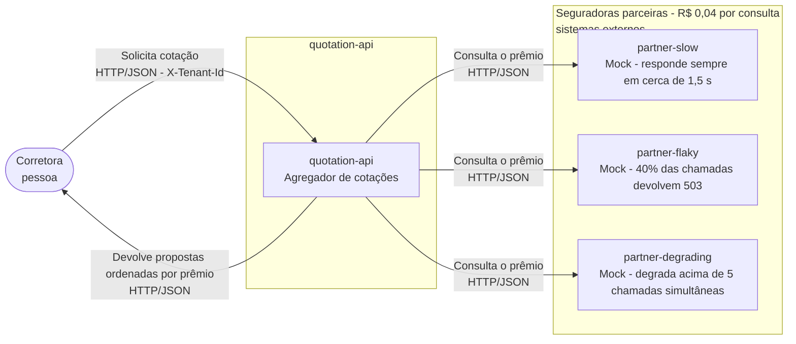
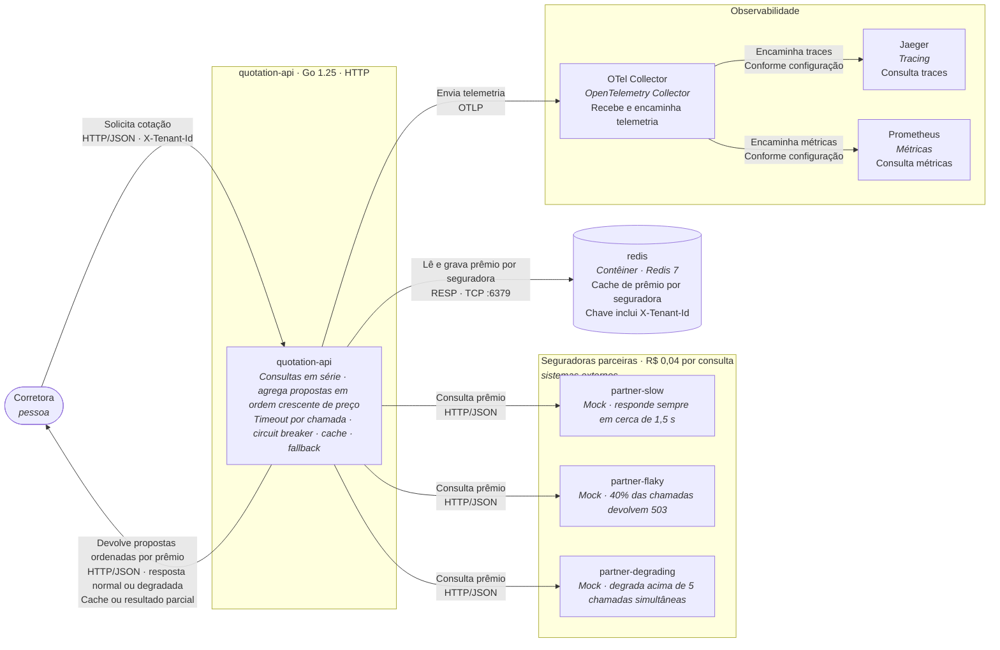
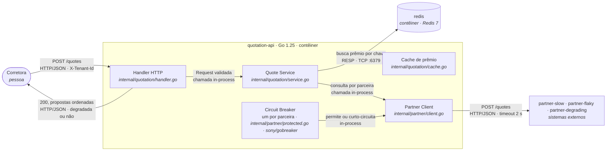

# System Architecture Document

## 1. Introdução

### 1.1. Propósito

Este documento define a arquitetura proposta para aumentar a resiliência da `quotation-api` na comunicação com as três seguradoras parceiras, utilizando timeout, circuit breaker, cache e fallback. A Prova de Conceito (PoC) avalia os efeitos desses mecanismos sobre a disponibilidade, a latência e os custos operacionais.

A linha de base, obtida em um teste com 200 requisições e 50 em voo, apresentou p95 de 8,01 s, taxa de sucesso de 60% e 80 respostas HTTP 502. Considerando 360.000 consultas diárias ao custo de R$ 0,04 por consulta, o gasto potencial é de R$ 14.400 por dia útil. As medições e os requisitos não funcionais são detalhados na [seção 3.1](#31-linha-de-base-medida), enquanto a avaliação financeira é apresentada na [seção 8](#8-tecnologias-custos-e-pessoal-tco).

### 1.2. Escopo

#### 1.2.1. Dentro do escopo

O documento abrange a `quotation-api` e sua fronteira de comunicação com as três seguradoras parceiras. A proposta implementa circuit breaker, timeout nas chamadas às parceiras, cache e fallback.

Ficam fora da implementação a paralelização das consultas e os padrões adicionais de retry com backoff, bulkhead, rate limiting e fila. Também permanecem como limitações conhecidas a ausência de limite de chamadas simultâneas por parceira, o breaker mantido na memória do processo, a invalidação do cache exclusivamente por TTL e a possibilidade de uma corretora consumir a capacidade das demais. Esses limites são detalhados na [seção 4](#4-detalhamento-da-arquitetura).

Não fazem parte do escopo o motor de precificação das seguradoras, o CRM da corretora, a integração com seguradoras reais, a autenticação, o Kubernetes, a interface de usuário, o cadastro de corretoras, a cobrança e os relatórios. A auditoria é tratada como requisito arquitetural e custo, sem implementação de persistência real nesta proposta. Também não há garantia transacional entre o cache e as seguradoras.

### 1.3. Restrições

As restrições tecnológicas são Go 1.25 para a API e os testes, Docker com Compose v2, Redis para cache, OpenTelemetry para instrumentação e Mermaid para os diagramas. O SDK de telemetria já está inicializado em [`internal/platform/telemetry.go`](/internal/platform/telemetry.go), com traces enviados ao Jaeger e métricas ao Prometheus por meio do Collector. As três parceiras são mocks existentes em [`cmd/partner-mock/`](/cmd/partner-mock/), e seus perfis e o ambiente definido em [`docker-compose.yml`](/docker-compose.yml) não podem ser alterados.

No âmbito do negócio, cada consulta a uma parceira custa R$ 0,04, e cada cotação gera três consultas. O volume de referência é de 120.000 cotações por dia útil, durante 22 dias úteis por mês. As seguradoras honram os prêmios por até 24 horas, estabelecendo o limite comercial para reaproveitamento.

A cotação apresentada deve ser auditável, com identificação da seguradora, prêmio, corretora e instante, e o registro deve ser retido por cinco anos sem possibilidade de regravação. Conforme os requisitos regulatórios considerados, a corretora é controladora dos dados e a Prumo é operadora, com obrigação de minimizar os dados, respeitar o prazo de descarte e impedir o uso cruzado entre corretoras. Por isso, a chave do cache deve incluir a identificação da corretora.

### 1.4. Decisões

As decisões arquiteturais são escolhas da solução, e não restrições impostas pelo ambiente

- **D-01:** Escopo do circuit breaker (por parceira, por par parceira e corretora, ou global). Defendida na [seção 4](#4-detalhamento-da-arquitetura).
- **D-02:** Limiares do breaker: Falhas, janela, tempo aberto e requisições do meio aberto. Defendida na [seção 4](#4-detalhamento-da-arquitetura).
- **D-03:** Valor do timeout da chamada e efeito do estouro sobre o breaker. Defendida na [seção 4](#4-detalhamento-da-arquitetura).
- **D-04:** Granularidade do cache (por parceira ou cotação agregada) e chave por extenso. Defendida na [seção 4](#4-detalhamento-da-arquitetura).
- **D-05:** TTL do cache, dentro do teto de 24 horas. Defendida na [seção 4](#4-detalhamento-da-arquitetura).
- **D-06:** Política de invalidação e de descarte das entradas do cache. Defendida na [seção 4](#4-detalhamento-da-arquitetura).
- **D-07:** Tipo de fallback e a mudança no contrato de resposta. Defendida na [seção 4](#4-detalhamento-da-arquitetura).
- **D-08:** Biblioteca de circuit breaker (implementação própria ou `sony/gobreaker`). Defendida na [seção 5](#5-implementação).

### 1.5. Pressupostos

**P-01 — Volume de produção:** Assume-se um volume de 120.000 cotações por dia útil, durante 22 dias úteis por mês, conforme o [enunciado do desafio](TODO:ATUALIZAR_CAMINHO_NA_REVISAO_FINAL). Se o volume real for diferente, os custos das parceiras, o dimensionamento do Redis e o custo de auditoria deverão ser recalculados ([seção 8](#8-tecnologias-custos-e-pessoal-tco)).

**P-02 — Comportamento das parceiras:** Assume-se que as parceiras reais se comportam como os mocks: `partner-slow` responde em aproximadamente 1.500 ms ± 200 ms, `partner-flaky` apresenta 40% de respostas HTTP 503 e `partner-degrading` degrada acima de cinco chamadas simultâneas. O pressuposto baseia-se no enunciado e nas medições da [seção 3.1](#31-linha-de-base-medida). Se não for confirmado, os limiares do breaker e o timeout deverão ser recalibrados ([seção 4](#4-detalhamento-da-arquitetura)).

**P-03 — Validade comercial:** Assume-se que o prêmio permanece válido por 24 horas, sem alteração de preço nesse período. A origem é o [enunciado do desafio](TODO:ATUALIZAR_CAMINHO_NA_REVISAO_FINAL). Se esse pressuposto for falso, uma cotação servida do cache poderá não ser honrada na venda, exigindo revisão do TTL (D-05), da arquitetura ([seção 4](#4-detalhamento-da-arquitetura)) e da gestão de mudanças ([seção 6](#6-operação-e-gestão-de-mudanças)).

**P-04 — Instância única:** Assume-se que a API executa em um único contêiner `quotation-api`, conforme o [enunciado do desafio](TODO:ATUALIZAR_CAMINHO_NA_REVISAO_FINAL) e o [`docker-compose.yml`](/docker-compose.yml). Se houver múltiplas réplicas, cada processo manterá seu próprio estado do circuit breaker, podendo detectar falhas em momentos diferentes. Esse limite é detalhado na [seção 4](#4-detalhamento-da-arquitetura).

**P-05 — Repetição de cotações:** Assume-se que 30% das cotações se repetem para a mesma corretora e o mesmo risco em até uma hora. O enunciado menciona uma “boa parte” das consultas repetidas, mas não apresenta um percentual; portanto, a estimativa deve ser validada com dados reais da Prumo. Se a repetição for de apenas 5%, o cache poderá não compensar seus custos, alterando a conclusão financeira da [seção 8](#8-tecnologias-custos-e-pessoal-tco). Se for superior a 30%, a economia poderá aumentar e justificar uma revisão do TTL (D-05) na [seção 4](#4-detalhamento-da-arquitetura).

## 2. Visão geral da arquitetura

### 2.1. Antes da intervenção

#### 2.1.1. C4 - Nível 1: Context



#### 2.1.2. C4 - Nível 2: Container


### 2.2. Depois da intervenção

#### 2.2.1. C4 - Nível 1: Context


#### 2.2.2. C4 - Nível 2: Container



### 2.3. Delta

Entra o uso do Redis, contêiner já existente no `docker-compose.yml`, que passa a ser consultado pela `quotation-api` como cache de prêmio por seguradora, incluindo a corretora na chave. Muda a fronteira da `quotation-api` com as seguradoras, que passa a contar com timeout por chamada, circuit breaker, cache e fallback; o contrato de resposta passa a admitir respostas degradadas, servidas do cache ou parciais, com essa condição visível para a corretora. Não sai nenhum componente: nenhum contêiner é removido ou muda de lugar.

### 2.4. A quem esta arquitetura serve

Esta arquitetura serve a três leitores ao mesmo tempo: ao CTO da Prumo, porque transforma o custo por consulta em uma conta defensável ([seção 8](#8-tecnologias-custos-e-pessoal-tco)); aos operadores do sistema, porque o estado de cada mecanismo fica observável e com ação definida ([seção 6](#6-operação-e-gestão-de-mudanças)); e ao encarregado de dados e auditoria, porque nenhuma cotação servida de cache ou fallback deixa de ser rastreável à consulta que a originou, e o isolamento entre corretoras está na chave do cache ([seção 4](#4-detalhamento-da-arquitetura)).

## 3. Requisitos funcionais e não funcionais

### 3.1. Linha de base medida

Todas as medições foram realizadas pelo autor deste documento, em máquina própria, antes do desenvolvimento do PoC, com a carga padrão do `make reproduce` (10 requisições de baseline e 200 com 50 em voo). Os arquivos brutos estão em [`docs/evidencias/`](/docs/evidencias/). É a partir desta linha de base que são desenvolvidos os requisitos não funcionais, presentes na [seção 3.3](#33-requisitos-não-funcionais).

#### Relatório do `make reproduce`

```bash
make down && make reproduce
```

```text
baseline — 10 requests, 1 in flight, 20:21:39 UTC to 20:21:58 UTC
  success        5 of 10 (50%)
  latency        p50 1.89s   p95 2.04s   p99 2.04s   max 2.04s
  throughput     0.5 req/s in 18.78s
  failures       HTTP 502 from partner-flaky: 5

load — 200 requests, 50 in flight, 20:21:58 UTC to 20:22:22 UTC
  success        120 of 200 (60%)
  latency        p50 6.11s   p95 8.01s   p99 8.03s   max 8.05s
  throughput     8.0 req/s in 24.86s
  failures       HTTP 502 from partner-flaky: 80

baseline → load
  p95 latency    2.04s → 8.01s   3.9x
  max latency    2.04s → 8.05s   4.0x
  success        50% → 60%
  throughput     0.5 → 8.0 req/s
```

Legenda: baseline e carga com falhas da `partner-flaky`, e p95 subindo de ~2 s para ~8 s.

#### p95 do POST /quotes (Prometheus, janela [1m])

```promql
histogram_quantile(0.95, sum by (le) (rate(http_server_request_duration_seconds_bucket[1m])))
```


Legenda: p95 estimado pelo Prometheus durante a carga, na janela `[1m]`. O gráfico mostra a forma da curva e o valor exato é o do relatório do teste de carga e/ou dos traces do Jaeger.

#### Trace lento (Jaeger, Last Hour)

Export completo: [`/docs/evidencias/antes-trace-lento.json`](/docs/evidencias/antes-trace-lento.json).
Resumo dos spans, com início medido a partir do span raiz:

| Span                              | Início | Duração | Status |
| --------------------------------- | ------ | ------- | ------ |
| `POST /quotes` (`quotation-api`)  | 0,00 s | 8,05 s  | 200    |
| `HTTP POST` → `partner-slow`      | 0,00 s | 1,70 s  | 200    |
| `HTTP POST` → `partner-flaky`     | 1,70 s | 0,20 s  | 200    |
| `HTTP POST` → `partner-degrading` | 1,90 s | 6,15 s  | 200    |


Legenda: três spans `HTTP POST` em série somando ~8 s.

#### Trace com erro (Jaeger, Last Hour)

Export completo: [`/docs/evidencias/antes-trace-erro.json`](/docs/evidencias/antes-trace-erro.json).
Resumo dos spans, com início medido a partir do span raiz:

| Span                             | Início | Duração | Status |
| -------------------------------- | ------ | ------- | ------ |
| `POST /quotes` (`quotation-api`) | 0,00 s | 1,76 s  | 502    |
| `HTTP POST` → `partner-slow`     | 0,00 s | 1,57 s  | 200    |
| `HTTP POST` → `partner-flaky`    | 1,57 s | 0,20 s  | 503    |


Legenda: sequência interrompida na `partner-flaky` (503), sem span da `partner-degrading`, e o servidor responde 502.

#### make test

```bash
make test
```

```text
ok      github.com/GuilhermeOliveira591/mba_arquitetura_desafio_cotacao_seguros/cmd/loadgen             1.762s
ok      github.com/GuilhermeOliveira591/mba_arquitetura_desafio_cotacao_seguros/cmd/partner-mock        0.118s
?       github.com/GuilhermeOliveira591/mba_arquitetura_desafio_cotacao_seguros/cmd/quotation-api       [no test files]
ok      github.com/GuilhermeOliveira591/mba_arquitetura_desafio_cotacao_seguros/internal/partner        0.006s
ok      github.com/GuilhermeOliveira591/mba_arquitetura_desafio_cotacao_seguros/internal/platform       0.003s
ok      github.com/GuilhermeOliveira591/mba_arquitetura_desafio_cotacao_seguros/internal/quotation      0.126s
```

Legenda: testes que já vinham no repositório, todos passando.

### 3.2. Requisitos funcionais

Os requisitos RF-01 a RF-04 saem do contrato que já existe ([`internal/quotation/handler.go`](/internal/quotation/handler.go), [`internal/quotation/service.go`](/internal/quotation/service.go)); RF-05 e RF-06 são criados por esta arquitetura e aparecem como mecanismo na [seção 4](#4-detalhamento-da-arquitetura).

- **RF-01:** A API rejeita cotação sem o cabeçalho `X-Tenant-Id` com 400 `X-Tenant-Id is required`, e corretora fora de `TENANTS` com 403 `broker not enabled on this platform`. Originado do contrato atual;
- **RF-02:** A resposta de sucesso entrega as propostas recebidas ordenadas por `premium_cents` crescente, também quando degradada. Originado do contrato atual;
- **RF-03:** Todo prêmio entregue vem de uma parceira ou do cache rastreável à consulta que o originou (`quote_id` preservado); a plataforma nunca calcula prêmio. Originado do contrato atual e da regulação (SUSEP/LGPD);
- **RF-04:** Toda cotação apresentada é auditável (seguradora, prêmio, corretora, instante), retida por cinco anos e não regravável, inclusive a servida de cache ou fallback. Originado da SUSEP ([seção 8](#8-tecnologias-custos-e-pessoal-tco));
- **RF-05:** Cotação cuja chave de cache bate e não expirou é respondida com o prêmio do cache, sem nova consulta às seguradoras, e a resposta declara a origem `cache` e a idade da entrada. Criado por esta arquitetura;
- **RF-06:** Quando uma parceira falha, estoura o timeout ou é curto-circuitada pelo breaker, a resposta continua sendo entregue com as propostas disponíveis, marcada como degradada e declarando quais parceiras faltam; sem nenhuma proposta disponível, a API devolve erro de negócio distinguível, não 502 genérico. Criado por esta arquitetura.

### 3.3. Requisitos não funcionais

A coluna "hoje" vem da medição da [seção 3.1](#31-linha-de-base-medida), exceto onde indicado. As métricas `partner_breaker_state`, `partner_breaker_transitions_total` `cache_hits_total` e `cache_misses_total` são criadas por esta entrega e têm os nomes declarados no README do processo.

**RNF-01: Latência da cotação.** A métrica é o p95 do `POST /quotes`. Hoje, o valor é de 8,01 s sob carga ([seção 3.1](#31-linha-de-base-medida)). O alvo é ≤ 2,5 s. A medição será feita por meio de `http_server_request_duration_seconds` no Prometheus, usando a janela `[5m]` e a mesma carga de `make reproduce`. Esse limite foi definido porque a soma serial das parceiras saudáveis é de aproximadamente 1,8 s (1,5 s + 0,15 s + 0,12 s); o alvo de 2,5 s contempla o caminho completo com margem e considera o tempo de resposta aceitável para o corretor atender o cliente.

**RNF-02: Taxa de sucesso da cotação.** A métrica é o percentual de respostas HTTP 200. Hoje, a taxa é de 60% sob carga, com 80 respostas HTTP 502 ([seção 3.1](#31-linha-de-base-medida)). O alvo é ≥ 95%. A medição será feita pelo relatório de `make reproduce`, incluindo a contagem de respostas 502. Esse limite busca evitar que a disponibilidade do produto dependa do desempenho conjunto das três parceiras e estabelece 95% como o nível mínimo esperado de sucesso.

**RNF-03: Consultas compradas por cotação entregue.** As métricas são o número de consultas por cotação e a taxa de acerto do cache. Hoje, são realizadas três consultas por cotação, com hit rate de 0%, conforme o [Enunciado do desafio](TODO:ATUALIZAR_CAMINHO_NA_REVISAO_FINAL). O alvo é ≤ 2,1 consultas por cotação, correspondente a um hit rate ≥ 30%. A medição será feita pela fórmula `sum(rate(cache_hits_total[15m])) / (sum(rate(cache_hits_total[15m])) + sum(rate(cache_misses_total[15m])))`. Esse alvo utiliza o pressuposto de repetição de 30% definido em P-05 e sustenta a economia projetada na [seção 8](#8-tecnologias-custos-e-pessoal-tco).

**RNF-04: Detecção de parceira instável.** A métrica é o tempo até a abertura do circuito. Hoje, o circuito não abre durante o teste de referência: a `partner-flaky` é chamada durante toda a carga e contribui para as 80 respostas HTTP 502 ([seção 3.1](#31-linha-de-base-medida)). O alvo é abrir o circuito em até um minuto de falhas contínuas. A medição será feita pela métrica `partner_breaker_state` no Prometheus. A justificativa é que a `partner-flaky` acumula cinco falhas antes da décima chamada e o circuito deve abrir na quinta falha, em menos de 20 segundos. Essa transição deverá ser confirmada no log `breaker partner-flaky: closed -> open`. A ocorrência de nove falhas consecutivas só poderá ser observada se o circuito permanecer fechado; com tráfego alto, uma rajada curta pode não ser suficiente para abrir o circuito ([D-02](#14-decisoes)).

**RNF-05: Isolamento entre corretoras.** A métrica é o número de cotações servidas com prêmio originado de outra corretora. Hoje, não há cache, e a única barreira é o allowlist de tenant, que retorna HTTP 403 quando o acesso não é autorizado. O alvo é zero ocorrências de uso cruzado. A medição será feita por teste determinístico da chave com `make test`, além da conferência da composição da chave descrita na [seção 4](#4-detalhamento-da-arquitetura). Esse requisito decorre das obrigações de proteção de dados e auditoria consideradas no projeto: o compartilhamento de dados entre corretoras não é permitido, e um incidente poderá exigir notificação à ANPD.

### 3.4. Resultados após a intervenção

As medições foram realizadas pelo autor deste documento, em máquina própria, após o desenvolvimento do PoC, utilizando a mesma carga padrão do `make reproduce` (10 requisições de baseline e 200 com 50 em voo). Os arquivos brutos estão em [`docs/evidencias/`](/docs/evidencias/).

#### Relatório do `make reproduce`

```bash
make down && make reproduce
```

```text
baseline — 10 requests, 1 in flight, 19:50:40 UTC to 19:50:50 UTC
  success        10 of 10 (100%)
  latency        p50 199ms   p95 2.04s   p99 2.04s   max 2.04s
  throughput     1.0 req/s in 10.02s

load — 200 requests, 50 in flight, 19:50:50 UTC to 19:50:50 UTC
  success        200 of 200 (100%)
  latency        p50 6ms   p95 198ms   p99 228ms   max 229ms
  throughput     798.0 req/s in 250ms

baseline → load
  p95 latency    2.04s → 198ms   0.1x
  max latency    2.04s → 229ms   0.1x
  success        100% → 100%
  throughput     1.0 → 798.0 req/s
```

Legenda: carga com 100% de sucesso e p95 de 198 ms, favorecida pela taxa de acerto do cache próxima de 90%.

#### p95 do POST /quotes (Prometheus, janela [1m])

```promql
histogram_quantile(0.95, sum by (le) (rate(http_server_request_duration_seconds_bucket[1m])))
```


Legenda: p95 estimado pelo Prometheus durante a carga, na janela `[1m]`. O gráfico mostra as variações de tempo de resposta e o valor exato é o do relatório do teste de carga e/ou dos traces do Jaeger.

#### Taxa de acerto do cache (Prometheus)

```promql
sum(cache_hits_total) / (sum(cache_hits_total) + sum(cache_misses_total))
```


Legenda: taxa de acerto do cache próxima de 90%, reduzindo chamadas às seguradoras.

#### Trace com circuito aberto e timeout (Jaeger, Last Hour)

Export completo: [`/docs/evidencias/depois-trace-breaker-open.json`](/docs/evidencias/depois-trace-breaker-open.json).
Resumo dos spans, com início medido a partir do span raiz:

| Span / evento                                | Início | Duração | Resultado       |
| -------------------------------------------- | -----: | ------: | --------------- |
| `POST /quotes` (`quotation-api`)             | 0,00 s |  3,61 s | HTTP 200        |
| `HTTP POST` → `partner-slow`                 | 0,00 s |  1,61 s | HTTP 200        |
| `HTTP POST` → `partner-degrading`            | 1,61 s |  2,00 s | Timeout         |
| `circuit_breaker_rejected` → `partner-flaky` | 1,61 s |       — | Circuito aberto |


Legenda: circuito aberto rejeita a chamada à `partner-flaky`, enquanto a `partner-degrading` atinge o timeout.

#### make test

```bash
make test
```

```text
ok      github.com/GuilhermeOliveira591/mba_arquitetura_desafio_cotacao_seguros/cmd/loadgen     1.769s
ok      github.com/GuilhermeOliveira591/mba_arquitetura_desafio_cotacao_seguros/cmd/partner-mock        0.123s
?       github.com/GuilhermeOliveira591/mba_arquitetura_desafio_cotacao_seguros/cmd/quotation-api       [no test files]
ok      github.com/GuilhermeOliveira591/mba_arquitetura_desafio_cotacao_seguros/internal/partner        0.013s
ok      github.com/GuilhermeOliveira591/mba_arquitetura_desafio_cotacao_seguros/internal/platform       0.008s
ok      github.com/GuilhermeOliveira591/mba_arquitetura_desafio_cotacao_seguros/internal/quotation      0.134s
```

Legenda: testes executados após a intervenção, com os pacotes listados passando.

## 4. Detalhamento da arquitetura

Cada decisão segue o formato: Contexto, opções, escolha e consequências. Os parâmetros definidos aqui serão os mesmos do código ([seção 5](#5-implementação)) e sustentam os requisitos da [seção 3.3](#33-requisitos-não-funcionais).

### 4.1. Circuit breaker, timeout e limiares

#### D-01: Escopo do breaker (um por parceira)

- **Contexto:** Três parceiras independentes, instáveis por natureza; Número variável de corretoras em produção.
- **Opções:** Breaker global; Um por par (parceira, corretora); Um por parceira.
- **Escolha:** Um breaker por parceira.
- **Consequências:** A falha de uma parceira não derruba as consultas às outras duas. Alternativa global descartada: Uma parceira afundando abriria o circuito para todas, derrubando a plataforma inteira, que é exatamente o comportamento que esta arquitetura existe para remover. Alternativa por par descartada: com diversas corretoras, cada breaker acumularia poucas chamadas e demoraria a aprender, além da cardinalidade de estado.
- **Consequência ruim:** O breaker vive na memória do processo e não atravessa réplicas (limite conhecido L-02, [seção 4.5](#45-limites-conhecidos)).

#### D-02: Limiares do breaker

- **Contexto:** A `partner-flaky` falha 40% das vezes em regime, com rajada determinística de nove falhas consecutivas nas sequências 49 a 57 ([enunciado do desafio](TODO:ATUALIZAR_CAMINHO_NA_REVISAO_FINAL)).
- **Opções:** Contador de falhas consecutivas; Janela por contagem das últimas 10 chamadas (código próprio); Janela deslizante por tempo da biblioteca.
- **Escolha:** Janela deslizante por tempo de 30 s, em 10 buckets de 3 s, da `sony/gobreaker` ([D-08](#14-decisões)). O circuito abre quando a janela tem ao menos 5 falhas e elas são ao menos metade das chamadas concluídas (sucessos mais falhas). Fica aberto por 30 s, deixa passar 3 requisições de prova no meio aberto, fecha com 3 sucessos seguidos e reabre com 1 falha.
- **Por que este par:** Cinco falhas é o piso de evidência: abaixo disso a parceira não é julgada. A metade das chamadas separa parceira doente de ruído. Em regime nominal (40%) a `partner-flaky` fica abaixo da metade e não abre o circuito: ela ainda entrega 6 de cada 10 prêmios, e o fallback parcial ([D-07](#14-decisões)) cobre o resto. O circuito abre quando a taxa passa de 50%, por rajada ou por piora da parceira. É reproduzível: no baseline serial a quinta falha chega antes da décima chamada, com mais da metade das chamadas falhando, e o circuito abre sempre nesse ponto. A carga seguinte, de 200 requisições em menos de 30 s, encontra o circuito aberto ([RNF-04](#33-requisitos-não-funcionais)). A janela por contagem das últimas 10 chamadas daria o mesmo resultado, mas exige código próprio de janela, já que a biblioteca guarda contadores e não a ordem das chamadas ([D-08](#14-decisões)).
- **Aberto por 30 s:** Tempo suficiente para não martelar uma parceira durante uma rajada curta e curto o bastante para não atrasar a recuperação.
- **Meio aberto:** Na biblioteca, `MaxRequests` define ao mesmo tempo o número de provas e o de sucessos seguidos para fechar, por isso são 3 e 3.
- **Consequência ruim:** Com o circuito aberto, a parceira fica de fora das respostas completas até ele fechar de novo. A corretora vê cotação degradada ([RF-06](#32-requisitos-funcionais)), não silêncio. A janela é por tempo: Com tráfego baixo, 30 s podem não reunir 5 falhas, e com tráfego alto uma rajada curta diluída não passa da metade das chamadas (9 falhas entre 120 chamadas são 7,5%) e não abre o circuito. As transições de estado são da biblioteca e dependem de tempo real nos testes.

#### D-03: Timeout da chamada

- **Contexto:** A `partner-slow` responde em 1.500 ms ± 200 ms (máximo observável de 1.700 ms); A `partner-degrading` nunca falha, apenas afunda até 6.000 ms. Sem timeout, a degradação dela não vira sinal para contador nenhum.
- **Opções:** 1.500 ms; 1.700 ms; 2.000 ms; 5.000 ms; sem timeout (o atual).
- **Escolha:** 2.000 ms, e o estouro conta como falha para o breaker.
- **Por que:** Cobre a `partner-slow` saudável com folga (1.700 ms mais a margem de rede) e corta a `partner-degrading` afundada; É o estouro que faz a parceira lenta ser vista pelo mecanismo. 1.500 ms e 1.700 ms foram descartados porque matam a `partner-slow` na cauda da distribuição; 5.000 ms foi descartado porque deixa a plataforma esperar quase o teto de afundamento antes de reagir.
- **Consequência ruim:** Uma cotação em série com as três parceiras lentas pode acumular até 6 s antes de o breaker intervir; O alvo do [RNF-01](#33-requisitos-não-funcionais) vale para o regime com cache ativo.

### 4.2. Cache: Granularidade, chave e TTL

#### D-04: Granularidade do cache e chave

**Chave de cache, por extenso:**

```text
prumo:quote:v1:tenant={X-Tenant-Id}:partner={partner}:request.coverage={request.coverage}:driver.document={driver.document}:driver.birth_year={driver.birth_year}:vehicle.plate={vehicle.plate}:vehicle.model={vehicle.model}:vehicle.year={vehicle.year}:vehicle.value_cents={vehicle.value_cents}
```

- **Contexto:** A corretora viaja no cabeçalho (`X-Tenant-Id`) e o risco, no corpo; o `Normalize()` de [`internal/quotation/request.go`](/internal/quotation/request.go) padroniza os componentes antes da montagem.
- **Opções:** Cache da cotação agregada; Cache do prêmio por parceira.
- **Escolha:** Cache do prêmio por parceira.
- **Por quê:** Sobrevive a uma parceira fora (as outras duas continuam servindo respostas frescas), compõe a resposta parcial do fallback peça por peça e expira por parceira.
- **Consequência ruim:** Três entradas por cotação em vez de uma; O hit rate por cotação exige que as três chaves estejam quentes. CPF e placa ficam na chave porque são a identificação do risco; a minimização é atendida pelo descarte ([D-06](#14-decisões)).

#### D-05: TTL do cache (3.600 s)

- **Contexto:** As seguradoras honram o prêmio por até 24 h; O [P-05](#15-pressupostos) assume 30% de recotação do mesmo risco para a mesma corretora dentro de 1 h.
- **Opções:** 300 s; 3.600 s; 24 h.
- **Escolha:** 3.600 s (1 hora), dentro do teto comercial de 24 h.
- **Por quê:** Cobre a janela de recotação do P-05 com folga, o que sustenta o hit rate de 30% do [RNF-03](#33-requisitos-não-funcionais) e da [seção 8](#8-tecnologias-custos-e-pessoal-tco); Parar em 1 h reduz o risco de servir prêmio vencido ([P-03](#15-pressupostos)). 300 s foi descartado porque sustenta hit rate muito menor que o pressuposto e desperdiça o teto comercial. 24 h foi descartado por ter o máximo risco regulatório e comercial (prêmio não honrado na venda) sem ganho de hit rate proporcional.
- **Consequência ruim:** Cotações repetidas depois de 1 h pagam as consultas de novo.

#### D-06: Invalidação e descarte

- **Contexto:** Não existe, no cenário, evento de mudança de preço que permita invalidar antes da hora; O Redis do ambiente sobe sem AOF nem RDB.
- **Escolha:** Invalidação só por TTL. As entradas somem por expiração do TTL e, no ambiente, quando o Redis é reiniciado. O prazo de descarte de dado pessoal (LGPD) é atendido pelo mesmo teto de 1 h.
- **Consequência ruim:** Uma tabela de preço que mude dentro do TTL serve prêmio defasado por até 1 h (limite conhecido L-03, [seção 4.5](#45-limites-conhecidos)).

### 4.3. Fallback

#### D-07: Fallback parcial

- **Contexto:** Hoje uma parceira falhando aborta a requisição inteira com 502 ([seção 3.1](#31-linha-de-base-medida): 80 respostas 502 numa carga).
- **Opções:** Resposta parcial; Cotação anterior agregada; Recusa explícita sempre.
- **Escolha:** O cache funciona como acerto normal ([RF-05](#32-requisitos-funcionais)): Uma entrada não expirada é servida sem consultar a parceira e não é degradação. O fallback é a resposta parcial: Se a parceira falha, estoura o timeout ou é curto-circuitada pelo breaker e não há entrada válida no cache, ela fica ausente. A resposta entrega as propostas que existirem, ordenadas por prêmio ([RF-02](#32-requisitos-funcionais)), e declara a degradação. Sem nenhuma proposta disponível, a API devolve o erro de negócio 503 `no quotes available`, distinguível do 502 `partner insurer unavailable`.
- **Alternativas descartadas:** Recusa sempre (atual); Cotação anterior agregada (perde as respostas frescas e combina mal com o cache por parceira).
- **Consequência ruim:** A corretora pode receber cotação sem a melhor oferta daquela parceira; A degradação é explícita para ela decidir.
  **Contrato de resposta** (mudança em [`internal/quotation/request.go`](/internal/quotation/request.go)):

```json
{
  "tenant_id": "corretora-a",
  "quotes": [
    {
      "partner": "partner-slow",
      "quote_id": "partner-slow-3f2a1c0b9d8e7f60",
      "premium_cents": 84210,
      "currency": "BRL",
      "coverage_cents": 5000000,
      "valid_for_seconds": 300,
      "source": "partner"
    },
    {
      "partner": "partner-flaky",
      "quote_id": "partner-flaky-9a8b7c6d5e4f3210",
      "premium_cents": 91300,
      "currency": "BRL",
      "coverage_cents": 5000000,
      "valid_for_seconds": 300,
      "source": "cache",
      "cache_age_seconds": 942
    }
  ],
  "degraded": true,
  "missing": ["partner-degrading"],
  "elapsed_ms": 1712
}
```

`degraded` é `true` quando há ao menos uma parceira em `missing`; Proposta servida de cache é acerto normal e não degrada a resposta. `missing` lista as parceiras sem resposta e sem cache. `source` diz, de cada proposta, se ela vem de `partner` ou de `cache`, e `cache_age_seconds` dá a idade da entrada. O `quote_id` original é preservado, o que mantém a cotação rastreável à consulta que a originou ([RF-03 e RF-04](#32-requisitos-funcionais)).

### 4.4. A fatia implementada, em C4 nível 3

Os arquivos `internal/quotation/cache.go` e `internal/partner/protected.go` ainda não existem: são criados por esta entrega (proposta). O mapa completo está na [seção 5](#5-implementação).



As duas marcações de trace que provam os mecanismos: A requisição curto-circuitada recebe o evento `circuit_open` no span (e não tem span de saída), e a resposta servida de cache recebe o evento `cache_hit` (sem spans de saída às parceiras). Nenhum CPF, placa ou `quote_id` em atributo de span ou métrica; `tenant_id` é o único identificador admitido.

### 4.5. Limites conhecidos

Nenhum dos quatro é para implementar; declará-los é parte da arquitetura.

**L-01: Sem limite de chamadas simultâneas por parceira (sem bulkhead).**

- **Gatilho:** Rajada de carga ou perda do Redis: A concorrência sobre a `partner-degrading` passa de 5;
- **Efeito na corretora:** A latência cresce até o timeout segurar, e as cotações degradadas se multiplicam.

**L-02: Breaker na memória do processo, que não atravessa réplicas.**

- **Gatilho:** Escalar para mais de uma réplica da API;
- **Efeito na corretora:** Cada réplica aprende sozinha, com mais consultas compradas do que o esperado e abertura aparentemente mais lenta.

**L-03: TTL como única forma de invalidar o cache.**

- **Gatilho:** Mudança de tabela de preço dentro da janela de 1 h;
- **Efeito na corretora:** Prêmio defasado servido por até 1 h, com risco de não ser honrado na venda.

**L-04: Uma corretora consome a capacidade das outras (sem rate limiting por corretora).**

- **Gatilho:** Uma corretora dispara carga anômala;
- **Efeito na corretora:** O p95 de todas as corretoras sobe junto.
